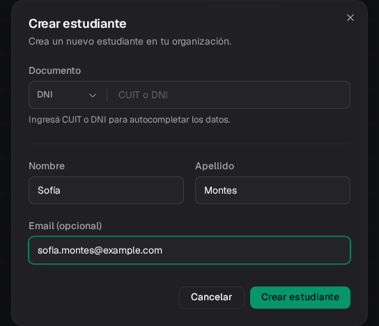
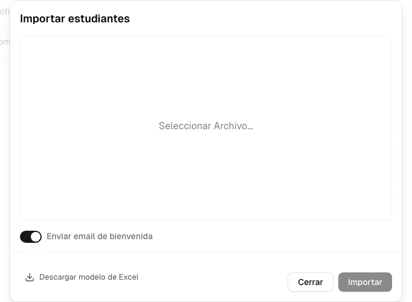
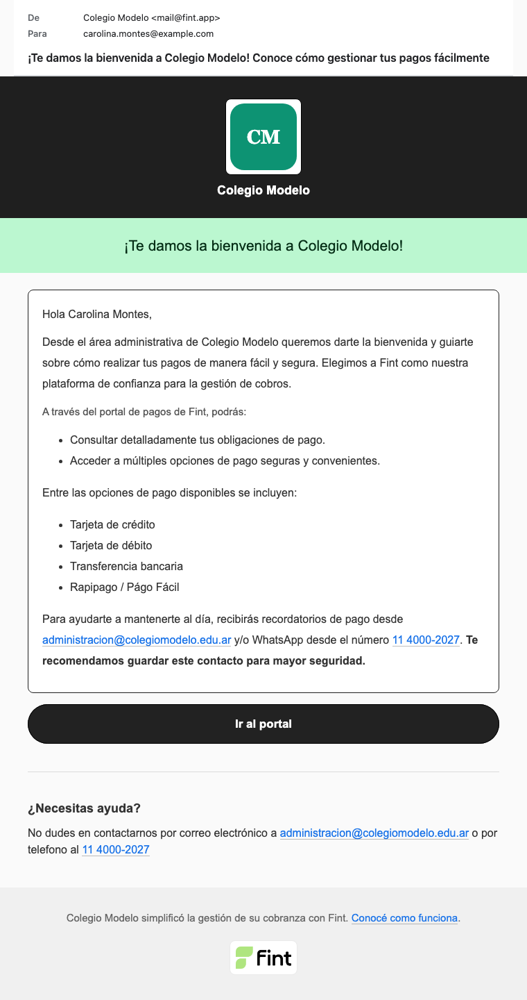

Al terminar esta guía, vas a tener clientes visibles en el listado y sabrás qué comprobar antes de empezar a asignarles items y órdenes.

## Elegí el método de carga

<Tabs>
  <Tab title="Alta manual" icon="user-plus">
    Usala para una persona o para corregir un caso puntual desde la interfaz.
  </Tab>
  <Tab title="Importación" icon="file-import">
    Usala para cargar una nómina preparada con la plantilla de Fint en formato `.xlsx`.
  </Tab>
</Tabs>

## Crear un cliente manualmente

<Steps>
  <Step title="Abrí el formulario">
    Entrá a **Clientes**, presioná **Crear** y elegí **Crear cliente**. Si el módulo se llama Estudiantes, la opción usa ese nombre.
  </Step>
  <Step title="Completá los datos">
    El primer campo es **Documento**: elegí el tipo (DNI, CUIT, CUIL, Pasaporte, CI Extranjera u Otro) y escribí el número. Con un CUIT o DNI, Fint intenta completar el nombre solo (**Ingresá CUIT o DNI para autocompletar los datos**). El número admite solo **dígitos**: un pasaporte con letras se carga después en el perfil. Después van **Nombre**, **Apellido** y **Email (opcional)**. Para habilitar **Crear cliente** / **Crear estudiante** alcanzan nombre y apellido.

    Si escribís un email, tiene que tener forma de email: si no, aparece **Ingresa un email válido (ej: nombre@gmail.com)** y no deja crear. Si el dominio parece mal escrito (`gmail.con`, `hotmail.co`), Fint pregunta **¿Quisiste decir @gmail.com en vez de @gmail.con?** y lo corregís con **Corregir**. Nunca lo cambia solo.
  </Step>
  <Step title="Revisá antes de crear">
    Confirmá la escritura del nombre y buscá a la persona en el listado por documento o email antes de crearla, para no duplicar el perfil.
  </Step>
  <Step title="Creá el perfil">
    Presioná **Crear cliente**. Fint agrega el registro y lo deja disponible para abrirlo desde el listado.
  </Step>
</Steps>

<Info>
  Crear un cliente no crea automáticamente un responsable de pago ni un acceso al portal. Hacé esa configuración desde **Contactos** en el perfil.
</Info>

Después del alta, abrí el perfil para agregar etiquetas, completar datos y [organizar responsables o familiares](/docs/guides/clientes-familias-responsables).

## Importar una nómina desde Excel

La importación acepta archivos `.xlsx`. El archivo debe respetar la plantilla disponible en el modal; no hay una pantalla posterior para mapear columnas.

<Warning>
  La importación interpreta cada dato por su posición. Descargá la plantilla actual y conservá el orden de las columnas al completarla.
</Warning>

<Steps>
  <Step title="Descargá el modelo">
    Entrá a **Clientes**, presioná **Crear → Importar excel** y elegí **Descargar modelo de Excel**.
  </Step>
  <Step title="Completá la plantilla">
    Cada fila es un estudiante **y** un responsable. Siempre hay un pagador por fila. No cambies el orden de las columnas: Fint lee cada dato por su posición.

    | Columna | Requerido | Qué guarda |
    | --- | --- | --- |
    | **Referencia Externa** | No | Un ID tuyo. No es el ID de Fint. |
    | **Nombre Estudiante** / **Apellido Estudiante** | Sí | La ficha del alumno. |
    | **Tipo documento (Opcional)** / **Nro. Documento (Opcional)** | No | Documento del estudiante. |
    | **Email (Opcional)** | No | Mail de la ficha del estudiante. No abre el portal. |
    | **Nivel** / **Curso** | No | Crean o reusan etiquetas: **Nivel** es el grupo (por ejemplo, Primario) y **Curso** el valor (4° A). **Curso** admite varias separadas por coma. |
    | **Nombre Pagador** | Sí | Nombre y apellido del responsable **juntos** en la celda. Fint los parte. |
    | **Tipo Documento** / **Nro. Documento** | Sí | Documento del responsable. Sin esto no hay portal. |
    | **Email** | No | Email del responsable. Hace falta para el mail de bienvenida. |
    | **Numero telefono** | No | Teléfono del responsable. También queda como su WhatsApp. |
    | **Direccion (Opcional)** | No | Dirección del responsable. |

    Tipos de documento que acepta: DNI, CUIT, CUIL, PAS (pasaporte), CI y OTRO.

    El interruptor **Enviar email de bienvenida** usa el mail del **pagador**, no el del estudiante.

    Si el estudiante ya existe, Fint **no duplica** la ficha: suma un pagador nuevo o rechaza la fila si ese pagador ya estaba asociado (`El contacto con documento … ya existe y el pagador … ya esta asociado`).
  </Step>
  <Step title="Seleccioná el archivo">
    Volvé a **Importar clientes**, elegí el `.xlsx` completo y comprobá que el nombre aparezca como archivo seleccionado.
  </Step>
  <Step title="Revisá el email de bienvenida">
    El interruptor **Enviar email de bienvenida** viene prendido. Si lo dejás así, los responsables importados con email reciben el enlace al Portal de Contacto. Podés apagarlo.
  </Step>
  <Step title="Iniciá la importación">
    Presioná **Importar**. Primero Fint revisa el archivo: si hay errores, el modal dice **El archivo contiene N errores** y los lista por fila y columna (por ejemplo, *El campo Nombre Pagador es requerido*). No se importa nada: corregí el Excel y usá **Reintentar**. Si está bien, aparece **Proceso de importar estudiantes iniciado con éxito. Puede tardar unos minutos.** y la carga sigue en segundo plano.
  </Step>
</Steps>

## Comprobar el resultado

Después de iniciar la importación, volvé al listado y buscá algunos registros del inicio, del medio y del final de la planilla. Comprobá que estén creados antes de continuar con la configuración.

Abrí esos perfiles y verificá nombre, documento, etiquetas y responsables.

<Info>
  El email de bienvenida corresponde al responsable de pago con email. No supone que cada cliente tenga un correo propio ni reemplaza la comprobación del portal.
</Info>

Importar **no** arma **Familia asociada** entre hermanos. Si Sofía y Tomás pagan con el mismo DNI, el mismo responsable aparece en ambos perfiles. Para que figuren como familia hay que asociarlos a mano en [Familias y responsables](/docs/guides/clientes-familias-responsables).

## Próximos pasos

<CardGroup cols={3}>
  <Card title="Familias y responsables" icon="users" href="/docs/guides/clientes-familias-responsables">
    Definí quién paga y qué clientes están relacionados.
  </Card>
  <Card title="Condición y estado" icon="circle-check" href="/docs/guides/clientes-estados">
    Aprendé a seguir altas, bajas y situación financiera.
  </Card>
  <Card title="Items y Descuentos" icon="tags" href="/docs/guides/items-descuentos">
    Asigná los conceptos que correspondan.
  </Card>
</CardGroup>
