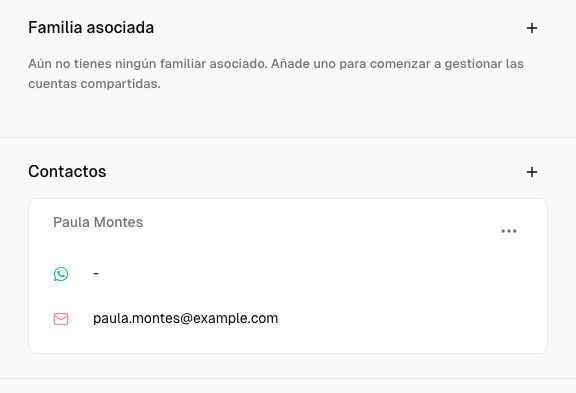
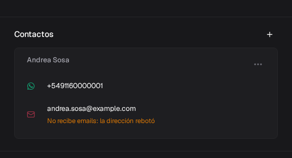

Esta guía te ayuda a representar una familia sin mezclar dos relaciones distintas: clientes vinculados entre sí y personas responsables de pagar.

## Antes de empezar: no son lo mismo

<CardGroup cols={2}>
  <Card title="Familia asociada" icon="people-roof">
    Agrupa perfiles de clientes, por ejemplo, dos hermanos. Cada integrante sigue teniendo su propio perfil.
  </Card>
  <Card title="Contactos" icon="wallet">
    Reúne responsables de pago. Cada responsable puede abrir su portal y pagar por los clientes que tenga asignados.
  </Card>
</CardGroup>

Relacionar dos clientes en **Familia asociada** no crea un responsable de pago. Para habilitar a una persona como pagadora, agregala también en **Contactos**.

## Asociar clientes de una familia

Primero creá los perfiles que querés relacionar. Después:

<Steps>
  <Step title="Abrí uno de los perfiles">
    Desde **Clientes**, buscá a la persona y abrí su detalle.
  </Step>
  <Step title="Desplegá Familia asociada">
    Abrí la sección y presioná el botón **+**.
  </Step>
  <Step title="Elegí el otro cliente">
    Buscalo en el selector y confirmá la asociación. Su nombre queda visible dentro de la sección.
  </Step>
</Steps>

Para retirar el vínculo, abrí el menú de tres puntos junto al nombre y elegí **Desasociar cliente** o **Desasociar estudiante**, según el nombre de tu módulo.

Desasociar quita la relación familiar; no elimina ninguno de los perfiles.

Cuando hay importes pendientes, el perfil puede separar en **Deuda** el total **Familiar** del importe **Individual** del cliente.

## Agregar un responsable de pago

<Steps>
  <Step title="Abrí Contactos">
    Dentro del perfil del cliente, desplegá **Contactos** y presioná **+**.
  </Step>
  <Step title="Elegí cómo incorporarlo">
    Usá **Asignar uno existente** si la persona ya paga por otro cliente. Elegí **Crear nuevo** si todavía no existe.
  </Step>
  <Step title="Completá los datos necesarios">
    **Crear contacto** pide **Nombre**, **Apellido** y documento. El email es opcional para guardar; hace falta para **Enviar mail con link al portal** y para que le lleguen las liquidaciones. Si ese documento ya está en Contactos, Fint **no crea otra persona**: vincula la que existe y deja los datos viejos. Si es la misma, usá **Asignar uno existente**.

    Si cargás un email con formato roto, aparece **Ingresa un email válido** y no se puede guardar. Si el dominio parece mal escrito, Fint muestra, por ejemplo, **¿Quisiste decir @gmail.com en vez de @gmail.con?**: tocá **Corregir** para aplicarlo. Los espacios de más se quitan al guardar.
  </Step>
  <Step title="Comprobá la relación">
    El responsable debe aparecer dentro de **Contactos**. Abrí su menú para editarlo, entrar al portal o enviar el enlace por email.
  </Step>
</Steps>

<Info>
  Un mismo responsable puede estar asignado a varios clientes. En su portal puede ver a las personas vinculadas y sus órdenes desde un único acceso.
</Info>

## Abrir o enviar el portal

En el menú de un responsable tenés dos acciones:

- **Ir al portal** abre su acceso para que compruebes qué información tiene disponible.
- **Enviar mail con link al portal** envía el enlace a la dirección registrada. Si el contacto no tiene email, Fint avisa y no envía nada.

Antes de enviar el email, verificá que el responsable tenga una dirección válida y sin el aviso de [email que no llega](#cuando-un-email-no-llega). El mail de la ficha del **estudiante** no abre el portal.

## Cuando un email no llega

Si el email de un responsable rebotó o la persona marcó un email de Fint como spam, la ficha lo avisa debajo de la dirección:

- **No recibe emails: la dirección rebotó**: la casilla no existe o rechaza los mails.
- **No recibe emails: la dirección está bloqueada**: el proveedor de email la dejó de usar.
- **No recibe comunicados: marcó un email como spam**: le siguen llegando cobros y recordatorios, pero no los comunicados de [Mensajería](/docs/guides/mensajeria).

<Frame>
  
</Frame>

Una casilla llena o un problema pasajero no bloquean la dirección. Para que vuelva a recibir, pedí al responsable un email que funcione y cambialo con **Editar**. Si la dirección es correcta y ya se arregló, escribile a soporte de Fint para que la desbloquee.

## Cambiar una relación

Usá **Desasignar contacto** cuando una persona ya no deba pagar por ese cliente. Esa acción quita su acceso a las facturas de ese perfil.

Si el responsable continúa asociado a otros clientes, conserva los vínculos restantes. Si sólo querés corregir sus datos, elegí **Editar** en lugar de desasignarlo.

En la pestaña **Contactos** del listado, al abrir un responsable ves sus **Estudiantes asignados** y podés corregir sus datos con **Editar detalles** (con la misma revisión del email). **Eliminar responsable** da de baja a esa persona como pagadora. Las órdenes de los estudiantes se conservan. Para sacarla de un solo perfil, usá **Desasignar contacto**.

## Próximos pasos

<CardGroup cols={3}>
  <Card title="Portal de Contacto" icon="house-user" href="/docs/guides/portal-contacto">
    Conocé el recorrido que ve el responsable.
  </Card>
  <Card title="Condición y estado" icon="circle-check" href="/docs/guides/clientes-estados">
    Administrá altas y bajas sin confundirlas con deuda.
  </Card>
  <Card title="Órdenes y Liquidaciones" icon="file-invoice" href="/docs/guides/solicitudes-pago">
    Generá las órdenes que aparecerán en el portal.
  </Card>
</CardGroup>
