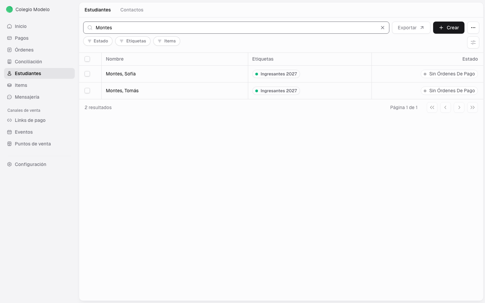
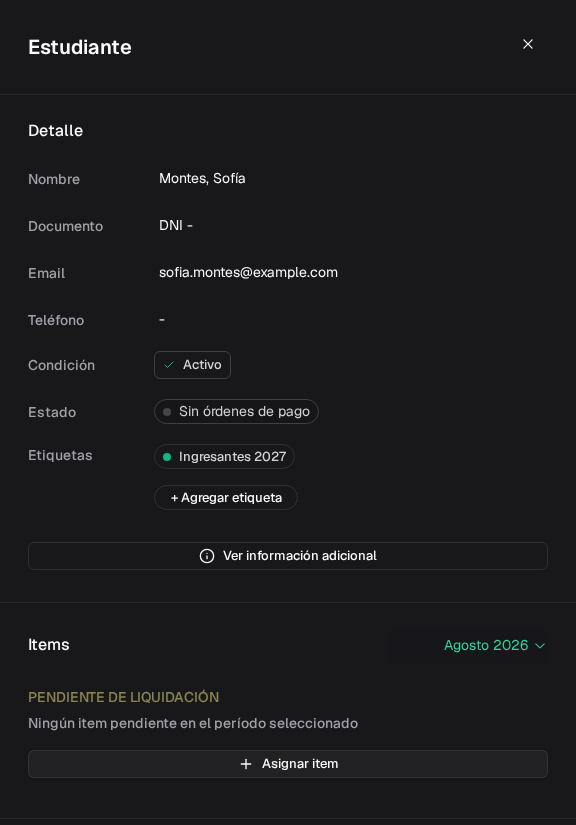
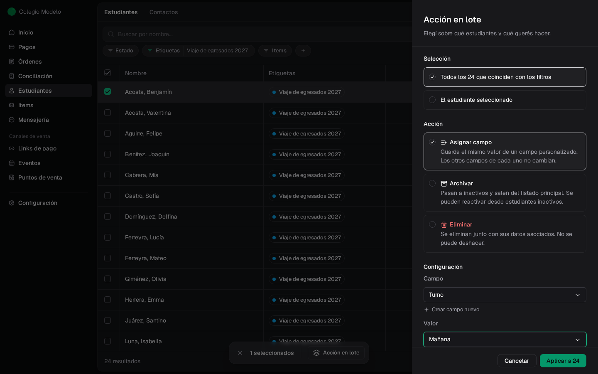

Clientes reúne a las personas a las que les cobrás. Desde este módulo podés cargar sus datos, organizar vínculos, asignar items y consultar su situación de pago.

<Info>
  Si tenés activado **Cuotas institucionales**, este módulo se llama **Estudiantes** en la aplicación. Es el mismo espacio de trabajo; sólo cambia el nombre visible.
</Info>

La gestión completa del módulo está disponible para administradores. El rol Cajero tiene un alta reducida dentro del Punto de Venta, cuando necesita asociar una venta.

<Frame>
  
</Frame>

## Elegí qué necesitás hacer

<CardGroup cols={2}>
  <Card title="Crear o importar clientes" icon="user-plus" href="/docs/guides/clientes-crear-importar">
    Cargá una persona o incorporá una nómina desde la plantilla de Excel.
  </Card>
  <Card title="Organizar familias y responsables" icon="users" href="/docs/guides/clientes-familias-responsables">
    Relacioná clientes entre sí y definí quién administra sus pagos.
  </Card>
  <Card title="Entender condición y estado" icon="circle-check" href="/docs/guides/clientes-estados">
    Distinguí la baja administrativa de la situación financiera calculada por Fint.
  </Card>
  <Card title="Usar el Portal de Contacto" icon="house-user" href="/docs/guides/portal-contacto">
    Conocé la experiencia donde los responsables consultan y pagan órdenes.
  </Card>
</CardGroup>

## Cuatro conceptos para empezar

<AccordionGroup>
  <Accordion title="Cliente o estudiante">
    Es la persona a la que se le asignan items y órdenes de pago. Si usás Cuotas institucionales, la interfaz la llama estudiante.
  </Accordion>
  <Accordion title="Responsable de pago">
    En el perfil aparece dentro de **Contactos**. Es quien puede acceder al Portal de Contacto y gestionar pagos de uno o más clientes.
  </Accordion>
  <Accordion title="Familia asociada">
    Relaciona perfiles de clientes, por ejemplo, hermanos. No crea un responsable de pago ni reemplaza la sección **Contactos**.
  </Accordion>
  <Accordion title="Condición y estado">
    La **condición** es administrativa y la definís vos. El **estado** refleja las órdenes del cliente y Fint lo calcula automáticamente.
  </Accordion>
</AccordionGroup>

## Recorrido recomendado

<Steps>
  <Step title="Cargá los clientes">
    Usá el alta manual para casos individuales o la plantilla de Excel para una nómina. Después, comprobá los registros en el listado.
  </Step>
  <Step title="Completá cada perfil">
    Revisá datos, etiquetas y los items que correspondan. El perfil concentra la información que vas a usar en cobranzas.
  </Step>
  <Step title="Definí los vínculos correctos">
    Asociá otros clientes en **Familia asociada** y agregá responsables de pago en **Contactos**. Son relaciones diferentes.
  </Step>
  <Step title="Seguí la situación">
    Usá la condición para administrar altas y bajas. Consultá el estado para saber si no hay órdenes, hay pagos pendientes, deuda o todo está al día.
  </Step>
</Steps>

## Qué encontrás en un perfil

Al abrir un cliente, podés revisar:

- **Detalle**: nombre, documento, email, teléfono, condición, estado y etiquetas.
- **Items**: conceptos asignados para el período seleccionado.
- **Familia asociada** y **Contactos**: clientes relacionados y responsables de pago. Si el email de un responsable rebotó o lo marcó como spam, lo ves debajo de la dirección (ver [Familias y responsables](/docs/guides/clientes-familias-responsables#cuando-un-email-no-llega)).
- **Deuda**: el importe pendiente; con hermanos asociados separa **Familiar** e **Individual**.
- **Campos personalizados**: los [campos](/docs/guides/configuracion-campos) que tu organización creó para estudiantes.
- **Órdenes**: solicitudes de pago vinculadas al cliente. Podés ordenarlas por fecha de emisión o de creación. Al hacer clic se abre el panel **Orden de pago**.
- **Actividad** y **Notas**: cambios registrados y comentarios internos.

Según la configuración de tu organización, también pueden aparecer integraciones específicas.

Para escribirle a un grupo, usá [Mensajería](/docs/guides/mensajeria) y filtrá por etiqueta, item o estado.

<Frame>
  
</Frame>

## Buscar, filtrar y exportar

El recuadro dice **Buscar por nombre...** y también encuentra por documento o email. Podés escribir varias palabras, por ejemplo nombre y apellido: Fint busca cada una, sin importar mayúsculas ni acentos. Los filtros **Estado** y **Etiquetas** están siempre. **Items** aparece si tenés **Cuotas institucionales**. Con el **+** filtrás por un [campo personalizado](/docs/guides/configuracion-campos).

El listado muestra 20 por página. El pie dice cuántos coinciden con la búsqueda y los filtros, y la página queda en la dirección del navegador: si la compartís, se abre igual.

Arriba del listado hay dos pestañas: **Estudiantes** (o **Clientes**) y **Contactos**. **Contactos** lista a todos los responsables; no es lo mismo que la sección **Contactos** dentro de un perfil.

El botón **Exportar** genera un archivo de Excel. Antes de descargarlo, podés limitar el resultado por **Etiquetas**, **Estados** e items. Si el archivo pasa las 5.000 filas, no se descarga en el momento: Fint lo arma y te lo manda por mail en unos minutos, y te avisa a qué dirección.

## Hacer algo con muchos a la vez

Tildá uno o más estudiantes: abajo aparece la barra con la cantidad y **Acción en lote**. El tilde del encabezado marca los 20 de la página. Si cambiás la búsqueda o un filtro, la selección se suelta.

<Steps>
  <Step title="Filtrá primero">
    Dejá en el listado solo a quienes querés cambiar: una etiqueta, un estado, una búsqueda.
  </Step>
  <Step title="Elegí sobre quiénes">
    En **Selección**, elegí **Los N seleccionados** (o **El estudiante seleccionado**) o **Todos los N que coinciden con los filtros**. La segunda incluye todas las páginas, hasta 10.000. Sin búsqueda ni filtros, esa opción dice **Todos los estudiantes (N)**.
  </Step>
  <Step title="Elegí la acción">
    - **Asignar campo**: guarda el mismo valor de un [campo personalizado](/docs/guides/configuracion-campos). Los otros campos de cada uno no cambian.
    - **Archivar**: pasan a inactivos. Se pueden reactivar (ver [Condición y estado](/docs/guides/clientes-estados#archivar-o-eliminar)).
    - **Eliminar**: se borran con sus datos asociados. No se puede deshacer.
  </Step>
  <Step title="Revisá la vista previa y aplicá">
    La vista previa dice qué va a pasar y a cuántos, por ejemplo *Vas a archivar 55 estudiantes.* Para archivar o eliminar más de 50, escribí la cantidad en **Para confirmar, escribí N**. Después tocá **Aplicar a N**.
  </Step>
</Steps>

<Frame>
  
</Frame>

Al archivar o eliminar, el panel muestra el avance (*Archivar: procesando 20 de 55…*). Podés cerrarlo: la acción sigue en segundo plano y conviene actualizar el listado en unos minutos. Al terminar dice a cuántos se aplicó (*55 estudiantes archivados*) y agrupa los que no, con el motivo y algunos nombres. Por ejemplo, un estudiante con una suscripción activa no se archiva ni se elimina: cancelá antes la suscripción.

Si mientras tanto cambió cuántos coinciden (alguien cargó o archivó estudiantes), Fint no aplica nada y avisa: *Ahora coinciden 56 con los filtros, no 55. Revisá el listado y volvé a aplicar.* El listado se actualiza solo. Si los filtros abarcan más de 10.000, Fint pide que los acotes.

## Próximos pasos

<CardGroup cols={3}>
  <Card title="Items y Descuentos" icon="tags" href="/docs/guides/items-descuentos">
    Configurá qué conceptos vas a cobrar.
  </Card>
  <Card title="Órdenes y Liquidaciones" icon="file-invoice" href="/docs/guides/solicitudes-pago">
    Generá órdenes para tus clientes.
  </Card>
  <Card title="Portal de Contacto" icon="house-user" href="/docs/guides/portal-contacto">
    Revisá cómo consultan y pagan los responsables.
  </Card>
</CardGroup>
