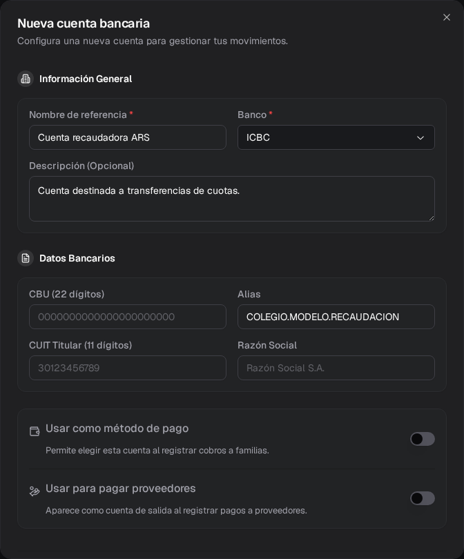
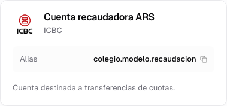
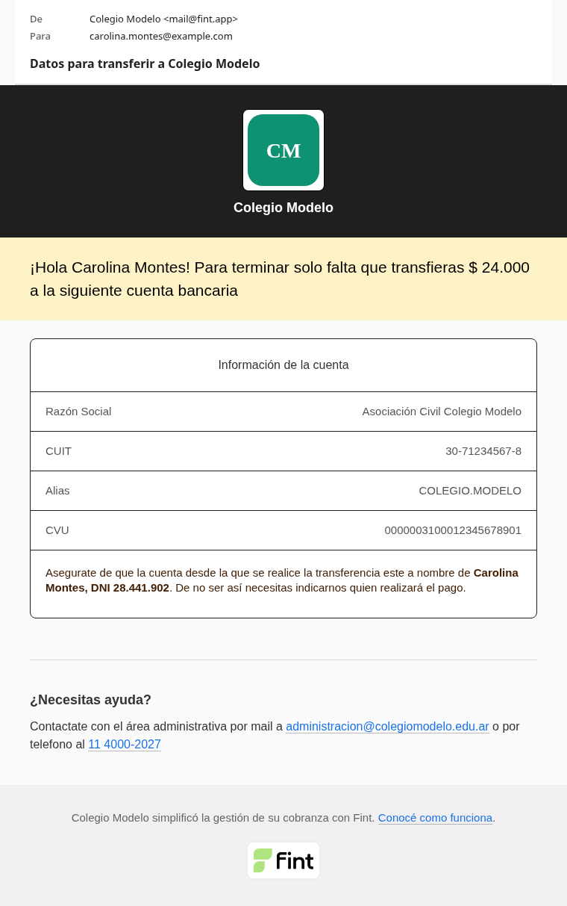

Creá una cuenta bancaria para indicarle a Fint de qué banco proviene cada extracto que vas a importar.

Esta configuración no conecta Fint con el banco ni descarga movimientos. Después de crearla, vas a subir cada extracto desde **Conciliación → Extractos**.

## Antes de empezar

Necesitás:

- La funcionalidad **Conciliación** activada en **Configuración → Funcionalidades**.
- Acceso de **Administrador**. Los demás roles no pueden abrir las pantallas ni usar las operaciones de conciliación.
- Un nombre que permita reconocer la cuenta y el banco al que pertenece.

Fint admite extractos de **ICBC**, **Banco Provincia (BAPRO)**, **BBVA**, **Credicoop** y **Banco Patagonia**.

El nombre y el banco son los únicos datos obligatorios. El CBU, el alias, el CUIT, la razón social y la descripción son opcionales.

## Crear la cuenta

<Steps>
  <Step title="Abrí Cuentas bancarias">
    Entrá a **Conciliación → Cuentas bancarias** y presioná **Nueva cuenta**.
  </Step>

  <Step title="Identificá la cuenta">
    Completá **Nombre de referencia** y **Banco**.

    Usá un nombre que distinga su función y moneda. Por ejemplo: **Cuenta recaudadora ARS**.
  </Step>

  <Step title="Agregá los datos útiles">
    Podés completar una descripción, el CBU, el alias, el CUIT del titular y la razón social.

    En el ejemplo se usa el alias **colegio.modelo.recaudacion** y la descripción “Cuenta destinada a transferencias de cuotas”. No se cargan datos fiscales ni bancarios reales.

    <Frame>
      
    </Frame>
  </Step>

  <Step title="Definí para qué se usa">
    Los dos interruptores del final son opcionales. Ninguno hace falta para importar extractos ni para conciliar; en el ejemplo quedan apagados.

    - **Usar como método de pago**: la cuenta pasa a ser la que ven las familias cuando eligen pagar por **transferencia**. Ver [Pagos por transferencia de las familias](#pagos-por-transferencia-de-las-familias).
    - **Usar para pagar proveedores**: solo aparece si la institución tiene **Pagos a proveedores**. La cuenta queda como cuenta de salida al registrar pagos a proveedores. Ver [Configuración de proveedores](/docs/guides/proveedores-configuracion).
  </Step>

  <Step title="Guardá y verificá">
    Presioná **Crear Cuenta**. La tarjeta muestra el nombre, el banco y los datos opcionales que cargaste.

    
  </Step>
</Steps>

## Qué queda configurado

La cuenta aparece como opción al subir un extracto. El banco elegido define la estructura que Fint espera encontrar en el archivo.

<Warning>
  Elegí el banco correcto. Si el archivo no respeta la estructura esperada para esa cuenta, la importación puede rechazarse o informar filas que no pudo procesar.
</Warning>

## Pagos por transferencia de las familias

Cuando una familia elige pagar por **transferencia**, Fint le muestra los datos de la cuenta marcada con **Usar como método de pago** y se los manda por mail con el asunto **Datos para transferir a …**. La excepción es la institución que cobra con la CVU de Pagos Online: ahí se usan los datos de esa CVU.

<Frame>
  
</Frame>

- La razón social y el CUIT salen de los datos de la institución; si no están, de la cuenta.
- El alias y el CBU salen juntos de la misma fuente: de la institución si tiene alguno cargado y, si no, de la cuenta. El mail rotula ese número como **CVU**.
- Si un dato no está en ningún lado, la fila no aparece.
- Si hay varias cuentas con el interruptor prendido, se usa la primera que se creó.

Esa transferencia no se acredita sola: el pago queda registrado cuando [conciliás el movimiento](/docs/guides/conciliacion-bancaria) del extracto. Por eso el mail no promete un plazo de acreditación.

## Editar o eliminar la cuenta

Usá las acciones de la tarjeta para corregir sus datos o eliminarla.

Al eliminar una cuenta, Fint conserva los extractos que ya fueron importados. La eliminación de la cuenta no sirve para borrar esos movimientos.

## Próximos pasos

<CardGroup cols={3}>
  <Card title="Subir un extracto" icon="file-arrow-up" href="/docs/guides/conciliacion-bancaria-extractos">
    Importá movimientos y seguí su revisión
  </Card>
  <Card title="Conciliar un ingreso" icon="link" href="/docs/guides/conciliacion-bancaria">
    Aplicá una transferencia a una orden
  </Card>
  <Card title="Preguntas frecuentes" icon="circle-question" href="/docs/guides/conciliacion-bancaria-casos-frecuentes">
    Abrí el caso que te toca y seguí el camino que aplica
  </Card>
</CardGroup>
