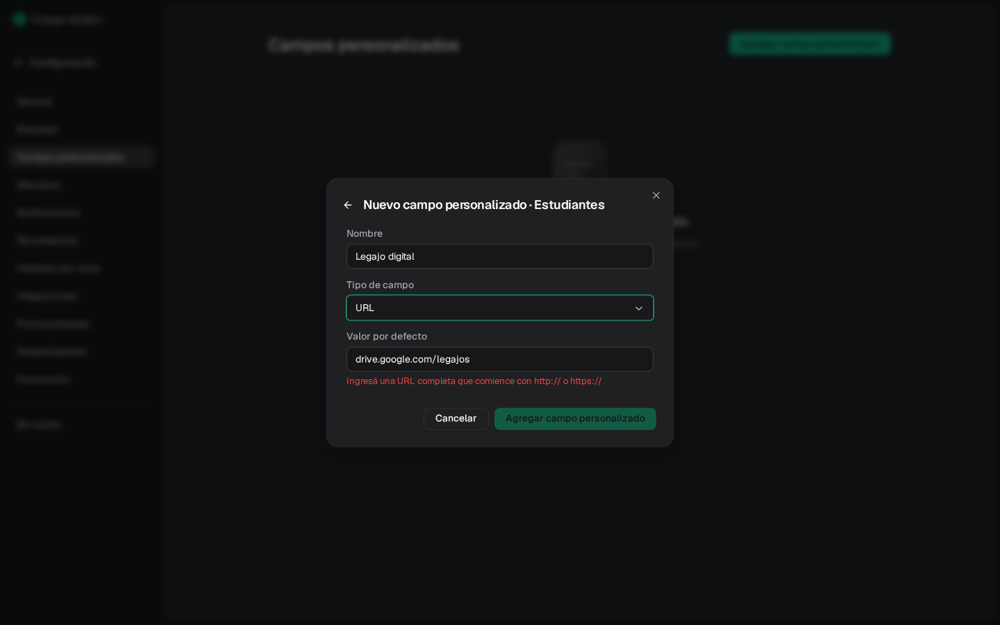
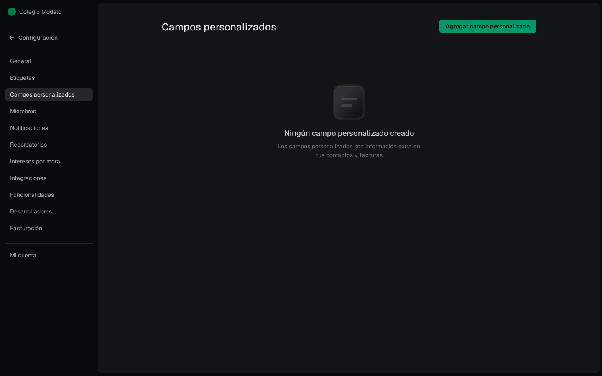

Un **campo personalizado** guarda información que Fint no trae de fábrica: legajo, curso, división u otro dato de tu institución.

Está en **Configuración → Campos personalizados**.

## Crear un campo

<Steps>
  <Step title="Abrí el alta">
    Usá **Agregar campo personalizado**.
  </Step>
  <Step title="Elegí la entidad">
    Fint pregunta *¿A qué entidad se aplicará este campo personalizado?*. Puede vivir en **Estudiantes** (o **Clientes**), en **Contactos** (responsables) o en **Órdenes de pago**. Si usás Proveedores, también aparecen **Proveedores** y **Comprobantes de proveedores** (ver [Configurar Proveedores](/docs/guides/proveedores-configuracion)).
  </Step>
  <Step title="Definí tipo y valor">
    Tipos: **Texto**, **Opciones**, **Número**, **Fecha**, **Teléfono**, **País**, **URL**. Si elegís Opciones, cargá al menos una. El **valor por defecto** es opcional: en la ficha se ve ese valor hasta que cargues otro.
  </Step>
</Steps>

### Campos de tipo URL

Usalo para guardar un link, por ejemplo al legajo digital del estudiante. La dirección tiene que estar completa: si no empieza con `http://` o `https://`, Fint muestra *Ingresá una URL completa que comience con http:// o https://* y no deja guardar.

En la ficha, el valor se ve como un link corto que abre en otra pestaña. Para editarlo, hacé clic en el campo.

Un campo URL no puede cambiar de tipo después de creado. Un campo de **Texto** sin valores cargados sí puede pasar a URL.

## Completar un campo en muchos a la vez

Para cargar el mismo valor en muchos estudiantes u órdenes, no hace falta entrar a cada ficha.

<Steps>
  <Step title="Filtrá el listado">
    En **Estudiantes** u **Órdenes**, dejá solo a los que corresponden (por ejemplo, una etiqueta) y tildá uno.
  </Step>
  <Step title="Abrí Acción en lote → Asignar campo">
    Elegí si va para los seleccionados o para todos los que coinciden con los filtros.
  </Step>
  <Step title="Elegí el campo y el valor">
    El valor se carga igual que en la ficha: texto, una opción, una fecha, un número o un link completo (con `https://`). Si el campo todavía no existe, usá **Crear campo nuevo**: se abre **Nuevo campo personalizado**, lo creás con **Crear campo** y queda también en Configuración.
  </Step>
  <Step title="Aplicá">
    La vista previa dice qué va a pasar, por ejemplo *Vas a guardar "Turno: Mañana" en 24 estudiantes.* Solo cambia ese campo; los demás de cada uno quedan igual. Si dejás el valor vacío, el panel avisa **Sin valor: se borra el campo.** y lo borra en todos. Al terminar dice *Campo asignado a 24 estudiantes*.
  </Step>
</Steps>

Después podés filtrar el listado por ese campo con el **+** de los filtros. Los pasos del panel están en [Estudiantes](/docs/guides/clientes#hacer-algo-con-muchos-a-la-vez) y en [Gestionar Órdenes](/docs/guides/ordenes-gestionar).

## Completar un campo de a uno

Lo completás en la ficha o en la orden, según la entidad que elegiste. Un campo de estudiante aparece en el perfil; uno de contacto, en el responsable; uno de orden, en el detalle **Orden de pago**. Los campos del checkout de un evento se configuran en el evento, no acá. Ahí, la descripción de una casilla admite negrita y links, y el portal los muestra como links.
