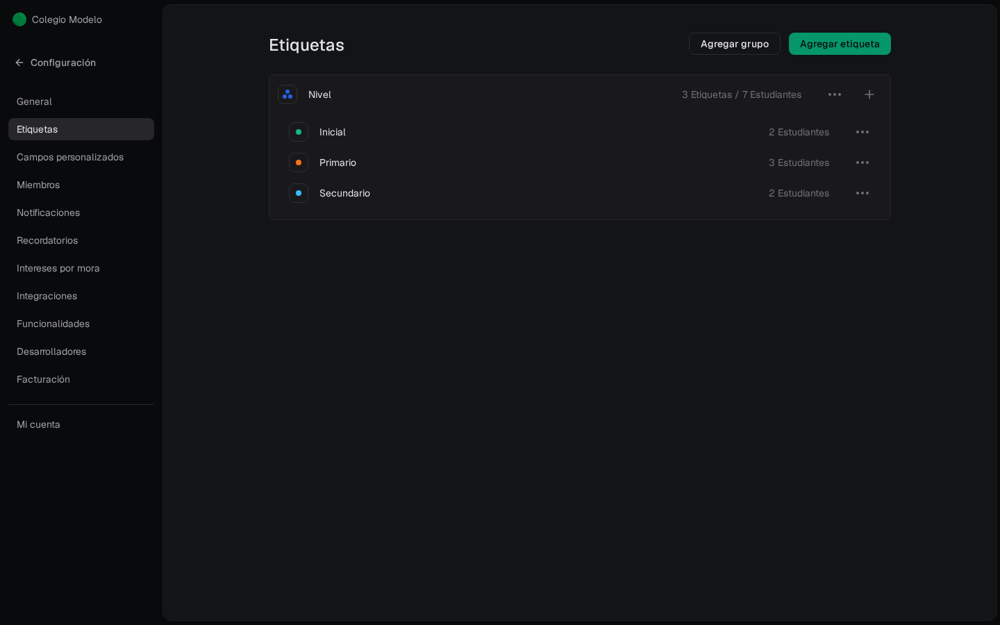

Las etiquetas viven en **Configuración → Etiquetas**. Se organizan en **grupos** y, dentro de cada grupo, etiquetas sueltas. También podés crear una etiqueta **sin grupo**.

Ejemplo: grupo **Nivel** con Inicial, Primario y Secundario. El color es del grupo. El número es cuántos estudiantes la tienen. No son las etiquetas de un evento.

El grupo muestra cuántas etiquetas tiene y a cuántos estudiantes llega (**3 Etiquetas / 7 Estudiantes**); cada etiqueta, cuántos la tienen. Si tu organización no usa Cuotas institucionales, dice **Clientes** en vez de Estudiantes. **Agregar grupo** y **Agregar etiqueta** están arriba a la derecha.

<Frame>
  
</Frame>

<Info>
  Las etiquetas sirven para filtrar en [Clientes](/docs/guides/clientes), en [Mensajería](/docs/guides/mensajeria) y al armar una [liquidación](/docs/guides/liquidaciones-crear-revisar). Conviene crearlas antes de cargar la nómina. En el Excel de clientes, **Nivel** es el grupo y **Curso** es la etiqueta: si no existen, Fint las crea.
</Info>
