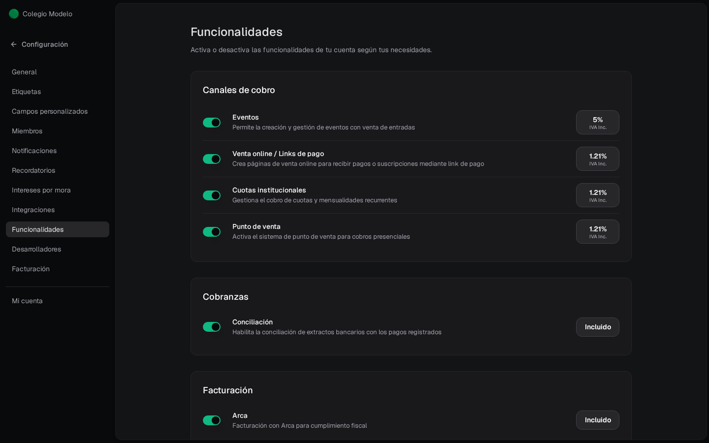

**Configuración → Funcionalidades** muestra u oculta partes de Fint. Apagar un módulo saca su entrada del menú; no borra los datos que ya existían.

## Canales de cobro

| Interruptor | Qué prende | Qué deja de verse si lo apagás |
| --- | --- | --- |
| **Eventos** | Eventos, Asistentes, Estadísticas y la App de Admisión | El menú Eventos. Las páginas públicas ya compartidas siguen existiendo hasta que pases el evento a Borrador. |
| **Venta online / Links de pago** | Links de pago y las suscripciones que nacen de ahí | El menú Links de pago. |
| **Cuotas institucionales** | Liquidaciones, items de Liquidación y el módulo se llama **Estudiantes** | Liquidaciones. El listado pasa a decir **Clientes**. |
| **Punto de venta** | Puntos de venta, cajas y reportes POS | El menú Punto de Venta. |

## Cobranzas

- **Conciliación**: extractos, movimientos y reglas. Sin esto no aparece el menú.

## Facturación

- **Arca**: prende el módulo de facturación electrónica. El alta está en [Configurar ARCA](/docs/guides/facturacion-arca). Apagarlo no desconecta el certificado: solo oculta el recorrido.

## Pagos

- **Pagos a proveedores**: suma al menú el grupo **Pagos a proveedores** (Proveedores, Comprobantes y Pagos), para cargar las facturas de tus proveedores y pagarlas. Lo ven solo los administradores.

A la derecha de cada canal está la **comisión de Fint**, con IVA incluido (**IVA Inc.**): por ejemplo **5%** en Eventos y **1.21%** en los demás canales. Pasá el mouse para ver el detalle. **Conciliación** y **Arca** dicen **Incluido**: no tienen costo aparte si cobrás con Fint. No son un interruptor más: informan el costo, no encienden el módulo.

<Info>
  Si no usás un módulo, apagalo para achicar el menú. Lo podés volver a prender después.
</Info>

Si dejás prendido **solo Eventos** (con o sin Arca), Fint pasa a un menú pensado para eventos: al entrar vas directo a **Eventos** en vez de [Inicio](/docs/guides/dashboard), **Items** se llama **Entradas** y **Órdenes** no aparece.
