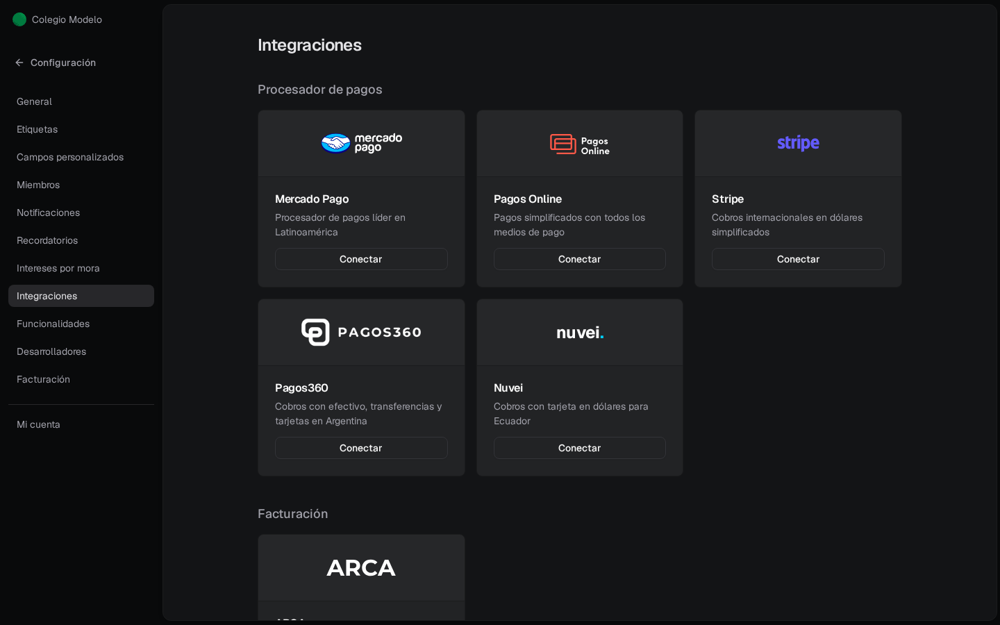
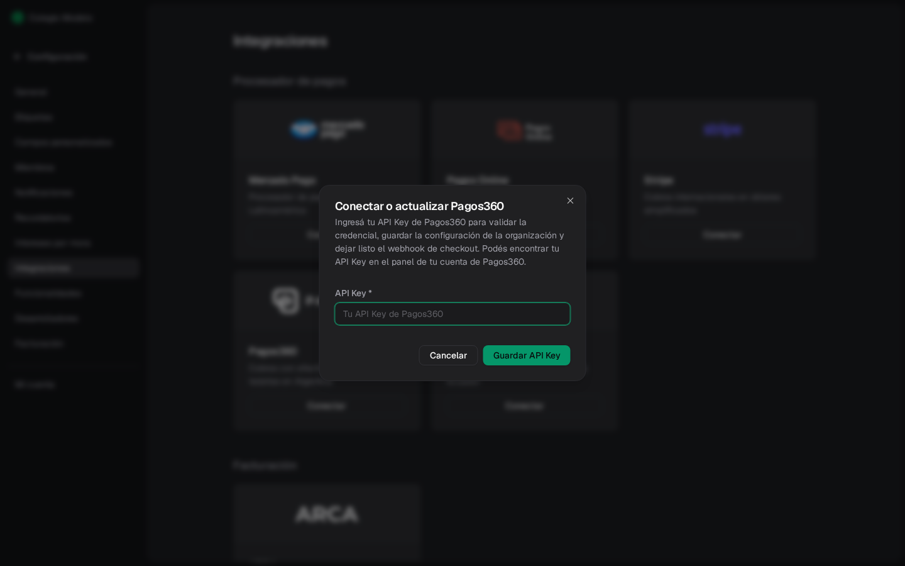
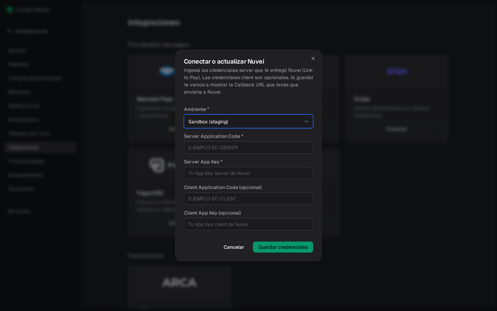

**Configuración → Integraciones** muestra las conexiones disponibles y su estado.

La pantalla se agrupa en **Procesador de pagos**, **Facturación** y **Plataformas de aprendizaje**.

## Procesador de pagos

- **Mercado Pago**
- **Pagos Online**
- **Stripe**
- **Pagos360**
- **Nuvei**

Hay **un procesador de cobro por organización**. Sin ninguno conectado, podés conectar vos mismo **Mercado Pago**, **Pagos360** (API Key) y **Nuvei** (credenciales + callback). **Stripe** y **Pagos Online** los activa el equipo de Fint: escribinos. El procesador conectado dice **Activo** y el resto muestra **Contactarse para activar**.

Para cambiar de procesador, **Desconectar** el actual y conectar el otro. Mercado Pago y Nuvei tienen **Desconectar** en su tarjeta; para dejar Pagos360, Stripe o Pagos Online escribinos. **Teachable** es aparte (API key) y no es un procesador de cobro.

### Mercado Pago

El recorrido completo está en [Conectar Mercado Pago](/docs/guides/conectar-mercado-pago). Con Mercado Pago activo, la tarjeta muestra la **Cuenta conectada** (email, usuario y documento del titular), el link **Configurar plazos y comisión**, que abre la sección de costos de tu cuenta de Mercado Pago, y **Desconectar**.

Si la conexión deja de funcionar, Fint manda el aviso **Acción requerida: Reconectá tu cuenta de Mercado Pago** a quien elegiste en [Notificaciones](/docs/guides/configuracion-notificaciones). Se resuelve con **Desconectar** y volviendo a conectar la cuenta.

### Pagos360

Con Pagos360, la familia paga desde el portal en la página de Pagos360: tarjeta, QR, transferencia o un cupón para pagar en efectivo.

<Steps>
  <Step title="Conseguí la API Key">
    Está en el panel de tu cuenta de Pagos360. No hace falta elegir ambiente.
  </Step>
  <Step title="Conectá">
    En la tarjeta **Pagos360**, presioná **Conectar**, pegá la clave en **API Key** y presioná **Guardar API Key**.

    

    Fint valida la clave con Pagos360, la guarda y deja configurado en tu cuenta de Pagos360 el aviso de pagos (webhook). No tenés que cargar nada más allá.
  </Step>
  <Step title="Si cambia la clave">
    Con Pagos360 activo, la tarjeta muestra **Actualizar API Key**. Abre el mismo diálogo.
  </Step>
</Steps>

### Nuvei

Nuvei cobra con tarjeta en dólares, para organizaciones de Ecuador.

<Steps>
  <Step title="Pedí las credenciales a Nuvei">
    Nuvei te entrega las credenciales de **Link to Pay**: las **server** son obligatorias y las **client**, opcionales.
  </Step>
  <Step title="Conectá">
    En la tarjeta **Nuvei**, presioná **Conectar**. **Ambiente** viene en **Sandbox (staging)**, que es para pruebas: para cobrar de verdad elegí **Producción**. Cargá **Server Application Code** y **Server App Key** y, si te las dieron, las credenciales client. Presioná **Guardar credenciales**.

    <Frame>
      
    </Frame>
  </Step>
  <Step title="Mandale la Callback URL a Nuvei">
    Con Nuvei activo, la tarjeta muestra el ambiente y la **Callback URL (enviar a Nuvei)**. Nuvei la necesita para avisarle a Fint de cada pago. Desde la misma tarjeta podés **Actualizar credenciales** o **Desconectar**.
  </Step>
</Steps>

## Facturación

**ARCA** abre **Activar ARCA** y te lleva a [Conectar ARCA](/docs/guides/facturacion-arca). Con el módulo prendido, la tarjeta dice **Activo**.

## Plataformas de aprendizaje

- **Teachable**: cursos online. **Conectar** pide la **API Key** de tu cuenta de Teachable y, opcional, un nombre para la integración. Con Teachable activo, la tarjeta tiene **Desconectar**.

<Info>
  No todas las tarjetas se pueden activar solas. Si el botón dice **Contactarse para activar**, el alta no es self-serve.
</Info>
