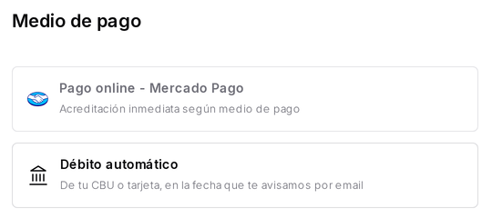
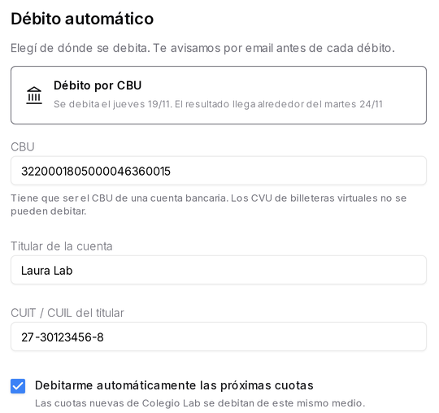
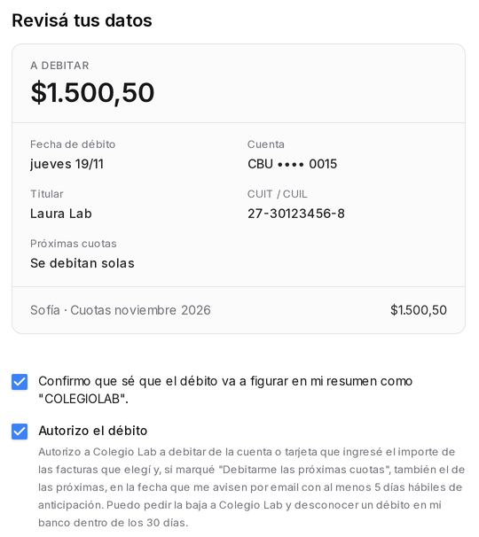
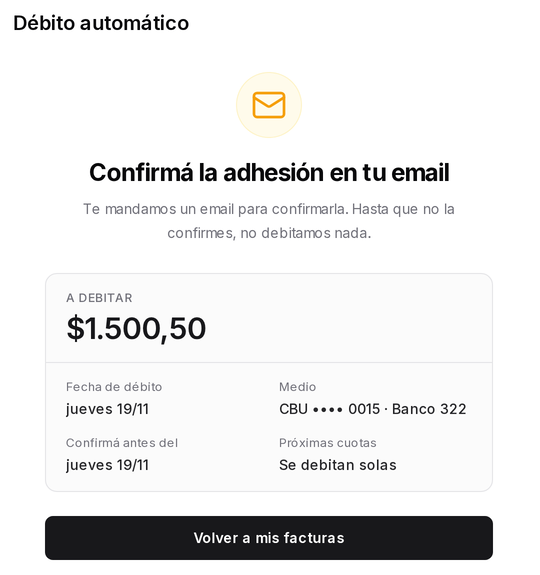
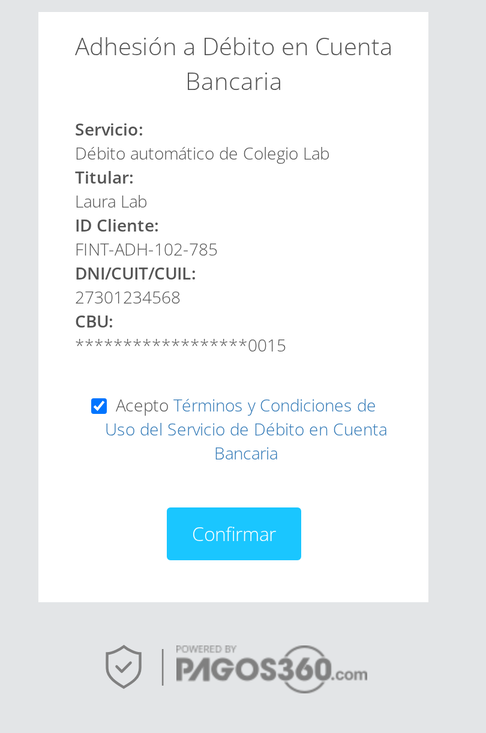
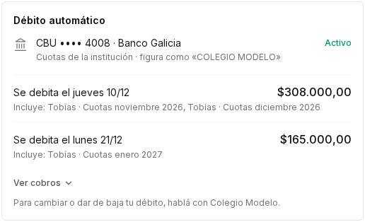

Esta guía es para las familias. Si trabajás en el colegio, mirá [Débito automático](/docs/guides/debito-automatico).

Con el débito automático, las cuotas del colegio se pagan solas desde tu cuenta bancaria, en una fecha que siempre te avisamos antes por email. No tenés que entrar a pagar todos los meses ni acordarte del vencimiento.

El débito lo hace el colegio a través de Pagos360, una empresa de pagos registrada ante el Banco Central. Por ahora funciona con cuentas bancarias (CBU). El débito con tarjeta va a estar disponible próximamente.

## Antes de empezar

Vas a necesitar:

- el CBU de una cuenta bancaria, caja de ahorro o cuenta corriente. Son 22 números y lo encontrás en la app o el home banking de tu banco;
- el nombre y el CUIT o CUIL del titular de esa cuenta;
- acceso al email que tiene cargado el colegio, porque ahí te llega la confirmación.

## Cómo adherirte

<Steps>
  <Step title="Entrá a tu portal">
    Abrí el link del portal que te mandó el colegio. Elegí las cuotas que querés pagar y presioná **Continuar al pago**.
  </Step>
  <Step title="Elegí Débito automático · CBU">
    Entre las opciones de pago, elegí **Débito automático · CBU**.

    <Frame>
      
    </Frame>
  </Step>
  <Step title="Cargá los datos de tu cuenta">
    Completá el CBU, el titular de la cuenta y su CUIT o CUIL. Arriba ves qué día se debita y cuándo llega el resultado.

    Si dejás tildado **Debitarme automáticamente las próximas cuotas**, las cuotas siguientes también se debitan de esta cuenta. Si lo destildás, solo se debitan las que elegiste ahora.

    <Frame>
      
    </Frame>

    Presioná **Revisar**.
  </Step>
  <Step title="Revisá tus datos">
    Revisá el monto, la fecha, la cuenta y las cuotas incluidas. Antes de confirmar tenés que tildar dos cosas: que sabés con qué nombre va a figurar el débito en tu resumen, y que lo autorizás.

    <Frame>
      
    </Frame>

    Presioná **Confirmar débito**.
  </Step>
  <Step title="Confirmá en tu email">
    Listo del lado del portal. Ahora te llega un email de Pagos360 para confirmar la adhesión. Hasta que no lo confirmes, no se debita nada.

    <Frame>
      
    </Frame>
  </Step>
</Steps>

## El email de Pagos360

Te llega desde `debitoencuenta@pagos360.com`, con el asunto «Solicitud de adhesión a débito en cuenta bancaria». Si no lo ves, buscalo en correo no deseado o en promociones.

El email muestra:

- el nombre y el CUIT con los que el colegio está registrado en Pagos360 (puede ser su razón social);
- el servicio, «Débito automático de» y el nombre del colegio;
- el número de adhesión;
- tu banco y los últimos 4 números de tu CBU.

Presioná **Revisar y confirmar**. Se abre una página con tus datos. Dejá tildado **Acepto** y presioná **Confirmar**. Vas a ver «Adhesión Confirmada».

<Frame>
  
</Frame>

Tenés 7 días para confirmarla. En el portal ves la fecha límite. Si no la confirmás a tiempo, la adhesión se cancela y la cuota queda para pagar por otro medio. Podés volver a adherirte cuando quieras.

Después te llega un segundo email, «Adhesión a débito en cuenta bancaria confirmada». Guardalo: trae el link para dar de baja el débito.

## Cómo figura en tu resumen

En el resumen de tu banco, el débito figura con el nombre que confirmaste antes de adherirte, de hasta 10 caracteres. Por ejemplo, `COLMODELO`. También lo ves en tu portal, junto a tu cuenta.

## Los avisos antes de cada débito

Nunca debitamos sin avisarte:

1. Cuando el colegio envía la cuota, te llega el email de siempre con un bloque nuevo: qué día se debita, cuánto y cómo figura en tu resumen.
2. Un día hábil antes, te llega un recordatorio: «mañana debitamos».
3. En tu portal, cada cuota en débito muestra «Se debita el» y la fecha.

<Frame>
  
</Frame>

Si tenés más de un hijo en el colegio, sus cuotas de esa fecha se debitan juntas en un solo débito. Tené el saldo disponible ese día.

## Si no había saldo

Si el banco no puede debitar, te mandamos un email con el motivo.

- Si el colegio programó un reintento, el email te dice la fecha y el monto del segundo intento. El monto puede incluir el recargo por mora a esa fecha.
- Si no hay reintento, el email trae el botón **Pagar ahora** para que pagues desde el portal. Si pagás en los días siguientes, dentro del plazo que define el colegio, pagás el mismo monto sin recargo. Tu débito sigue activo para las próximas cuotas.
- Si el banco lo rechazó porque la cuenta está cerrada o por un motivo parecido, el débito automático se pausa. Pagá desde el link y hablá con el colegio para volver a activarlo.

## Pagar una cuota con otro medio

Podés pagar una cuota con otro medio online desde el portal mientras su débito no se haya presentado al banco. El débito se presenta 3 días hábiles antes de la fecha. Al pagarla, cancelamos ese débito y no se te cobra dos veces.

Si el débito ya está en el banco, la cuota dice «ya está en el banco» y no se puede elegir. Esperá el resultado.

Si empezaste un pago online y no lo terminaste, la cuota muestra «Esperando pago por» y el medio que elegiste. Para usar otra opción o adherirte al débito, abrí ese pago y cancelalo. Después elegí otra opción.

## Darte de baja

Para cambiar la cuenta o dar de baja el débito automático, hablá con el colegio. Tu portal te lo recuerda debajo de tus débitos.

También podés usar el link «stop debit» del email de Pagos360 que confirmó tu adhesión:

1. Abrí el link. Se abre una página de Pagos360 con tus datos.
2. Tildá **Acepto** y presioná **Confirmar**.
3. Pagos360 te manda un email confirmando la baja, y el colegio la ve en Fint.

Los débitos que todavía no se presentaron al banco se cancelan, y esas cuotas quedan para pagar desde el portal.

## Por qué no se puede usar un CVU

El débito automático funciona entre cuentas bancarias. Las billeteras virtuales, como Mercado Pago o Ualá, tienen CVU en lugar de CBU, y no reciben órdenes de débito. Por eso el portal solo acepta el CBU de una cuenta de banco.

Si solo tenés una billetera, podés seguir pagando cada cuota desde el portal.

## Preguntas frecuentes

<AccordionGroup>
  <Accordion title="¿Tiene algún costo?">
    No. Adherirte al débito automático no tiene costo para vos.
  </Accordion>
  <Accordion title="¿Puedo elegir el día del débito?">
    No. La fecha la define el colegio, y siempre la ves antes en el email y en el portal.
  </Accordion>
  <Accordion title="¿Pueden debitarme un monto distinto del que me avisaron?">
    No. El monto es el que te avisamos. Si hay un reintento, te avisamos el monto nuevo antes.
  </Accordion>
  <Accordion title="Cambié de banco, ¿qué hago?">
    Hablá con el colegio para dar de baja la adhesión y después adherite de nuevo con el CBU nuevo.
  </Accordion>
  <Accordion title="Somos dos responsables, ¿podemos adherirnos los dos?">
    Sí, cada uno con su cuenta. Si los dos cubren las mismas cuotas, se debita de la adhesión que se hizo primero.
  </Accordion>
  <Accordion title="¿La cuenta tiene que estar a mi nombre?">
    No necesariamente, pero el titular tiene que estar de acuerdo. En el formulario se cargan su nombre y su CUIT o CUIL.
  </Accordion>
  <Accordion title="No me llegó el email de Pagos360">
    Revisá correo no deseado y promociones. Si no aparece, escribile al colegio para que revise el email que tiene cargado.
  </Accordion>
  <Accordion title="Veo un débito que no reconozco">
    Hablá primero con el colegio. También tenés derecho a desconocerlo en tu banco dentro de los 30 días. Si lo hacés, la cuota vuelve a quedar pendiente y el débito automático se pausa hasta que hables con el colegio.
  </Accordion>
</AccordionGroup>

## Próximos pasos

<CardGroup cols={2}>
  <Card title="Portal de Contacto" icon="house-user" href="/docs/guides/portal-contacto">
    Todo lo que podés hacer desde tu portal
  </Card>
  <Card title="Débito automático para el colegio" icon="building-columns" href="/docs/guides/debito-automatico">
    Cómo lo configura y lo sigue el colegio
  </Card>
</CardGroup>
