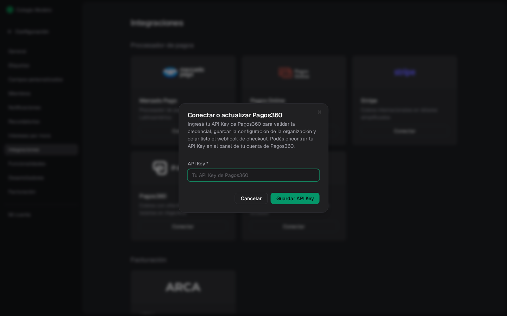
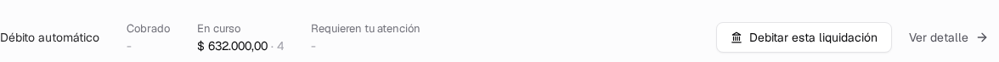
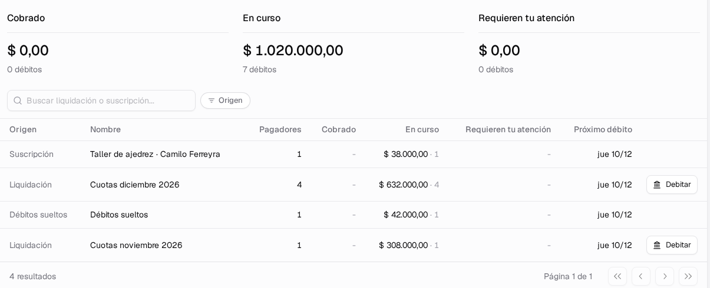
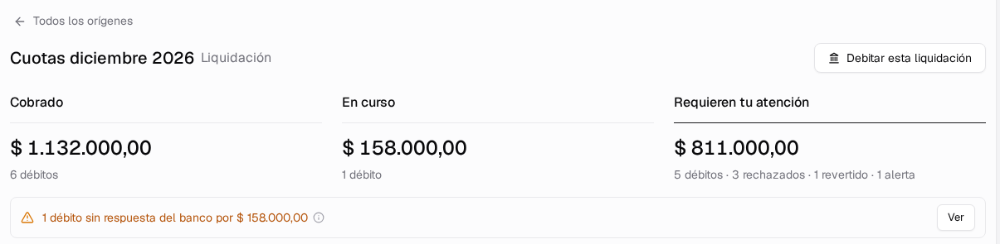
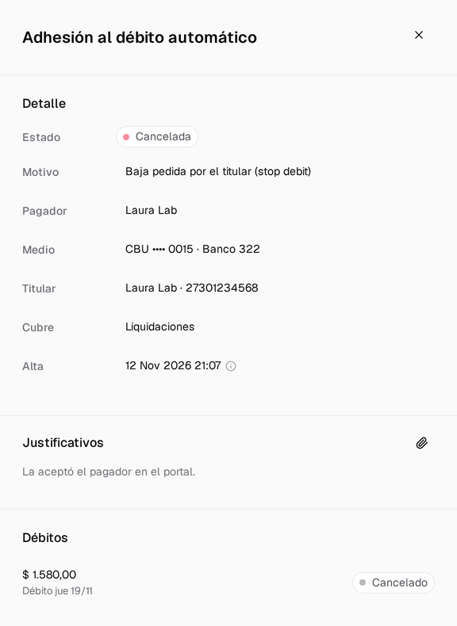
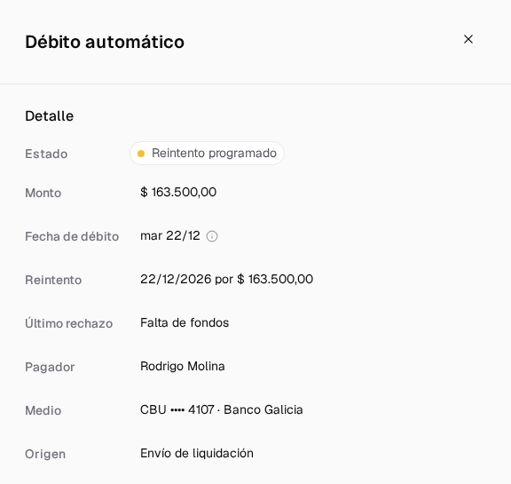
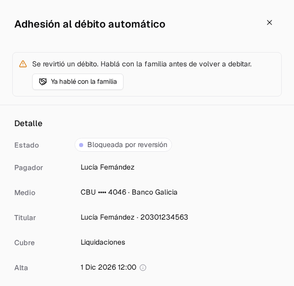
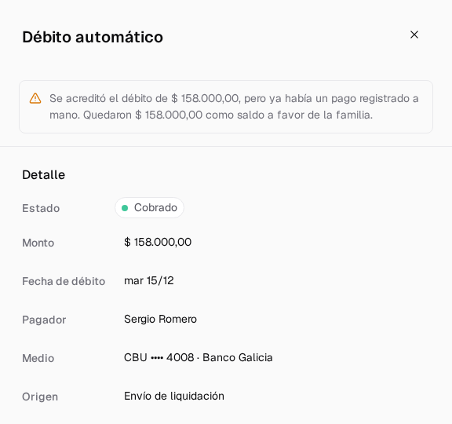
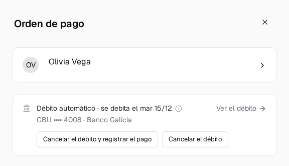
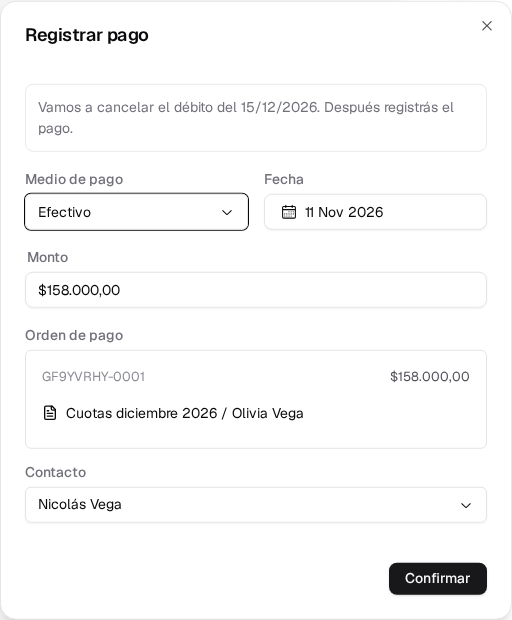

Con el débito automático, las cuotas se cobran solas de la cuenta bancaria (CBU) de las familias que se adhieren. Fint arma un débito por familia cuando enviás la liquidación, le avisa a la familia el monto y la fecha, y registra el pago cuando el banco lo confirma.

Funciona con la cuenta de Pagos360 del colegio. No importa con qué cobres hoy en el portal: si usás Mercado Pago o Pagos Online, siguen igual y Pagos360 se suma para el débito. El débito con tarjeta va a estar disponible próximamente.

## Cómo funciona

<Steps>
  <Step title="La familia se adhiere">
    Desde el [Portal de Contacto](/docs/guides/portal-contacto) elige Débito automático y carga su CBU. Pagos360 le manda un email para confirmar la adhesión. Hasta que no la confirma, no se debita nada.
  </Step>
  <Step title="Enviás la liquidación con débito">
    Fint programa un débito por familia, con todas las cuotas de sus hijos juntas, y el email de la liquidación ya le dice a la familia cuánto y qué día se debita.
  </Step>
  <Step title="La familia recibe un recordatorio">
    Un día hábil antes del débito le llega otro email: «mañana debitamos».
  </Step>
  <Step title="El débito se presenta al banco">
    Fint lo presenta 3 días hábiles antes de la fecha. Hasta ese momento se puede cancelar. Después ya está en el banco y hay que esperar el resultado.
  </Step>
  <Step title="Llega el resultado">
    Unos 2 días hábiles después de la fecha, el banco informa si se cobró. Si se cobró, el pago aparece en [Pagos](/docs/guides/pagos) y la orden queda pagada. Si no, la familia recibe un email con un link para pagar.
  </Step>
</Steps>

Un ejemplo con días hábiles y sin feriados: si enviás la liquidación un lunes, el débito es el lunes siguiente. Se presenta al banco el miércoles anterior y el resultado llega alrededor del miércoles posterior.

## Antes de activarlo

- Necesitás una cuenta de Pagos360 a nombre del colegio, con el débito en cuenta bancaria habilitado. Eso lo pedís a Pagos360.
- La organización tiene que cobrar en pesos.
- Tené en cuenta las reversiones: una familia puede desconocer un débito en su banco dentro de los 30 días. En ese caso la plata vuelve a la familia y Pagos360 descuenta ese monto de tu cuenta.

## Activar el débito automático

<Steps>
  <Step title="Conectá tu cuenta de Pagos360">
    En **Configuración → Integraciones**, en la tarjeta **Pagos360**, presioná **Conectar**, pegá la **API Key** de tu cuenta y guardá. Es el mismo diálogo de siempre.

    <Frame>
      
    </Frame>

    Al conectarla elegís para qué la usás: solo para el débito por CBU, solo como pago online en el portal, o para las dos cosas. Tu procesador principal no cambia.
  </Step>
  <Step title="Cargá el nombre en el resumen">
    En **Configuración → Débito automático**, completá **Nombre en el resumen**. Es lo que la familia ve en el resumen de su banco, así que conviene que sea fácil de reconocer, por ejemplo `COLMODELO`. Admite hasta 10 caracteres.

    La familia lo ve antes de adherirse y tiene que confirmar que lo reconoce.
  </Step>
  <Step title="Prendé el débito">
    En la misma pantalla, prendé **Débito automático** y elegí la **Fecha del débito por CBU**: 5 días hábiles después del envío, o el día del vencimiento de la cuota (siempre con un mínimo de 5 días hábiles).
  </Step>
  <Step title="Revisá la mora">
    **No cobrar mora si el débito se presentó antes del vencimiento** viene prendido: si el débito se presentó a tiempo, la familia no paga recargo aunque el banco lo procese después del vencimiento.

    **Días de gracia tras un rechazo** (3 días hábiles por defecto) es el tiempo que tiene la familia para pagar el mismo monto, sin mora, después de un débito rechazado.
  </Step>
</Steps>

<Warning>
  Mientras haya adhesiones o débitos en curso no se puede cambiar la API Key de Pagos360. Si necesitás pasar a otra cuenta, escribinos.
</Warning>

### Qué opciones ve la familia en el portal

El débito automático aparece en el portal como una opción de pago más, junto al pago online y la transferencia. Desde **Configuración → Integraciones** podés ordenar las opciones y ocultar las que no quieras ofrecer.

## Enviar una liquidación con débito

Cuando presionás **Enviar liquidación**, el diálogo de confirmación suma un bloque de débito automático:

- **Debitar a los adheridos** prende o apaga el débito para esta liquidación. Muestra cuántos pagadores están adheridos y el total.
- Cada medio muestra la cantidad de débitos, la fecha y el monto. El (i) explica la regla de los 5 días hábiles y cuántas cuotas van a estar vencidas a esa fecha.
- **Fecha de débito** viene con la primera fecha posible. Podés elegir una más adelante, nunca una anterior.
- **Reintentar si se rechaza** programa un segundo intento si el primero se rechaza por falta de fondos. Elegís a cuántos días hábiles (5 por defecto). El monto del reintento se recalcula con la mora a esa fecha.

Abajo se ven los pagadores que todavía no confirmaron la adhesión y los que quedan afuera por una reversión sin resolver.

Si una familia ya tiene un débito programado para la misma fecha y todavía no se presentó, las cuotas nuevas se suman a ese débito. La familia ve un solo débito.

### Debitar una liquidación ya enviada

Si la enviaste sin débito, o se adhirieron familias después del envío, usá **Debitar esta liquidación**. Está en la franja de débito automático de la liquidación y en la pantalla de débitos. Debita las órdenes pendientes de los adheridos que todavía no tienen un débito en curso, con las mismas opciones de fecha y reintento.

<Frame>
  
</Frame>

## La pantalla de débitos

Todo el seguimiento está en **Órdenes → Débito automático**, en la pestaña **Cobros**.

<Frame>
  
</Frame>

Arriba ves tres totales: lo que ya se cobró, lo que está en curso y lo que requiere tu atención (rechazos, reversiones y alertas). Cada débito está en uno solo de los tres.

Abajo, cada fila es un origen: una liquidación, una suscripción o los débitos sueltos que cargaste a mano. Al abrir una fila ves los mismos totales para ese origen y la lista de sus débitos, con el pagador, el medio, el monto, la fecha, el motivo de un rechazo y el estado.

<Frame>
  
</Frame>

Si un débito sigue sin resultado 3 días hábiles después de la fecha esperada, aparece el aviso **Sin respuesta del banco**. Fint lo consulta todos los días. Mientras tanto la orden sigue bloqueada: no le pidas a la familia que pague por otro medio todavía.

Al abrir un débito ves su detalle, las órdenes que incluye, los intentos y los movimientos con fecha y hora.

## Adhesiones

En **Órdenes → Débito automático → Adhesiones** está la lista de familias adheridas. Cada adhesión tiene uno de estos estados:

<CardGroup cols={2}>
  <Card title="Pendiente de firma" icon="envelope">
    La familia todavía no confirmó el email de Pagos360. Si no lo confirma en 7 días, Pagos360 cancela la adhesión, Fint cancela su débito y las órdenes vuelven a quedar para pagar por otro medio.
  </Card>
  <Card title="Activa" icon="circle-check">
    Se debita en cada liquidación que envíes con débito.
  </Card>
  <Card title="Bloqueada por reversión" icon="triangle-exclamation">
    La familia desconoció un débito en su banco. No se vuelve a debitar hasta que confirmes que hablaste con ella.
  </Card>
  <Card title="Pausada o cancelada" icon="circle-pause">
    El banco la rechazó por un motivo que no se arregla solo (cuenta cerrada, orden de no pagar), la familia pidió la baja o la diste de baja vos. El motivo aparece en el detalle.
  </Card>
</CardGroup>

### Cargar una adhesión a mano

Si la familia te firmó una autorización en papel, la podés cargar con **Nueva adhesión**, desde Adhesiones o desde la ficha del alumno. Elegí el pagador, cargá el CBU, el titular y su CUIT o CUIL, y adjuntá la autorización firmada: sin ese archivo no se puede crear.

La familia recibe un email avisándole que la adheriste, y el email de Pagos360 para confirmar. Hasta que no lo confirma, no se debita nada.

### Bajas

La familia no puede darse de baja desde el portal: el portal le dice que hable con el colegio. Para dar de baja una adhesión, abrila y usá **Cancelar adhesión**. Los débitos que todavía no se presentaron se cancelan.

La familia también puede usar el link para cancelar la adhesión que trae el email de confirmación de Pagos360. En ese caso la vas a ver cancelada con el motivo «Baja pedida por el titular».

<Frame>
  
</Frame>

## Rechazos y reintentos

Un débito rechazado pasa a **Requieren tu atención** con su motivo. Qué pasa después depende del motivo:

- Si faltaron fondos y prendiste el reintento, Fint lo vuelve a intentar en la fecha elegida y le avisa a la familia el nuevo monto. Mientras tanto la orden sigue en débito.
- Si faltaron fondos y no hay reintento (o el reintento también falló), la familia recibe un email con **Pagar ahora**. Su adhesión sigue activa para las próximas cuotas.
- Si el banco rechazó por un motivo de fondo, como una cuenta cerrada o una orden de no pagar, la adhesión queda pausada o cancelada y el email le pide a la familia que hable con el colegio.

<Frame>
  
</Frame>

Durante los días de gracia que configuraste, la familia paga el mismo monto del débito, sin mora.

## Reversiones y saldo a favor

Si una familia desconoce un débito en su banco, el débito pasa a **Revertido**: el pago se anula, la orden vuelve a quedar pendiente y la familia recibe un aviso. La adhesión queda bloqueada para que no se vuelva a debitar sin hablar antes.

Cuando ya lo hablaste, abrí la adhesión y presioná **Ya hablé con la familia**. Desde ahí vuelve a estar activa.

<Frame>
  
</Frame>

El saldo a favor aparece en otro caso: registraste un pago a mano cuando el débito ya estaba en el banco, y después el débito se acreditó. Fint no cobra dos veces la orden: deja la diferencia como saldo a favor de la familia y marca el débito con una alerta en **Requieren tu atención**. Coordiná con la familia qué hacer con ese saldo.

<Frame>
  
</Frame>

## Si la familia te paga por otro medio

Una orden con débito en curso muestra arriba la fecha del débito y el medio. Mientras el débito no se presentó al banco, tenés dos acciones:

- **Cancelar el débito y registrar el pago**, si la familia te pagó en efectivo o por transferencia. Cancela el débito y abre el registro del pago.
- **Cancelar el débito**, si tenés que corregir la orden. Mientras haya un débito en curso no se pueden editar los ítems ni el monto. Después de corregirla, la volvés a debitar con **Debitar esta liquidación**.

<Frame>
  
</Frame>

Si un débito incluye cuotas de varios hijos, cancelarlo libera todas. Las que sigan pendientes las podés volver a debitar.

Cuando el débito ya está en el banco no se puede cancelar. Queda **Registrar el pago igual**, con una advertencia: si después el débito se acredita, la diferencia queda como saldo a favor.

<Frame>
  
</Frame>

La [conciliación bancaria](/docs/guides/conciliacion) no ofrece órdenes con un débito en curso, para que un mismo pago no se impute dos veces.

## Qué ve la familia

- En el portal, Débito automático es una opción de pago más. Antes de confirmar revisa sus datos y confirma el nombre con el que va a figurar el débito en su resumen.
- Ya adherida, el portal le muestra su CBU, los próximos débitos con su fecha y monto, y la frase «Para cambiar o dar de baja tu débito, hablá con» el colegio.
- Cada orden en débito muestra «Se debita el» y la fecha.
- Mientras un débito no se presentó al banco, la familia puede pagar esa cuota con otro medio online desde el portal. Fint cancela el débito solo. Ya presentado, la cuota queda bloqueada hasta el resultado.
- Recibe emails con el nombre y el logo del colegio: el aviso con la liquidación, el recordatorio del día anterior, el pago y, si hace falta, el rechazo o la reversión.

La guía para familias explica todo esto paso a paso. Podés compartirles el link.

## Preguntas frecuentes

<AccordionGroup>
  <Accordion title="¿Puedo ofrecer débito si cobro con Mercado Pago o Pagos Online?">
    Sí. Conectás Pagos360 para el débito y tu procesador principal sigue igual. La familia elige en el portal.
  </Accordion>
  <Accordion title="¿Se puede debitar de una tarjeta?">
    Todavía no. El débito con tarjeta va a estar disponible próximamente.
  </Accordion>
  <Accordion title="¿Una familia con dos hijos tiene dos débitos?">
    No. Se hace un solo débito por pagador con todas las cuotas de esa fecha.
  </Accordion>
  <Accordion title="¿Qué pasa con padres separados?">
    Cada responsable puede tener su propia adhesión. Si dos adhesiones cubren las mismas cuotas, se debita de la más antigua.
  </Accordion>
  <Accordion title="¿Fint valida que el CBU sea del titular?">
    No. Valida que el formato sea correcto y que no sea un CVU de billetera virtual. La adhesión la tiene que confirmar la familia desde el email de Pagos360.
  </Accordion>
  <Accordion title="¿Puedo cambiar la fecha de un débito ya programado?">
    Si todavía no se presentó al banco, cancelalo desde la orden y volvé a debitar la liquidación eligiendo otra fecha. Si ya está en el banco, no.
  </Accordion>
  <Accordion title="Me equivoqué en el monto de una cuota que ya está en débito">
    Si el débito todavía se puede cancelar, cancelalo, corregí la orden y volvé a debitar. Si ya está en el banco, esperá el resultado y corregí con una nota de crédito o una devolución.
  </Accordion>
  <Accordion title="¿Por qué un débito dice Sin respuesta del banco?">
    El banco todavía no informó el resultado y ya pasaron 3 días hábiles de la fecha esperada. Fint lo sigue consultando. No hace falta que hagas nada: cuando llega el resultado, el aviso desaparece.
  </Accordion>
</AccordionGroup>

## Próximos pasos

<CardGroup cols={3}>
  <Card title="Guía para familias" icon="house-user" href="/docs/guides/debito-automatico-familias">
    Compartila con las familias que se quieran adherir
  </Card>
  <Card title="Enviar una liquidación" icon="paper-plane" href="/docs/guides/liquidaciones-corregir-enviar-cancelar">
    Revisá y enviá las órdenes del período
  </Card>
  <Card title="Integraciones" icon="plug" href="/docs/guides/configuracion-integraciones">
    Conectá tu cuenta de Pagos360
  </Card>
</CardGroup>
