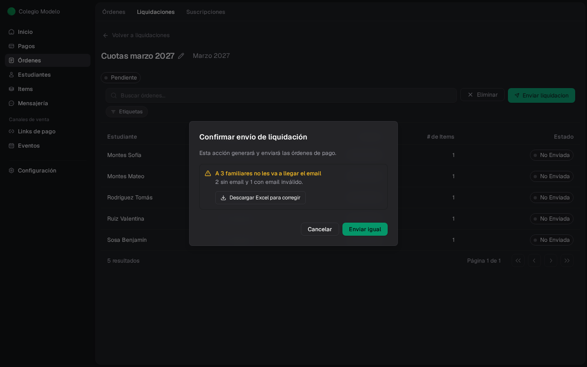
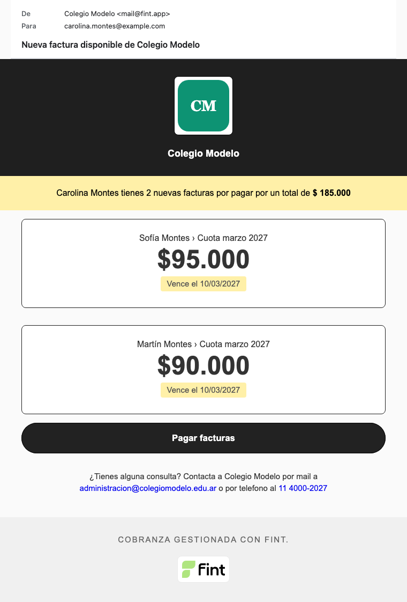

Tomá una decisión solo después de revisar clientes, items, descuentos e importes en el detalle de la liquidación.

<Info>
  Corregir, enviar, eliminar o cancelar una liquidación requiere el rol **Administrador**.
</Info>

## Corregir una liquidación Pendiente

Abrí una orden de la liquidación y compará sus items con la configuración esperada para ese cliente y período.

Si falta un item, usá el botón **+** de la sección **Items** y elegí uno disponible.

Si sobra un item, usá la **X** junto a ese renglón. La confirmación (**Desvincular item**) advierte que también se desvinculará del cliente y que esto puede afectar futuras liquidaciones. Tocá **Confirmar**.

En una liquidación **Pendiente** podés sumar o sacar items: esas órdenes todavía no se pagan. Si ya está **Enviada** y la familia arrancó un pago por transferencia o cupón, Fint bloquea el alta o baja de items con **Intento de pago en progreso, no se puede editar la factura**. Hay que cancelar el intento en el [portal](/docs/guides/portal-contacto) o esperar a que venza. Un cobro con tarjeta no deja este bloqueo. Mientras figura **Enviando**, no se edita nada.

<Warning>
  Una orden que se queda sin items no sale al enviar la liquidación. Volvé al detalle de la liquidación y comprobá el resultado antes de continuar.
</Warning>

Si el importe es incorrecto, revisá el item y los descuentos asignados. Después regresá a la liquidación y verificá nuevamente el desglose y el total.

{/* TODO(captura): Mostrar el detalle de una orden Pendiente con el botón para agregar items y la confirmación de desvinculación. */}

## Revisar casos especiales

- Una orden con items cuyo total es cero se convierte en **Bonificada** al procesar la liquidación.
- Una orden con total negativo impide iniciar el envío.

Si aparece un error por monto negativo, corregí los descuentos o items y volvé a revisar el total.

{/* TODO(captura): Mostrar el mensaje real de monto negativo solo después de reproducirlo de forma determinista en un entorno de documentación. */}

## Iniciar el envío

Cuando la liquidación esté Pendiente y la revisión sea correcta, seleccioná **Enviar liquidación**. Antes de abrir la confirmación, Fint revisa a quién le va a llegar el email.

<Steps>
  <Step title="Mirá si hay familias sin email">
    Si todos los responsables tienen un email que sirve, el cuadro **Confirmar envío de liquidación** solo dice que la acción generará y enviará las órdenes de pago, con el botón **Enviar**.

    Si alguno no lo va a recibir, el cuadro lo avisa: por ejemplo, **A 3 familiares no les va a llegar el email** y debajo cuántos no tienen email y cuántos lo tienen mal escrito. Si no falta ningún familiar pero hay estudiantes sin un contacto que reciba el aviso, dice **N estudiantes se quedan sin aviso**.

    <Frame>
      
    </Frame>
  </Step>
  <Step title="Bajá el Excel para corregir">
    **Descargar Excel para corregir** baja *Emails a corregir - (nombre de la liquidación).xlsx* sin cerrar el cuadro. Tiene una fila por estudiante y familiar al que no le llega el email, con **Problema** (Sin email, Email vacío, Email inválido o Sin familiar a notificar), el email cargado, teléfono, WhatsApp, si la familia recibe igual por otro familiar y un link para **Abrir ficha**. Primero van, en rojo, los estudiantes a los que no les llega por nadie.

    Corregí los emails en la ficha de cada estudiante (sección **Contactos**) y volvé a tocar **Enviar liquidación**: el aviso se actualiza.
  </Step>
  <Step title="Enviá">
    Con el aviso, el botón dice **Enviar igual**: las órdenes se generan para todos y el email sale solo a quienes tienen una dirección que sirve. Sin aviso, el botón es **Enviar**. Fint confirma con **Envío iniciado con éxito**.
  </Step>
</Steps>

La liquidación pasa por **Enviando** (el detalle muestra cuántas órdenes ya se generaron) y luego por **Enviada**. Fint congela el desglose de esa corrida y le pone número a cada orden. Las órdenes con importe pasan de no enviadas a **Por Cobrar**; las que tienen total cero por sus items quedan **Bonificadas**. Una orden que se quedó sin items **no sale**: se elimina. **Enviando** no se puede cancelar ni editar. Si alguna orden tiene total negativo, Fint no envía y avisa **La liquidación tiene órdenes de pago con monto negativo**.

Cada responsable con email recibe este correo, con las órdenes de su familia y el botón al portal. Los emails salen de a poco, después de que la liquidación queda **Enviada**: en una liquidación grande pueden tardar unos minutos en llegar. A quien no tiene un email que sirva no se le manda nada; su orden se crea igual y la ve en el [portal](/docs/guides/portal-contacto).

## Eliminar una liquidación Pendiente

Mientras la liquidación está **Pendiente**, el detalle muestra **Eliminar**. La confirmación se titula **Eliminar liquidación**.

Usá esta acción si no querés procesar esa preparación. Después de eliminarla, volvés al listado de liquidaciones.

No confundas esta acción con cancelar una liquidación ya Enviada.

## Cancelar una liquidación Enviada

En una liquidación **Enviada**, el detalle muestra **Cancelar liquidación**.

La confirmación avisa que *Las órdenes ya no aparecerán en el portal.* Al confirmar, la liquidación pasa a **Cancelada**. Sus órdenes Por Cobrar pasan a Cancelada. Las órdenes Pagadas, con Pago parcial o Bonificadas se conservan.

<Info>
  La cancelación cambia estados. No elimina las órdenes ni los pagos conservados.
</Info>

La acción no está disponible mientras la liquidación figura como **Enviando**.

{/* TODO(captura): Mostrar la confirmación de Cancelar liquidación y otra vista con el estado Cancelada, sin ejecutar el flujo sobre datos reales. */}

## Próximos pasos

<CardGroup cols={2}>
  <Card title="Revisar órdenes conservadas" icon="list" href="/docs/guides/ordenes-gestionar">
    Consultá las órdenes Pagadas, con Pago parcial o Bonificadas que se conservaron.
  </Card>
  <Card title="Pagos" icon="credit-card" href="/docs/guides/pagos">
    Revisá cobros y pagos parciales asociados.
  </Card>
</CardGroup>
