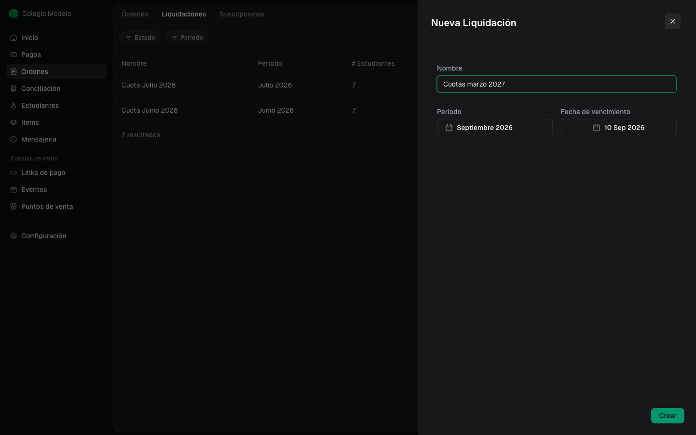
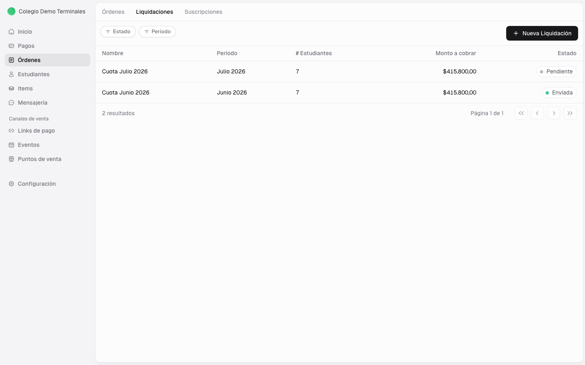

Una liquidación prepara órdenes para un período. Fint toma los items de Liquidación aplicables y sus descuentos, y agrupa en una orden los conceptos de cada cliente activo.

<Info>
  Crear y administrar liquidaciones requiere el rol **Administrador**.

  La pestaña Liquidaciones depende del módulo de cuotas institucionales y del acceso de tu cuenta. Si no aparece, revisá la disponibilidad con el administrador de tu organización.
</Info>

## Antes de empezar

Verificá estos puntos:

- Los [items de Liquidación](/docs/guides/items-liquidaciones) están activos y vigentes para el período.
- Cada item está asignado a los clientes que correspondan.
- Los [descuentos](/docs/guides/descuentos) tienen el alcance y las condiciones correctas.
- Los clientes que deban recibir una orden están activos.

Un cliente sin items aplicables no genera una orden. Un cliente inactivo tampoco se incluye.

## 1. Crear la liquidación

Entrá en **Órdenes**, abrí la pestaña **Liquidaciones** y seleccioná **Nueva Liquidación**.

Completá:

- **Nombre**: una referencia clara, como “Cuotas marzo 2027”.
- **Período**: el mes al que corresponden los items.
- **Fecha de vencimiento**: el límite de pago de las órdenes.

La fecha de vencimiento no puede ser anterior al período (*La fecha de vencimiento no puede ser anterior al período de facturación*). Si elegís una fecha anterior a hoy, el formulario avisa que se crearán órdenes de pago vencidas. Tocá **Crear**.

Mientras exista una liquidación **Pendiente** o **Enviando** para el período, no podés crear otra para el mismo mes (*Ya existe una liquidación pendiente en el período seleccionado*). Si esa liquidación ya está **Enviada** o **Cancelada**, sí podés volver a liquidar el mes: Fint **no** vuelve a incluir conceptos que ya tienen una orden cobrada, parcial o bonificada. Las **Por Cobrar** que cancelaste sí pueden volver a salir. Si no queda nada, el alta dice **No se encontraron items para el período seleccionado**.

<Info>
  Las órdenes generadas por una liquidación se registran en **ARS**.
</Info>

## 2. Entender el estado Pendiente

Al crearla, la liquidación aparece como **Pendiente**. Esta etapa permite revisar sus órdenes antes de iniciar el envío.

Si después de crearla asignás un item a otro alumno **desde el item** y lo guardás, Fint suma a ese alumno a las liquidaciones **Pendientes** que correspondan. El **+** de una orden suma un concepto a un cliente que ya está; no crea una orden nueva.

El **precio** de un item se ve en vivo mientras está Pendiente. Las órdenes ya **Enviadas** no se recálculan: el nuevo monto vale para lo que sigue.

Las becas se acumulan: cada porcentaje se calcula sobre los cargos fijos, no sobre el resultado de la otra.

El listado muestra nombre, período, cantidad de clientes, monto a cobrar y estado. En una liquidación **Enviada**, la cantidad y el monto cuentan solo las órdenes que siguen **Por Cobrar**. El filtro **Estado** ofrece Pendiente y Enviado; el filtro **Período** usa los meses disponibles.

**Pendiente** = lote armado, todavía no sale al portal. **Enviando** = se están generando las órdenes. **Enviada** = las órdenes ya salieron. **Cancelada** = lote dado de baja.

La fecha de vencimiento la cargás al crear el lote y aplica a todas las órdenes. El formulario propone el mes actual (o el siguiente, a partir del día 15) y el **día 10** de ese mes como vencimiento. Si cambiás el período, revisá también el vencimiento: no se mueve solo.

{/* TODO(captura): Mostrar liquidaciones 2027 con estados Pendiente, Enviada y Cancelada, usando nombres y períodos coherentes. */}

## 3. Revisar las órdenes

Abrí la liquidación Pendiente. El detalle muestra sus órdenes y permite buscarlas por cliente con **Buscar órdenes...** y filtrar por **Etiquetas**. Las columnas son el cliente, **Etiquetas**, **Importe**, **# de Items** y **Estado** (antes de enviar, **No Enviada**). El nombre de la liquidación se puede editar con el lápiz.

Seleccioná una orden para revisar sus items, descuentos, total, vencimiento y estado.

{/* TODO(captura): Mostrar el detalle real de una liquidación Pendiente con su tabla de órdenes, buscador y filtro de etiquetas. */}

{/* TODO(captura): Mostrar una orden de la liquidación con Cuota escolar 2027 y Beca por hermanos 2027 aplicada. */}

## 4. Decidir cómo continuar

Si los clientes, items o importes no coinciden con lo esperado, no inicies el envío.

Usá la guía de [corrección, envío y cancelación](/docs/guides/liquidaciones-corregir-enviar-cancelar) para revisar cada caso y conocer qué conserva el sistema al cancelar.

## Próximos pasos

<CardGroup cols={2}>
  <Card title="Corregir y continuar" icon="pen-to-square" href="/docs/guides/liquidaciones-corregir-enviar-cancelar">
    Corregí items, validá importes y elegí entre enviar, eliminar o cancelar.
  </Card>
  <Card title="Gestionar órdenes" icon="list" href="/docs/guides/ordenes-gestionar">
    Consultá estados, vencimientos y pagos.
  </Card>
</CardGroup>
