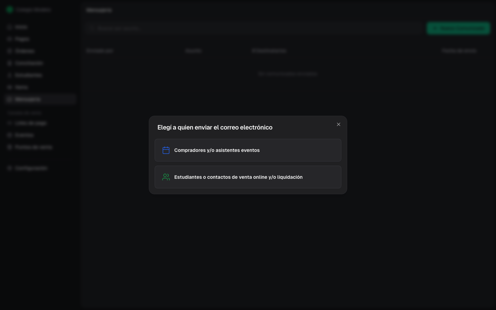
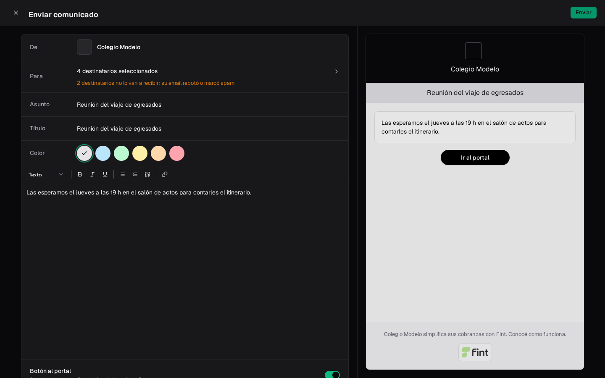
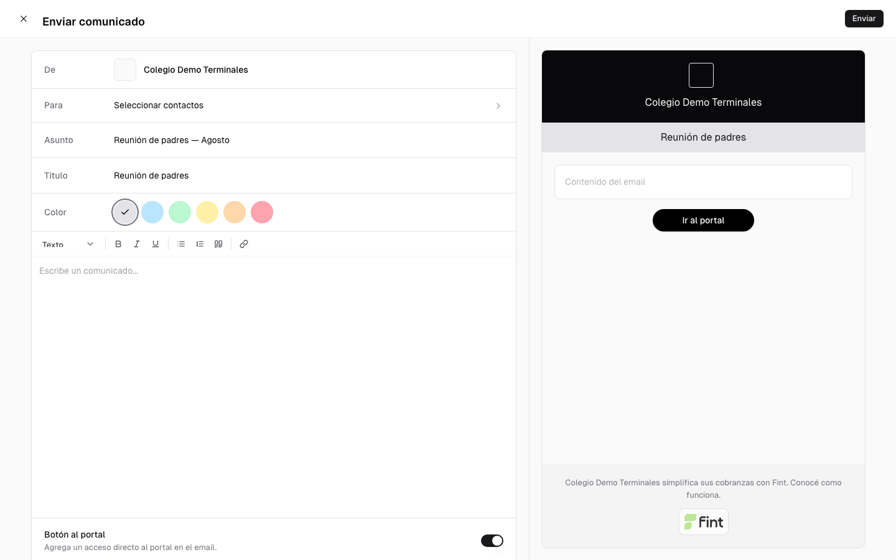
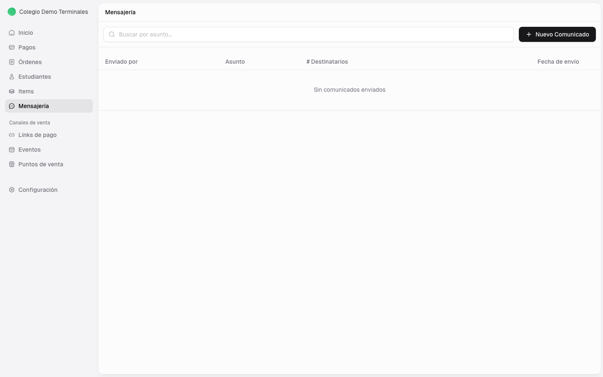
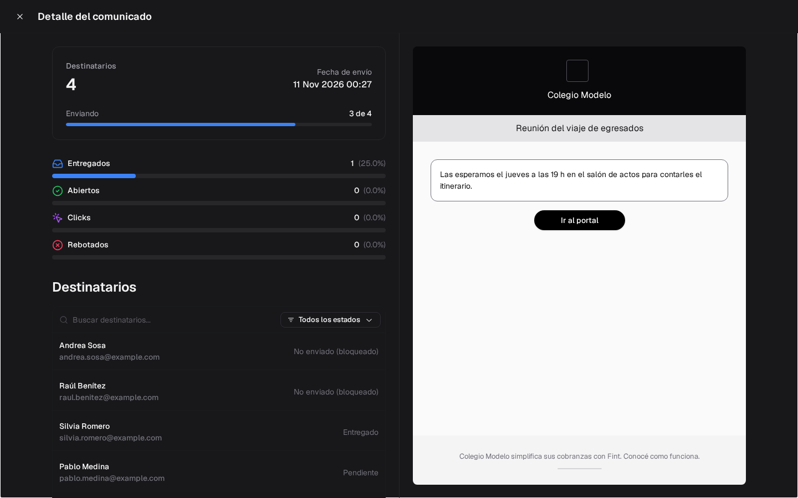
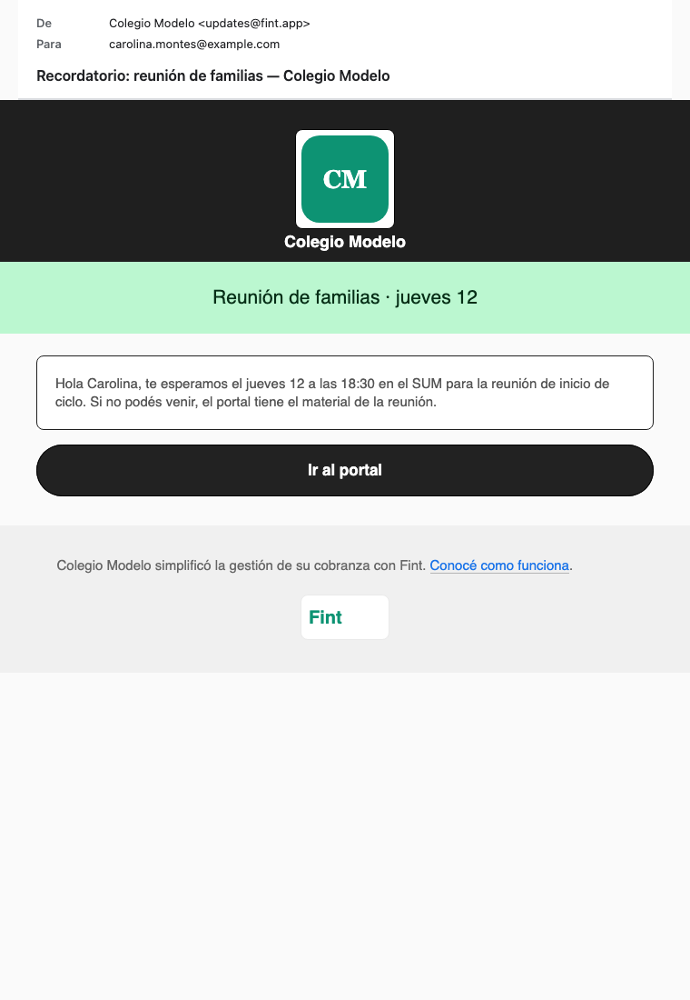

Mensajería sirve para enviar un email a un grupo de personas: estudiantes, sus contactos o gente de un evento.

No reemplaza a los [recordatorios automáticos](/docs/guides/configuracion-recordatorios). Acá el mensaje lo armás vos y lo enviás cuando querés. El compositor vive **en este módulo**: para escribirle a un estudiante o a un grupo, filtrá por etiquetas, items o estado acá.

<Info>
  Los comunicados salen **por email**. Para compartir un archivo, incluí un enlace en el texto.
</Info>

## Elegí a quién enviar

Si tu organización usa Eventos, al tocar **Nuevo Comunicado** Fint pregunta *Elegí a quien enviar el correo electrónico*:

<CardGroup cols={2}>
  <Card title="Estudiantes o contactos de venta online y/o liquidación" icon="users">
    Personas de cobranzas institucionales o de venta online. El nombre cambia si tenés **Cuotas institucionales**.
  </Card>
  <Card title="Compradores y/o asistentes eventos" icon="calendar">
    Asistentes o compradores de un evento.
  </Card>
</CardGroup>

Sin Eventos, el compositor se abre directo para estudiantes o contactos.

<Info>
  Si el estudiante tiene **contactos** (responsables), el mensaje va a cada contacto. Solo si no tiene ningún contacto va al email de su ficha. Un contacto sin email no recibe nada, aunque el estudiante tenga email.
</Info>

Si alguno de los elegidos no tiene email, al enviar aparece **Emails faltantes** con la lista: podés seguir con **Enviar Restantes (N)**. En un evento, los asistentes y compradores sin email no aparecen para elegir.

## Armar el mensaje

<Steps>
  <Step title="Abrí un comunicado nuevo">
    En **Mensajería**, usá **Nuevo Comunicado** y elegí el destino.
  </Step>
  <Step title="Seleccioná destinatarios">
    En estudiantes o contactos podés filtrar por **etiquetas**, **items** o **estado**.

    En eventos los filtros son **por evento** y **por entrada**, y arriba elegís **Asistentes** o **Compradores**. Buscá el evento y usá **Seleccionar resultados** (o **Seleccionar todos**, sin filtros) para elegir a todos de una vez.

    Podés mandar solo a **Compradores**: a cada compra le llega un email. Si elegís compradores y asistentes, y una entrada de esa misma compra tiene el email de quien compró, le llega un solo email: el de la compra.

    Debajo de **Para** se ve cuántos elegiste y, si alguno no lo va a recibir porque su email rebotó o marcó spam, cuántos son. Esas direcciones se revisan en la ficha (ver [Cuando un email no llega](/docs/guides/clientes-familias-responsables#cuando-un-email-no-llega)).

    <Frame>
      
    </Frame>
  </Step>
  <Step title="Completá el contenido">
    Cargá asunto, título, color y texto. A la derecha se ve la vista previa.

    El remitente usa el nombre y el logo de [Configuración](/docs/guides/configuracion-general).

    
  </Step>
  <Step title="Sumá un botón, si sirve">
    En estudiantes o contactos, **Botón al portal** viene prendido con el texto **Ir al portal**; podés cambiar el texto o apagarlo. En eventos, **Entrada QR** suma el código de ingreso de cada asistente (viene apagado).
  </Step>
  <Step title="Revisá y enviá">
    Revisá todo antes de enviar: un comunicado enviado no se edita ni se cancela. Para reutilizar el texto, usá **Duplicar** (no copia los destinatarios).
  </Step>
</Steps>

### Si el envío no sale

Fint te dice qué pasó y qué hacer:

| Mensaje | Qué hacer |
| --- | --- |
| *Podés mandar hasta 20.000 destinatarios por envío. Dividilo en partes.* | Separá el envío, por ejemplo por etiqueta. |
| *Algunos contactos ya no existen. Recargá la página y volvé a elegir los destinatarios.* | Alguien borró a un destinatario mientras armabas el mensaje. |
| *Hay destinatarios sin email. Sacalos de la lista y volvé a intentar.* | Quitá a los que no tienen email. |
| *Elegí al menos un destinatario.* / *Escribí el contenido del comunicado.* | Falta elegir a quién va o escribir el texto. |
| *No pudimos conectarnos al servidor…* | Revisá tu conexión e intentá de nuevo. |

## Después del envío

El listado muestra quién lo envió, el asunto, cuántos destinatarios y la fecha. Arriba podés buscar por asunto.

Al abrir un comunicado ves cuántos **Destinatarios** tiene (los que tienen email), la fecha de envío y cuántos emails fueron **Entregados**, **Abiertos**, con **Clicks** y **Rebotados**.

Un comunicado a cientos o miles de personas no sale de golpe: los emails salen de a poco, unos pocos por segundo, y cada organización tiene su propia fila, así que un envío grande de otra escuela no demora el tuyo. Mientras sale, el detalle muestra **Enviando** con una barra (por ejemplo, *3 de 4*) y se actualiza solo; cuando termina dice **Enviados**. Un solo envío admite hasta 20.000 destinatarios; si necesitás más, dividilo.

<Frame>
  
</Frame>

En **Destinatarios** podés buscar a una persona y filtrar por estado.

El comunicado sale desde **updates.fint.app** (el resto de los mails van por **mail.fint.app**). Así lo ve la familia:

El estado de cada persona puede ser:

| Estado | Qué significa |
| --- | --- |
| **Pendiente** | Todavía no salió (el envío sigue en curso). |
| **En cola** / **Enviado** / **Demorado** | Salió de Fint y el proveedor lo está entregando. |
| **Entregado** / **Abierto** / **Clickeado** | Llegó a la casilla; la persona lo abrió o tocó un link. |
| **Rebotado** | La casilla no lo aceptó. |
| **Marcado como spam** | La persona lo marcó como spam: no recibe más comunicados. |
| **No enviado (bloqueado)** | No se mandó porque esa dirección rebotó antes o marcó spam. |
| **No enviado (error)** | No se pudo mandar. |
| **Sin email** | Esa persona no tiene email. |

## Qué no promete esta guía

- Un tope mensual de envíos: el módulo no tiene cupo propio. El límite, si existe, es del proveedor de email.
- WhatsApp: es otro flujo, no este compositor.

## Próximos pasos

<CardGroup cols={3}>
  <Card title="Recordatorios" icon="bell" href="/docs/guides/configuracion-recordatorios">
    Emails automáticos de vencimiento
  </Card>
  <Card title="Clientes" icon="users" href="/docs/guides/clientes">
    Emails y contactos de cada ficha
  </Card>
  <Card title="Portal de Contacto" icon="house-user" href="/docs/guides/portal-contacto">
    A dónde lleva el botón del email
  </Card>
</CardGroup>
