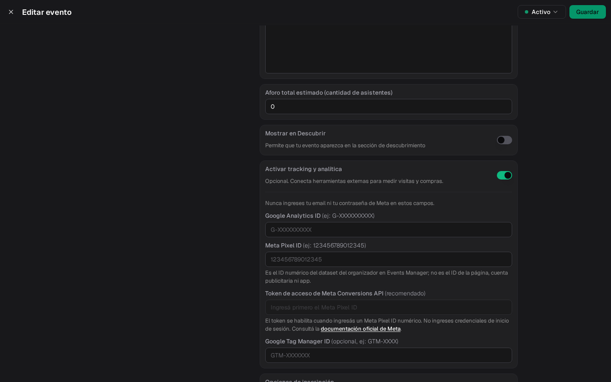

Si promocionás tu evento con Meta Ads (Instagram/Facebook) o campañas de Google, podés conectar tus herramientas de medición directamente a la **página pública del evento**. Fint se encarga de disparar los eventos de conversión — vos solo pegás tu ID.

La configuración es **por evento**: cada evento puede tener su propio píxel y sus propias propiedades de análisis.

## Configurar el tracking

<Steps>
  <Step title="Abrí la configuración del evento">
    En **Eventos**, editá tu evento y entrá a **Configuración**. Cerca del final del panel, después de **Mostrar en Descubrir**, está **Activar tracking y analítica**.

    
  </Step>

  <Step title="Pegá tus IDs">
    Primero prendé **Activar tracking y analítica**: los campos aparecen recién con el interruptor prendido. Después:

    - **Google Analytics ID** (`G-XXXXXXXXXX`), si medís con GA4.
    - **Meta Pixel ID**: solo el número del dataset (Events Manager). No es el ID de la página, de la cuenta publicitaria ni de la app. Tiene que ser numérico.
    - **Token de acceso de Meta Conversions API** (recomendado): se habilita cuando el Pixel ID es numérico. Pegá el token de Events Manager → Dataset → Configuración → Conversions API. Es un campo de contraseña. Sin este token, el **Purchase** del navegador igual se dispara; el envío servidor (CAPI) no.
    - **Google Tag Manager ID** (`GTM-XXXXXX`), opcional.

    No pegues email ni contraseña de Meta.
  </Step>

  <Step title="Guardá">
    Desde ese momento, la página pública del evento carga tus scripts de medición.
  </Step>
</Steps>

## Qué se mide

Con el **Meta Pixel ID** configurado, en el navegador del comprador se disparan:

| Evento de Meta | Cuándo | Datos |
|---|---|---|
| **PageView** | Al entrar a la página pública del evento | — |
| **Purchase** | En la pantalla de confirmación, cuando el pago se acredita | Valor y moneda de la compra y un **ID de transacción único** (la referencia de la compra) |

El ID de transacción evita que una misma compra se cuente dos veces, incluso si el comprador recarga la página de confirmación.

### Aviso de cookies

Con el tracking activado, la página del evento muestra el aviso **Usamos cookies para medir visitas y compras**, con **Solo necesarias** y **Aceptar**. Los scripts de Meta, Google Analytics y Tag Manager se cargan solo si la persona toca **Aceptar**. Después puede cambiar su elección con el botón **Privacidad** de la página.

Con **Google Analytics** se registra la navegación y un evento `purchase` con el monto y la transacción; con **Tag Manager**, el mismo evento `purchase` se empuja al `dataLayer` para que lo uses en tus tags.

## ¿A dónde apunto mis anuncios?

Hay dos formas de armar la campaña, y la atribución funciona distinto en cada una:

### Anuncio → página del evento en Fint (recomendado)

Usá la **URL pública del evento** (`tuinstitucion.fint.app/eventos/mi-evento`) como destino del anuncio. No hay que hacer nada más: Meta agrega automáticamente el parámetro `fbclid` al link, el píxel lo captura al cargar la página, y el **Purchase queda atribuido a la campaña** de punta a punta.

El [link corto del evento](/docs/guides/eventos-crear-publicar#link-corto-y-qr) (`fint.app/e/abc234`) también sirve como destino: pasa a la página el `fbclid` y los parámetros `utm_*` que traiga. Las visitas que entran por el QR del evento llegan con `utm_source=qr` y `utm_medium=qr`, así las separás en Google Analytics.

### Anuncio → tu propia web → página del evento en Fint

Si el anuncio apunta primero a tu sitio (una landing propia) y desde ahí el visitante pasa a Fint, hay un detalle clave: **los parámetros de la campaña no viajan solos entre dominios**. El `fbclid` (y los UTM) quedan en la URL de *tu* web — si el botón "Comprar entradas" linkea a Fint sin ellos, el píxel en la página del evento no puede vincular la compra con el anuncio y la atribución se pierde.

La solución es que tu web **reenvíe los query params** al link de Fint. Si tu página no usa parámetros propios, alcanza con este snippet:

```html
<a id="comprar-entradas" href="https://tuinstitucion.fint.app/eventos/mi-evento">
  Comprar entradas
</a>
<script>
  var link = document.getElementById("comprar-entradas");
  if (window.location.search) {
    link.href += window.location.search;
  }
</script>
```

<Info>
  Lo mínimo indispensable para Meta es propagar **`fbclid`**. Si además medís con Google Analytics, propagá también los parámetros **`utm_*`**. Y si tu web tiene instalado el mismo píxel, mejor: Meta ve el recorrido completo.
</Info>

### ¿Y si no reenvío los parámetros?

Puede que igual veas **algunas** conversiones atribuidas en el Ads Manager: si la persona está logueada en Facebook o Instagram en ese mismo navegador, Meta a veces logra vincular la compra al anuncio por sus propios medios. Pero es una atribución **parcial y cada vez menos confiable** — depende de que el usuario esté logueado y de que el navegador no bloquee las cookies de terceros (Safari y Firefox las bloquean por defecto, y Chrome las está restringiendo).

En la práctica: sin el reenvío de parámetros vas a **subcontar** las conversiones de tus campañas, y no de forma pareja — verás resultados erráticos. El `fbclid` propagado convierte la atribución en determinística. Por eso, si podés elegir, el flujo directo (anuncio → página del evento) es siempre la opción más confiable.

## Verificar que funciona

1. Instalá la extensión [Meta Pixel Helper](https://chrome.google.com/webstore/detail/meta-pixel-helper/fdgfkebogiimcoedlicjlajpkdmockpc) en Chrome, entrá a la página pública de tu evento y tocá **Aceptar** en el aviso de cookies: deberías ver el **PageView** de tu píxel.
2. Hacé una compra de prueba y verificá el **Purchase** en la pantalla de confirmación.
3. En el Administrador de eventos de Meta, los eventos aparecen en **"Probar eventos"** y en el resumen del píxel.

## Próximos Pasos

<CardGroup cols={3}>
  <Card title="Eventos" icon="calendar" href="/docs/guides/eventos">
    Creá y publicá tu evento
  </Card>
  <Card title="App de Admisión" icon="qrcode" href="/docs/guides/app-admision">
    El día del evento
  </Card>
  <Card title="Mensajería" icon="envelope" href="/docs/guides/mensajeria">
    Comunicate con los asistentes
  </Card>
</CardGroup>
