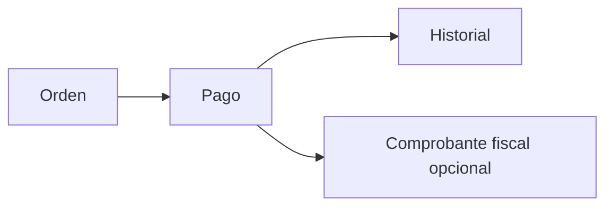
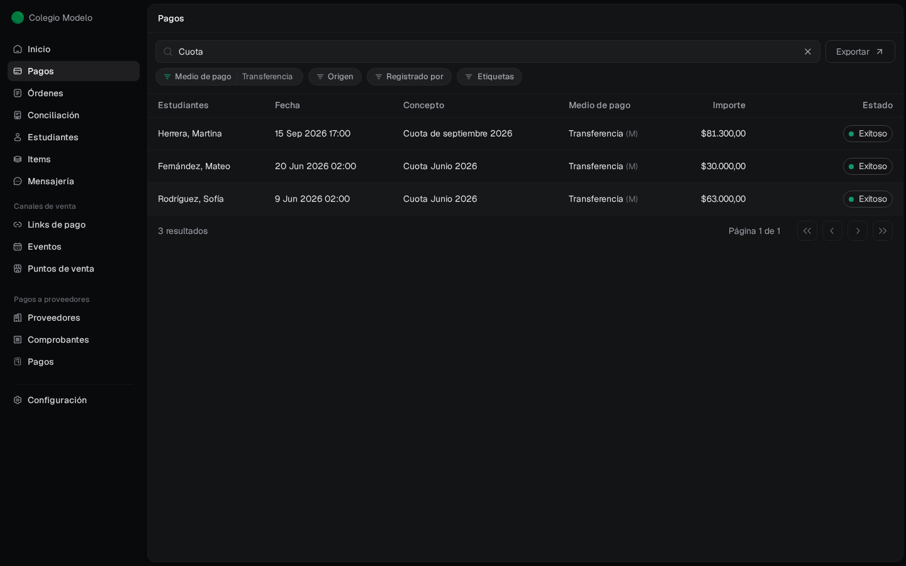
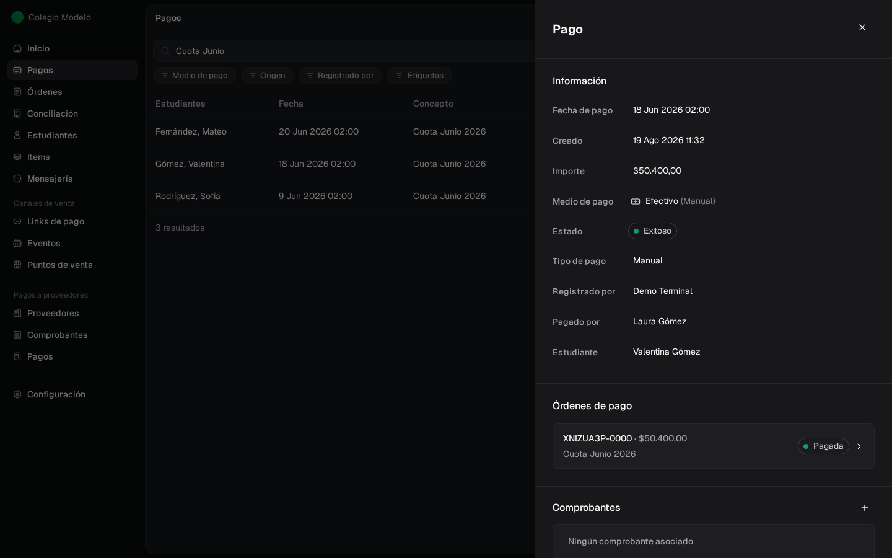
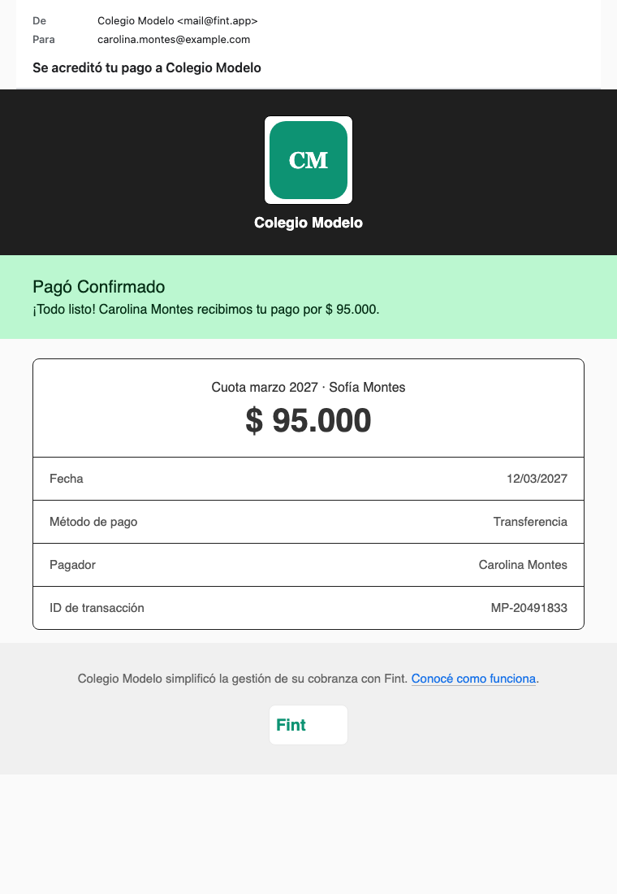
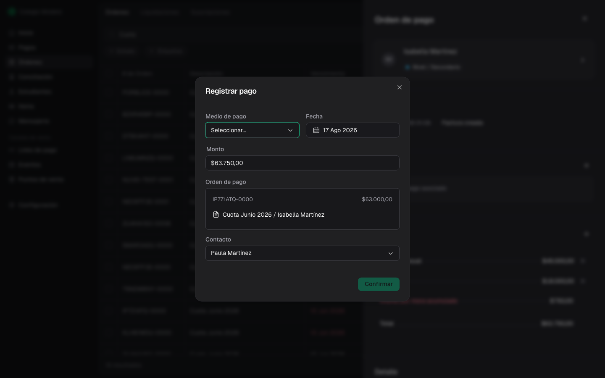
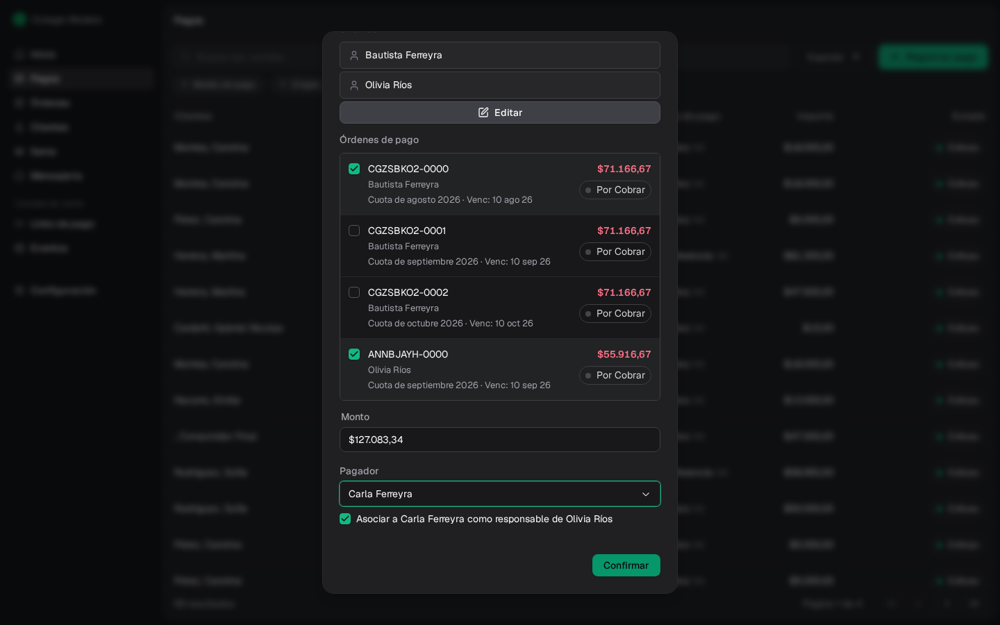
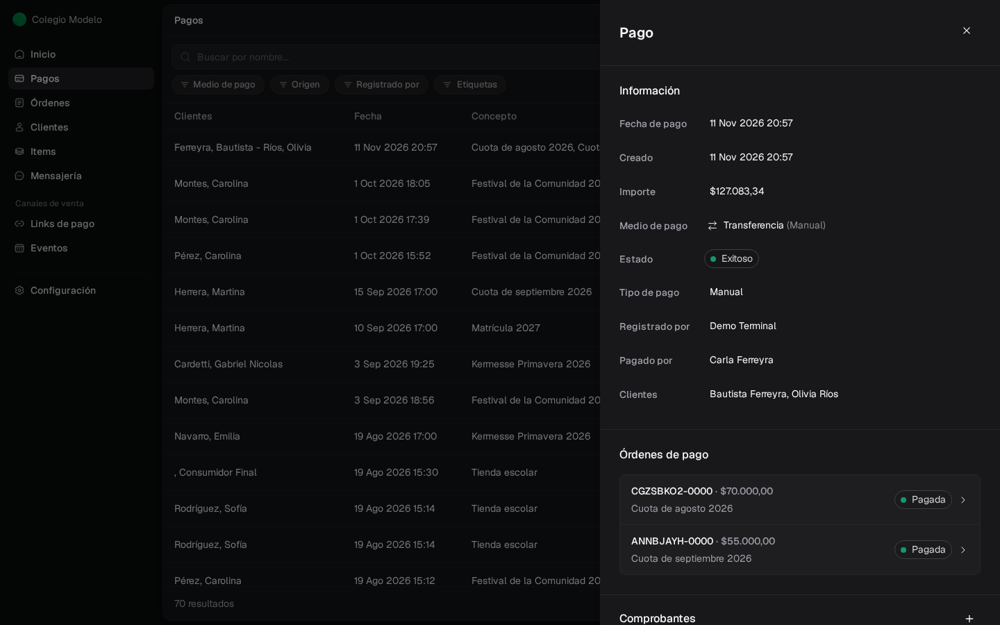
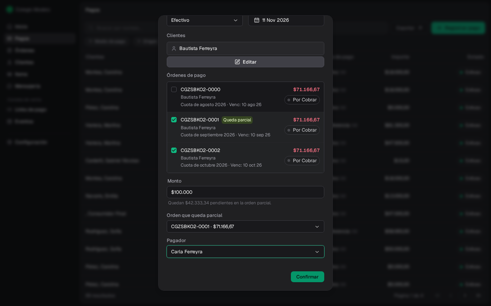

Pagos es el historial de lo que ya **entró**. Una [orden](/docs/guides/solicitudes-pago) registra lo que hay que cobrar; un pago registra el cobro, ya sea online o cargado a mano.

Una transferencia **informada** en el portal no aparece acá hasta que la imputás. Un cupón de Rapipago o Pago Fácil tampoco: el pago nace cuando el medio acredita.

<Info>
  Esta guía describe la vista **Administrador**. Registrar, eliminar y exportar son acciones administrativas.
</Info>

## Cómo se organiza

<CardGroup cols={3}>
  <Card title="Listado" icon="list">
    Buscá por cliente, concepto o referencia y filtrá por medio, origen, quién lo registró o etiquetas.
  </Card>
  <Card title="Detalle" icon="receipt">
    Abrí un pago para ver importe, medio, estado, quién pagó y las órdenes cubiertas.
  </Card>
  <Card title="Exportar" icon="file-export">
    Descargá Excel o PDF eligiendo un rango y si filtrás por la fecha del cobro o por la de registro.
  </Card>
</CardGroup>

El comprobante fiscal no nace con el pago. Si tu organización usa ARCA, se gestiona después desde [Facturación](/docs/guides/facturacion).

## Listado

El listado muestra cliente, fecha, concepto, medio de pago, importe y estado. Los pagos cargados a mano se distinguen con **(M)** junto al medio. Con ARCA, pueden aparecer pastillas **F** (factura), **R** (recibo), **NC** y **ND**. El alta del comprobante es en el detalle del pago, sección **Comprobantes**, no en un módulo aparte. Ver [Facturación](/docs/guides/facturacion).

Si una familia te pagó varias cuotas o las de varios hermanos con una sola transferencia, cargalo con **Registrar pago**, arriba a la derecha del listado. Ver [Registrar un pago para varias órdenes](#registrar-un-pago-para-varias-órdenes).

El buscador recorre el nombre del cliente, el concepto, la descripción y la referencia del pago.

También podés filtrar por:

- **Medio de pago**
- **Origen**: Manual u Online
- **Registrado por**, cuando el pago es manual
- **Etiquetas** del cliente

### Estados

<CardGroup cols={3}>
  <Card title="Exitoso" icon="check-circle">
    El pago quedó acreditado. Es el estado habitual de un cobro confirmado.
  </Card>
  <Card title="Reembolsado" icon="rotate-left">
    El procesador devolvió el pago completo.
  </Card>
  <Card title="Contracargo" icon="exclamation-triangle">
    El pagador desconoció el cobro ante su tarjeta.
  </Card>
</CardGroup>

## Detalle del pago

Al hacer clic en una fila se abre el detalle. La información cambia según el origen:

<Tabs>
  <Tab title="Pago manual">
    Muestra la fecha del cobro, la fecha en que se registró en Fint, el importe, el medio con la marca Manual, el estado, quién lo registró, quién pagó y el cliente asociado. Si el pago salió de conciliar un movimiento del banco, también muestra el número del **Movimiento**.

    También lista las **órdenes de pago** cubiertas, con el importe imputado a cada una.

    

    Si el pago se cargó por error, usá **Eliminar pago manual**. Eso revierte el cobro y vuelve a dejar pendiente lo imputado a las órdenes. Si el pago cubría entradas de un [evento](/docs/guides/eventos), esas entradas se cancelan.

    Si el pago salió de [conciliar un movimiento del banco](/docs/guides/conciliacion-bancaria), al eliminarlo el movimiento también se libera: vuelve a **Con sugerencias** (o **En revisión**) y lo podés conciliar de nuevo. Si esa conciliación había creado la orden, la orden queda **Por Cobrar**: se borró el pago, no la orden.

    <Warning>
      Solo se pueden eliminar pagos **manuales**. Si el pago tiene una factura o un recibo de ARCA vigente, primero emití una [nota de crédito](/docs/guides/facturacion#nota-de-crédito-a-mano) por cada comprobante desde **Comprobantes**. Con todos anulados, eliminalo desde la orden a la que se aplicó: abrí la orden en **Órdenes** y, en **Pagos**, tocá **⋯ → Eliminar pago manual**. Después lo podés volver a cargar, por ejemplo con la fecha correcta. Si un movimiento del banco está **vinculado** a este pago (se vinculó a un pago que ya existía), primero desvinculalo desde Conciliación con **Acciones → Desvincular pago**.
    </Warning>

    Cuando un pago no se puede eliminar, el aviso dice el motivo.
  </Tab>

  <Tab title="Pago online">
    Muestra la fecha de procesamiento, el importe, el medio, el estado, la referencia del procesador, quién pagó y el cliente asociado.

    También lista las órdenes cubiertas.

    <Info>
      Los pagos online no se eliminan desde Fint. El estado cambia cuando el procesador informa un reembolso o un contracargo.
    </Info>
  </Tab>
</Tabs>

Cuando el cobro queda **Exitoso**, la familia puede recibir este mail. El asunto es *Se acreditó tu pago a [colegio]*.

## Registrar un pago manual

Usalo para un cobro en efectivo, transferencia u otro medio que no pasó por el checkout online.

<Steps>
  <Step title="Abrí la orden">
    Entrá desde [Órdenes](/docs/guides/ordenes-gestionar) o desde el perfil del cliente.
  </Step>
  <Step title="Cargá el cobro">
    En la sección **Pagos** del detalle, usá **+**. Completá medio, fecha y monto. El monto viene precargado con el total pendiente, mora incluida, y podés bajarlo para un **pago parcial**. También elegís qué contacto realizó el pago.

    
  </Step>
  <Step title="Confirmá">
    El pago aparece en el historial y la orden actualiza su pendiente.
  </Step>
</Steps>

<Info>
  En un pago parcial, el dinero cubre primero el capital. La mora recién se cobra cuando el capital queda cubierto. Si la orden ya estaba vencida, Fint congela la mora acumulada en ese momento para que no siga corriendo sobre lo ya pagado.
</Info>

## Registrar un pago para varias órdenes

Cuando una sola transferencia o un solo pago en efectivo cubre varias órdenes, de uno o de varios alumnos, cargalo una sola vez. Queda un único pago, con todas las órdenes que cubre.

<Steps>
  <Step title="Abrí Registrar pago">
    En **Pagos**, tocá **Registrar pago** arriba a la derecha. Elegí el medio y la fecha del cobro.
  </Step>
  <Step title="Elegí los alumnos y tildá las órdenes">
    En **Clientes**, tocá **Seleccionar** y buscá a cada alumno por nombre o documento. Aparecen todas sus órdenes pendientes. El importe en rojo incluye la mora calculada a la fecha del pago; si cambiás la fecha, se recalcula.

    El monto se completa con el total de lo que tildaste.
  </Step>
  <Step title="Elegí quién pagó">
    En **Pagador** aparecen primero los responsables de los alumnos y después el resto de los contactos. Si elegís a alguien que no es responsable de alguno de los alumnos, Fint te ofrece **asociarlo como responsable**. La casilla viene tildada y la asociación se hace al confirmar.

    
  </Step>
  <Step title="Confirmá">
    El pago aparece en el listado con todos los alumnos y, en su detalle, la lista de órdenes que cubrió.

    
  </Step>
</Steps>

### Si el monto no alcanza para todas

Si escribís un monto menor al total, las órdenes se pagan completas salvo una, que queda **parcial**. Cuando más de una puede quedar parcial, elegís cuál en **Orden que queda parcial**. Debajo del monto ves cuánto va a quedar pendiente.

La orden que queda parcial guarda la mora a la fecha del pago, igual que cuando cargás un pago parcial de una sola orden.

<Info>
  No se puede pagar más que el total de lo tildado. El monto tampoco puede ser tan bajo que no alcance para pagar completas las demás órdenes: en ese caso, destildá alguna. El pagador tiene que ser responsable de al menos uno de los alumnos, o tenés que dejar tildada la casilla para asociarlo. Las órdenes de eventos no aparecen en esta lista.
</Info>

## Devoluciones y contracargos

Las devoluciones se gestionan en el **procesador** (Mercado Pago, Stripe, Pagos Online u otro conectado). Fint escucha esos eventos y actualiza el pago:

- **Reembolso**: si el procesador devuelve el pago completo, el pago pasa a **Reembolsado** y la orden vuelve a tener ese saldo pendiente. Si el pago era de entradas de un evento, las entradas se cancelan. Un reembolso **parcial** no cambia el pago en Fint.
- **Contracargo**: el pago pasa a Contracargo.

Lo mismo vale para las ventas del [Punto de Venta](/docs/guides/pos-cobros). Si el cobro ya tiene factura, primero emití una [nota de crédito](/docs/guides/facturacion#nota-de-crédito-a-mano).

## Exportar

**Exportar** abre un modal para elegir el rango **Desde / Hasta** y el tipo de fecha:

- **En la que se ejecutó el pago**: la fecha real del cobro
- **En la que se creó el pago**: la fecha de registro en Fint

Podés descargar **Exportar Excel** o **Exportar PDF**. Las fechas del Excel están en hora de Argentina.

Si el Excel tiene más de 5.000 pagos, no se descarga en el momento: Fint lo arma en segundo plano y te lo manda al email de tu usuario: el asunto es *Tu Excel de pagos está listo* y trae el botón **Descargar Excel**. En pantalla aparece el aviso *Es un archivo grande, así que te lo mandamos por mail a …*. Si pedís otro mientras se arma el primero, Fint no arma uno nuevo y te avisa que ya está en camino. Con un rango demasiado grande, Fint te pide un período más corto o más filtros.

<Info>
  En un pago manual, la fecha de ejecución puede ser distinta de la de registro. Por ejemplo, recibiste el dinero el 1 de marzo y lo cargaste el 5.
</Info>

La exportación usa ese rango y, si llegaste al listado desde un evento, también respeta ese recorte. No copia los filtros de medio, origen o etiquetas que tengas activos en la tabla.

## Próximos pasos

<CardGroup cols={2}>
  <Card title="Cobrar en Fint" icon="wallet" href="/docs/guides/cobrar-en-fint">
    Elegí portal, carga manual u otro canal
  </Card>
  <Card title="Gestionar Órdenes" icon="file-invoice" href="/docs/guides/ordenes-gestionar">
    Revisá deudas y registrá el cobro desde la orden
  </Card>
  <Card title="Portal de Contacto" icon="house-user" href="/docs/guides/portal-contacto">
    Cómo pagan las familias sin que vos cargues el cobro
  </Card>
  <Card title="Facturación" icon="file-lines" href="/docs/guides/facturacion">
    Emití el comprobante fiscal sobre el pago
  </Card>
</CardGroup>
