En **Comprobantes** cargás lo que te facturan tus proveedores: facturas, notas de crédito y de débito, tickets, recibos y gastos sin comprobante. Todo entra **Por revisar** y recién cuando lo aprobás cuenta en la cuenta corriente del proveedor: una factura, nota de débito, ticket o gasto suma deuda; una nota de crédito queda como crédito a favor del colegio, y un recibo no cambia el saldo. Necesitás ser **Administrador**.

## Estados de un comprobante

| Estado | Qué significa |
| --- | --- |
| **Faltan datos** | Subiste el archivo pero falta algún dato obligatorio. No se puede aprobar hasta completarlo. |
| **Por revisar** | Tiene todos los datos. Todavía no cuenta como deuda. |
| **Por pagar** | Aprobado. La deuda está en la cuenta corriente del proveedor. |
| **Pago parcial** | Aprobado y pagado en parte. |
| **Pagado** | Aprobado y saldado. |
| **Anulado** | Se dio de baja. Conserva su historia pero no cuenta como deuda. |

Las pestañas **Todos**, **Por revisar**, **Por pagar** y **Pagados** (y **Anulados**, cuando hay alguno) separan cada grupo.

## Subir un comprobante

<Steps>
  <Step title="Elegí el archivo">
    Tocá **Subir comprobante** y arrastrá el PDF o la foto, o hacé clic para elegirlo. Podés subir hasta 20 archivos por vez, de hasta 20 MB cada uno (PDF, JPG o PNG). Cada archivo tiene que ser un solo comprobante: si un PDF reúne varias facturas, separalas antes de subirlas.
  </Step>
  <Step title="Fint lee los datos">
    Lee proveedor, tipo, número, fechas e importes y deja el comprobante en **Por revisar**. Si no encontró algún dato obligatorio, queda en el grupo **Faltan datos**.
  </Step>
</Steps>

<Frame>
  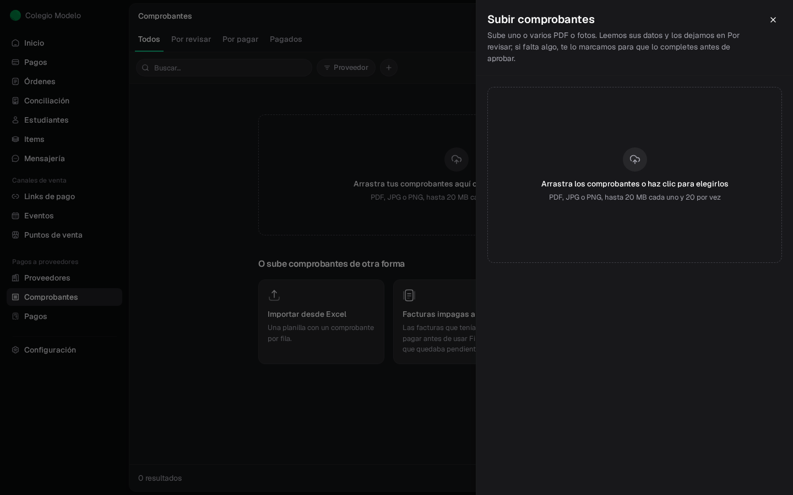
</Frame>

La subida sigue aunque cierres el panel. Un aviso te dice cuántos quedaron en **Por revisar** y cuántos necesitan que completes datos. Si un archivo ya estaba cargado, te lo avisa y no lo duplica.

Desde la ficha de un proveedor, **Subir comprobante** hace lo mismo y sugiere ese proveedor si el archivo no trae el CUIT.

## Completar y revisar

Abrí el comprobante desde **Por revisar**. A la izquierda ves el archivo y a la derecha el formulario, para controlar uno contra el otro.

<Frame>
  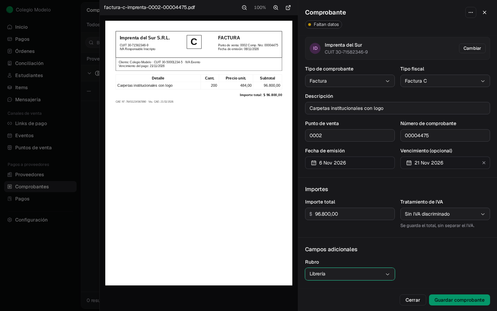
</Frame>

- **Proveedor**: si el proveedor todavía no está cargado, Fint te lo muestra como sugerencia y podés crearlo desde ahí con **Crear proveedor**.
- **Tipo de comprobante**: Factura, Nota de crédito, Nota de débito, Ticket, Gasto sin comprobante o Recibo de pago. En facturas y notas elegís también el **Tipo fiscal** (facturas A, B, C o M; notas de crédito y de débito A, B o C), el **Punto de venta** y el **Número de comprobante**.
- **Fecha de emisión**, **Vencimiento** y **Descripción**.
- **Importes**: el **Importe total** y, si tu organización pide el desglose, el **Tratamiento de IVA**. En una factura A cargás neto gravado, no gravado, exento y cada impuesto o percepción. Fint te avisa si la suma **Coincide con el importe total**.
- **Campos adicionales**, como el **Rubro**.

<Frame>
  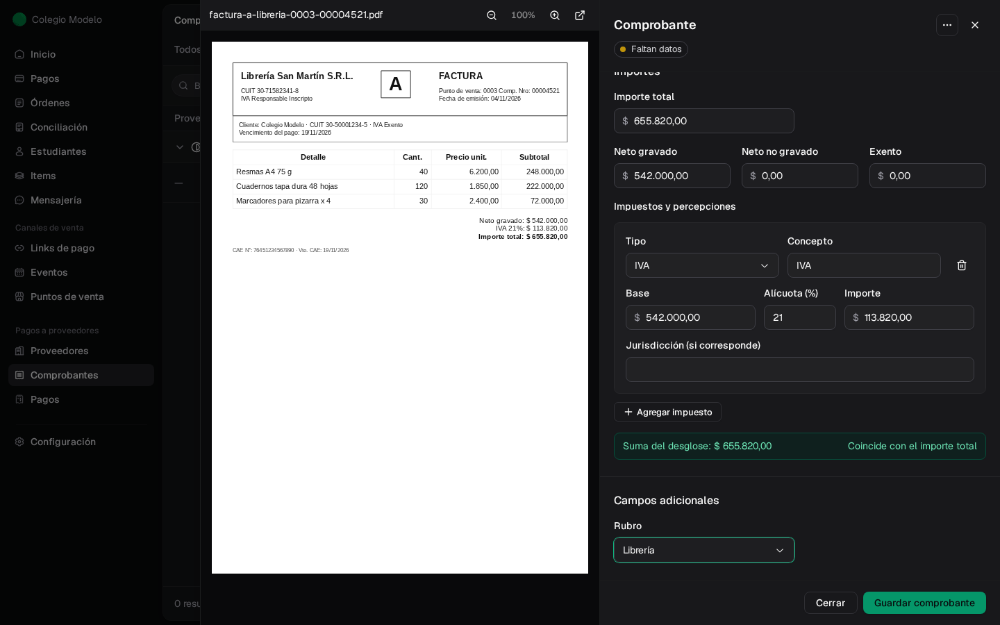
</Frame>

Tocá **Guardar comprobante**. Si estaba en **Faltan datos**, pasa a **Por revisar**.

<Info>
  Una **nota de crédito** aprobada queda como crédito a favor del colegio; se usa al pagar otras facturas. Un **recibo de pago** respalda un pago y no suma deuda. Ver [Anticipos y créditos](/docs/guides/proveedores-creditos).
</Info>

Mientras está **Por revisar** podés cambiar cualquier dato; **Guardar cambios** los confirma y **Descartar cambios** los deshace. Si un archivo no corresponde, en el menú **⋯** elegí **Descartar**: sale de Por revisar sin guardarse como comprobante.

<Frame>
  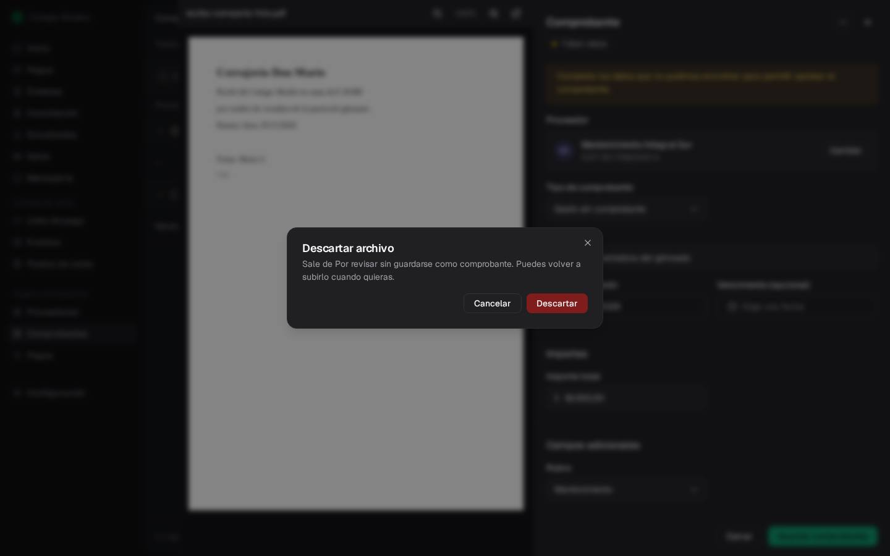
</Frame>

### Comprobante parecido

Si cargás un comprobante sin número fiscal (un ticket o un gasto) del mismo proveedor, tipo, fecha, moneda e importe que otro ya subido, Fint te frena antes de guardarlo. Abrí el existente para compararlo. Si es otra operación, marcá la confirmación y tocá **Crear otro comprobante distinto**; si es el mismo, **Volver a la subida** y descartalo.

<Frame>
  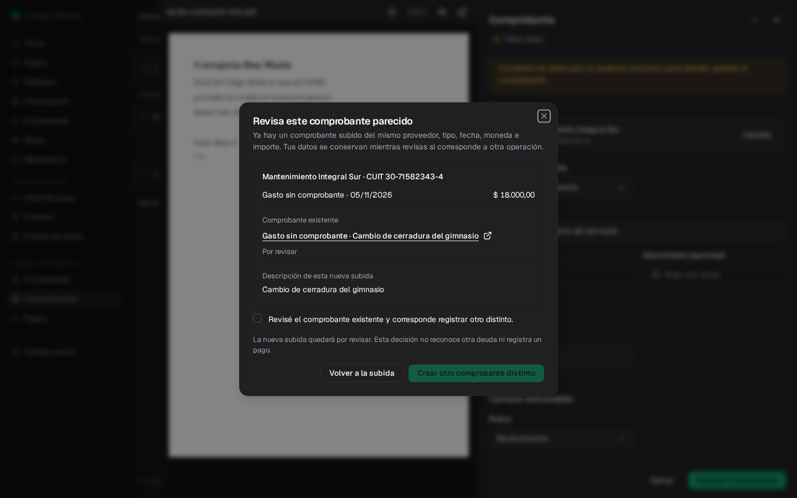
</Frame>

Con facturas y notas, el número fiscal ya evita duplicados: no se puede cargar dos veces un comprobante con el mismo CUIT del emisor, tipo fiscal, punto de venta y número, aunque ese CUIT esté en dos fichas de proveedor. Una factura y una nota de crédito sí pueden compartir punto de venta y número, porque su tipo fiscal es distinto.

## Aprobar

Con el comprobante revisado, tocá **Aprobar comprobante** (o elegilo en el menú **⋯** de la fila). Si cambiaste algo, primero **Guardar cambios**.

<Frame>
  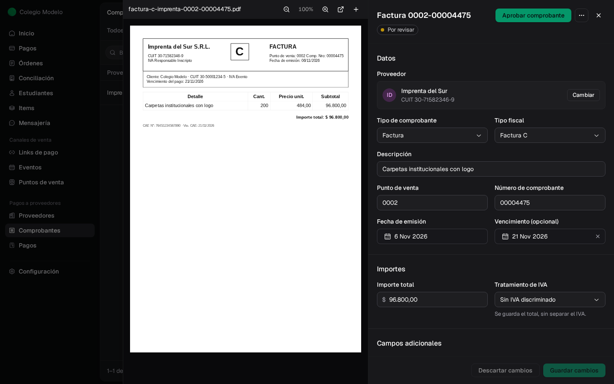
</Frame>

Una factura, nota de débito, ticket o gasto pasa a **Por pagar** y su importe suma a la deuda del proveedor. Una nota de crédito aprobada queda como crédito a favor y un recibo no cambia el saldo (ver el aviso de [Completar y revisar](#completar-y-revisar)).

<Frame>
  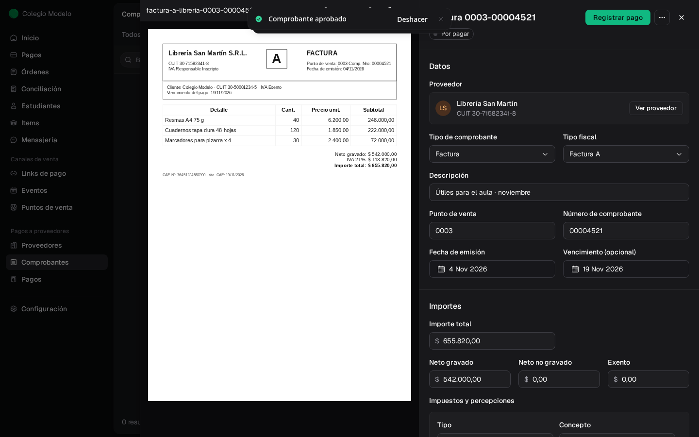
</Frame>

¿Te equivocaste? El aviso **Comprobante aprobado** tiene **Deshacer** durante unos segundos, y el comprobante vuelve a **Por revisar**.

Un comprobante aprobado ya no se edita. Si los importes estaban mal, usá **Corregir importes** desde su menú **⋯**: ver [Cuenta corriente](/docs/guides/proveedores-cuenta-corriente). Para pagarlo, **Registrar pago**: ver [Registrar pagos](/docs/guides/proveedores-pagos).

## Archivos y actividad

Al final del comprobante están sus **Pagos** (una vez aprobado), sus **Archivos** y la **Actividad**. Con **+** en Archivos adjuntás otro documento (por ejemplo, el remito). En Actividad ves quién lo cargó, lo aprobó o le adjuntó archivos, y podés dejar una nota. Para quitar un archivo o borrar una nota, ver [Archivos y notas](/docs/guides/proveedores-directorio#archivos-y-notas).

<Frame>
  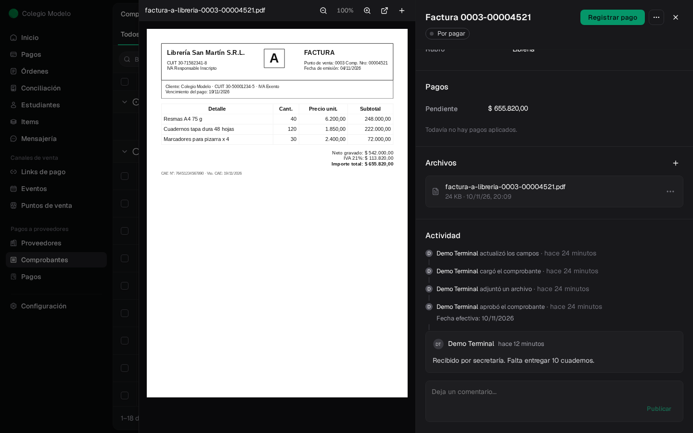
</Frame>

## Anular un comprobante

Si un comprobante se cargó por error, en su menú **⋯** elegí **Anular comprobante**. Podés dejar un motivo. Deja de contar como deuda desde hoy y conserva su historia.

<Frame>
  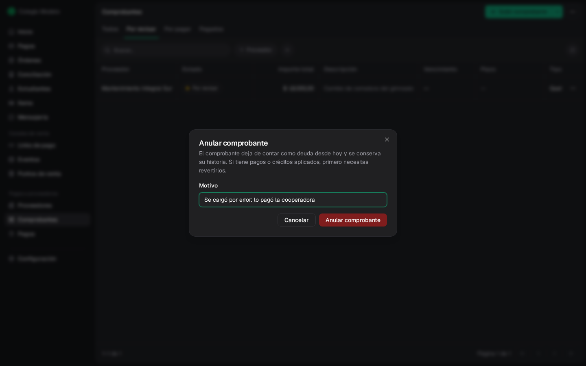
</Frame>

Si el comprobante ya tiene pagos o créditos aplicados, primero hay que revertirlos. Una nota de crédito con un reintegro registrado tampoco se anula: si el reintegro fue un error, [corregilo](/docs/guides/proveedores-creditos#registrar-un-reintegro) primero. Los anulados quedan en la pestaña **Anulados**.

<Frame>
  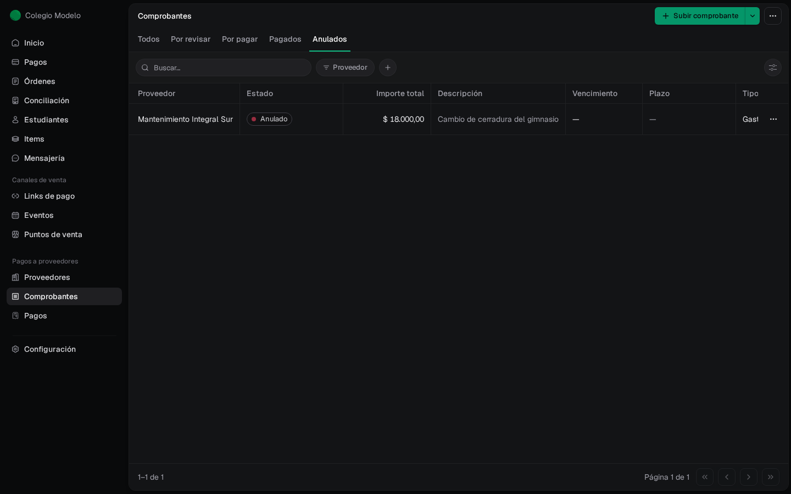
</Frame>

## Encontrar comprobantes

- **Buscar…** por número, descripción o proveedor.
- **Proveedor** filtra por uno; **+** agrega filtros por moneda, si tiene adjunto, fechas de emisión o vencimiento, o un campo como el **Rubro**.
- En **Todos**, el botón de vista permite **Agrupar por** estado o vencimiento (vencidos, vencen hoy, próximos 7 días) y **Ordenar por** vencimiento, fecha de emisión, importe o carga más reciente.

<Frame>
  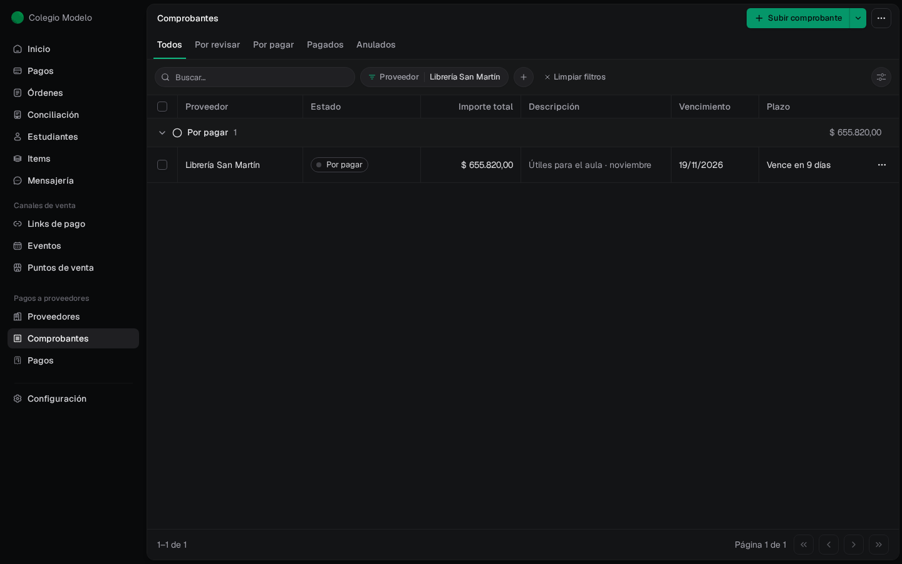
</Frame>

Para cargar muchos comprobantes desde una planilla, ver [Importar desde Excel](/docs/guides/proveedores-importaciones).

## Preguntas frecuentes

<AccordionGroup>
  <Accordion title="Subí una factura y no aparece en la cuenta corriente">
    Todavía no está aprobada. Buscala en **Por revisar** y tocá **Aprobar comprobante**.
  </Accordion>
  <Accordion title="No puedo aprobar un comprobante">
    Le faltan datos (grupo **Faltan datos**) o tiene cambios sin guardar. Completá lo marcado y tocá **Guardar comprobante** o **Guardar cambios**. Si el comprobante muestra el aviso **Comprobante anterior a la fecha de corte de los saldos**, es un registro histórico: su deuda ya está en el [saldo anterior](/docs/guides/proveedores-saldos-anteriores) y no se aprueba.
  </Accordion>
  <Accordion title="Cargué una factura en dólares">
    Elegí la moneda **USD** y cargá la cotización acordada y su fecha. La deuda queda en pesos; el importe en dólares es informativo. Si no ves la opción, habilitá USD en **Configurar campos → Moneda**.
  </Accordion>
  <Accordion title="No me deja anular una factura">
    Tiene pagos o créditos aplicados. Revertilos primero desde la orden de pago o el crédito. Si es una nota de crédito con un reintegro registrado por error, corregí antes el reintegro.
  </Accordion>
</AccordionGroup>
