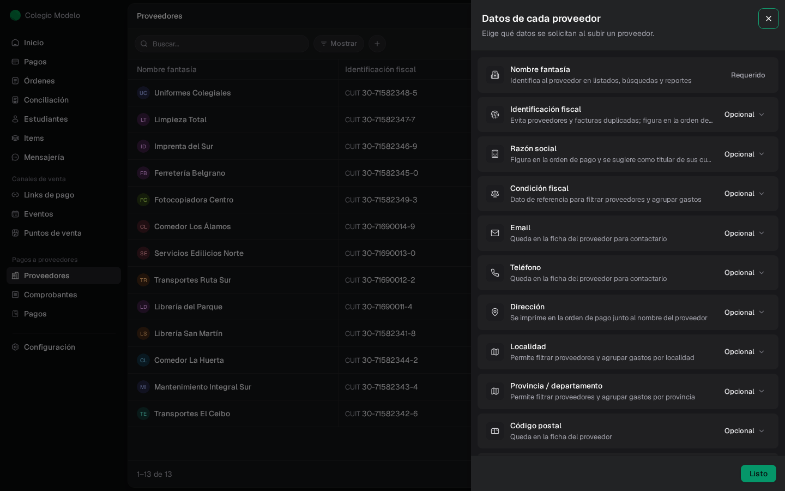
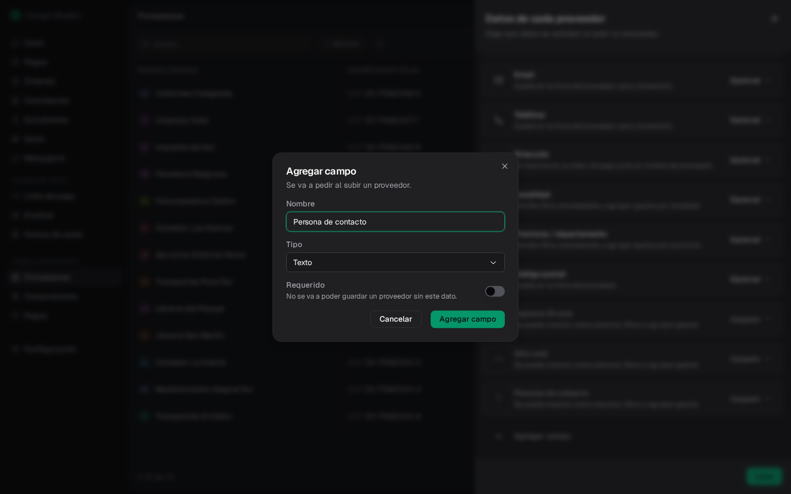
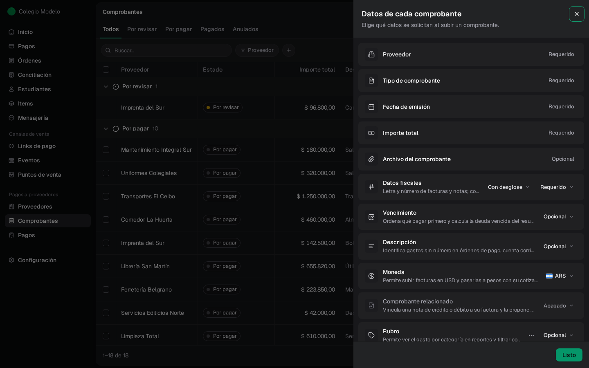
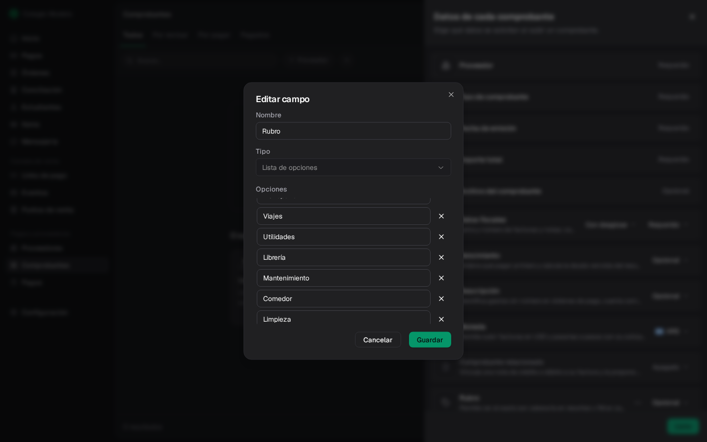
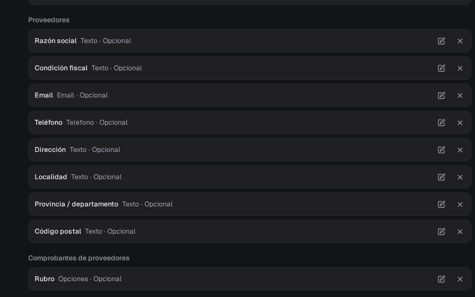
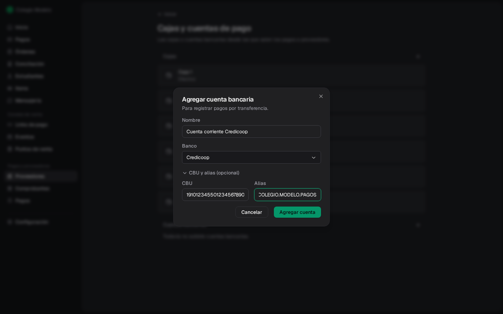
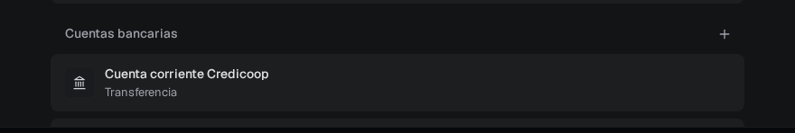

Antes de cargar en cantidad conviene decidir dos cosas: **qué datos** querés guardar de cada proveedor y de cada comprobante, y **desde dónde pagás** (cajas de efectivo y cuentas bancarias). Todo se puede cambiar después. Necesitás ser **Administrador**.

## Datos de cada proveedor

En **Proveedores**, abrí el menú **⋯** (arriba a la derecha) y elegí **Configurar campos**.

<Frame>
  
</Frame>

- **Nombre fantasía** siempre se pide: identifica al proveedor en listados, búsquedas y reportes.
- Cada uno de los demás datos tiene tres estados: **Requerido** (no se puede guardar un proveedor sin él), **Opcional** o **Apagado** (no aparece en el formulario).
- **Identificación fiscal** (CUIT, RUT u otra) evita proveedores y facturas duplicadas y figura en la orden de pago.
- **Razón social** y **Dirección** también se imprimen en la orden de pago. La razón social se sugiere como titular de sus cuentas bancarias.

Los cambios se guardan solos; **Listo** cierra el panel.

<Info>
  Si importás proveedores desde Excel y la planilla trae localidad, provincia o código postal, esos datos se guardan y el campo queda activo aunque antes estuviera apagado.
</Info>

### Agregar un dato propio

Al final del panel, **Agregar campo** crea un dato que tu organización necesita y Fint no trae, por ejemplo la persona de contacto o el número de Ingresos Brutos. Elegís el nombre, el tipo (texto, número, fecha, lista de opciones, selección múltiple, sí/no, email, teléfono, link o importe) y si es **Requerido**.

<Frame>
  
</Frame>

Los campos que agregás aparecen en el formulario del proveedor y se pueden buscar, filtrar y mostrar como columna en el listado. Desde su menú **⋯** los podés **Editar** o **Eliminar**.

## Datos de cada comprobante

En **Comprobantes**, menú **⋯** → **Configurar campos**.

<Frame>
  
</Frame>

- **Proveedor**, **Tipo de comprobante**, **Fecha de emisión** e **Importe total** siempre se piden. El **Archivo del comprobante** es opcional.
- **Datos fiscales**: letra y número de facturas y notas. A su lado elegís **Con desglose** (se carga neto gravado, IVA y percepciones) o **Sin desglose** (solo el total).
- **Vencimiento**: ordena qué pagar primero y marca lo vencido.
- **Descripción**: identifica gastos sin número en órdenes de pago y búsquedas.
- **Moneda**: sumá **USD** si recibís facturas en dólares. La deuda se registra en pesos con la cotización que cargues; el importe en dólares queda como referencia.
- **Comprobante relacionado**: vincula una nota de crédito o débito con su factura.
- **Rubro**: una lista de opciones para ver el gasto por categoría y filtrar comprobantes. Desde su menú **⋯ → Editar** agregás o quitás opciones.

<Frame>
  
</Frame>

## Los mismos campos en Configuración

Los campos de proveedores y comprobantes también aparecen en **Configuración → Campos personalizados**, en las secciones **Proveedores** y **Comprobantes de proveedores**. Son los mismos: lo que cambies en un lugar se ve en el otro. Ver [Campos personalizados](/docs/guides/configuracion-campos).

<Frame>
  
</Frame>

## Cajas y cuentas de pago

Al registrar un pago elegís de dónde salió la plata: una **caja** (efectivo) o una **cuenta bancaria** (transferencia). Para verlas, entrá a **Pagos**, menú **⋯** → **Cajas y cuentas de pago**.

- **Cajas**: son las cajas de la organización, las mismas del [Punto de venta](/docs/guides/pos-cajas-dispositivos). Con **+** agregás una nueva escribiendo su nombre.
- **Cuentas bancarias**: con **+** agregás una cuenta con su nombre, banco y, si querés, CBU y alias.

<Frame>
  
</Frame>

<Frame>
  
</Frame>

Las cuentas que ya cargaste en **Conciliación** también sirven: editá la cuenta y prendé **Usar para pagar proveedores**. Ver [Cuentas bancarias](/docs/guides/conciliacion-bancaria-cuentas).

<Info>
  Las cajas y cuentas de pago son de tu organización. Las cuentas bancarias **de cada proveedor** (adonde le transferís) se cargan en su ficha: ver [Cuentas de destino](/docs/guides/proveedores-directorio#cuentas-de-destino).
</Info>

## Próximos pasos

<CardGroup cols={3}>
  <Card title="Proveedores" icon="building" href="/docs/guides/proveedores-directorio">
    Cargá tu primer proveedor.
  </Card>
  <Card title="Comprobantes" icon="file-invoice" href="/docs/guides/proveedores-comprobantes">
    Subí y aprobá facturas.
  </Card>
  <Card title="Importar desde Excel" icon="file-excel" href="/docs/guides/proveedores-importaciones">
    Traé todo de una planilla.
  </Card>
</CardGroup>
