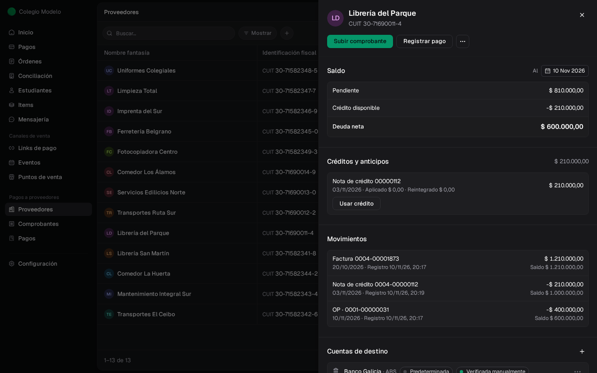
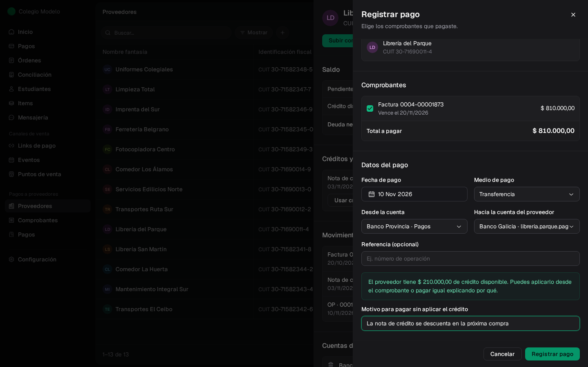
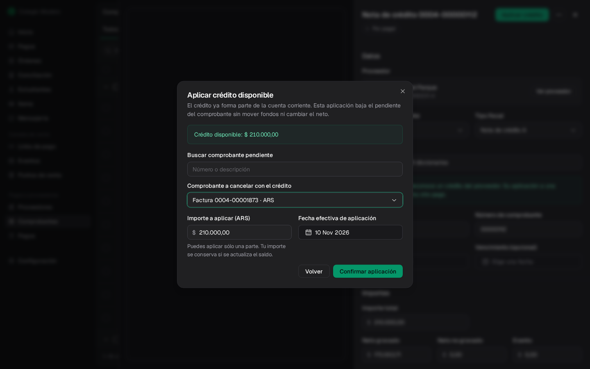
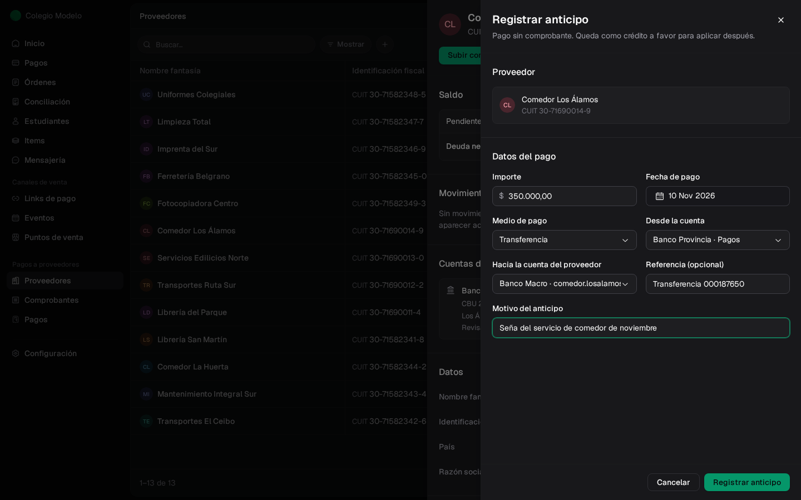
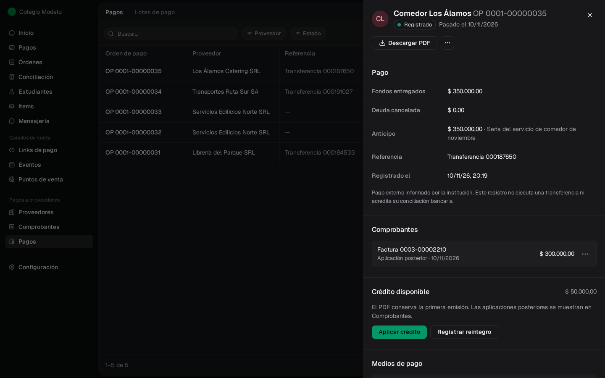
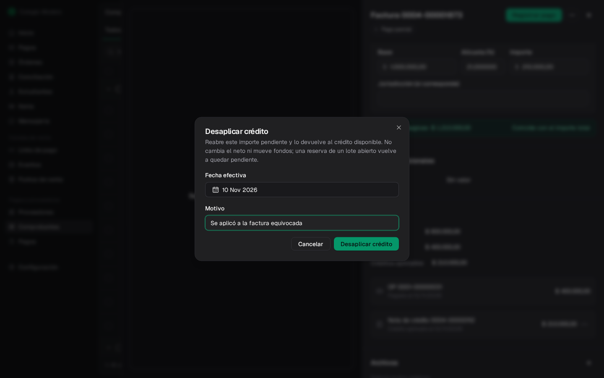
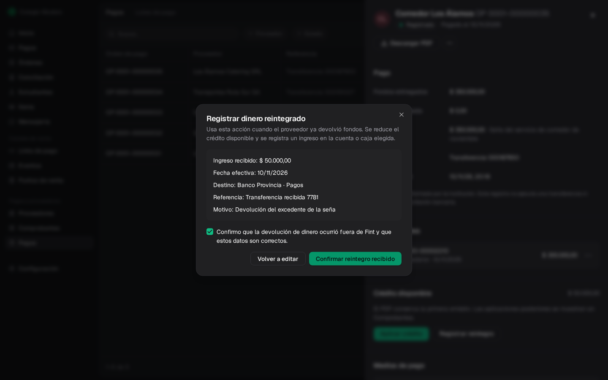
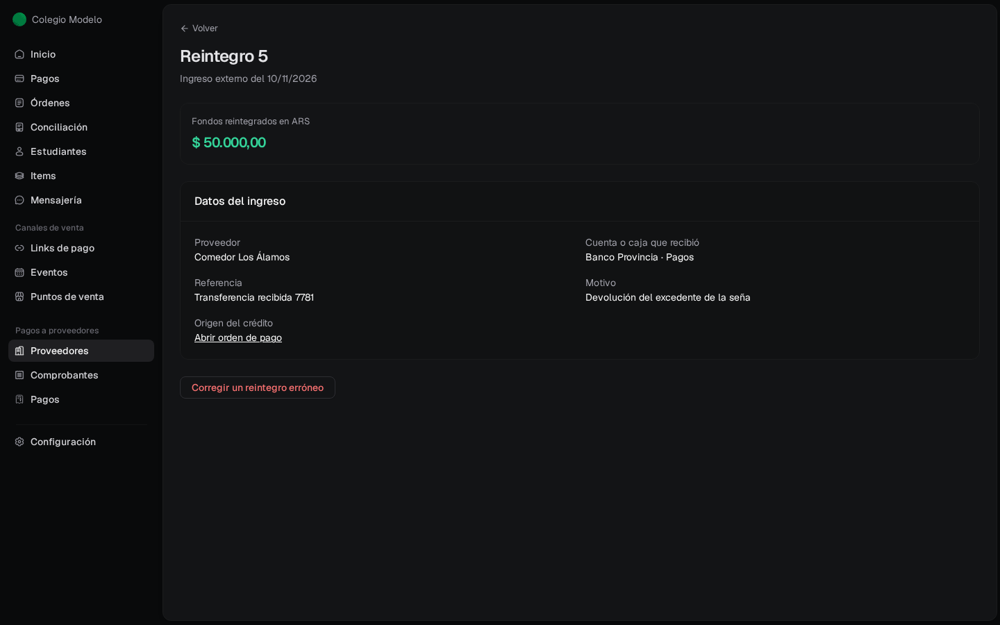
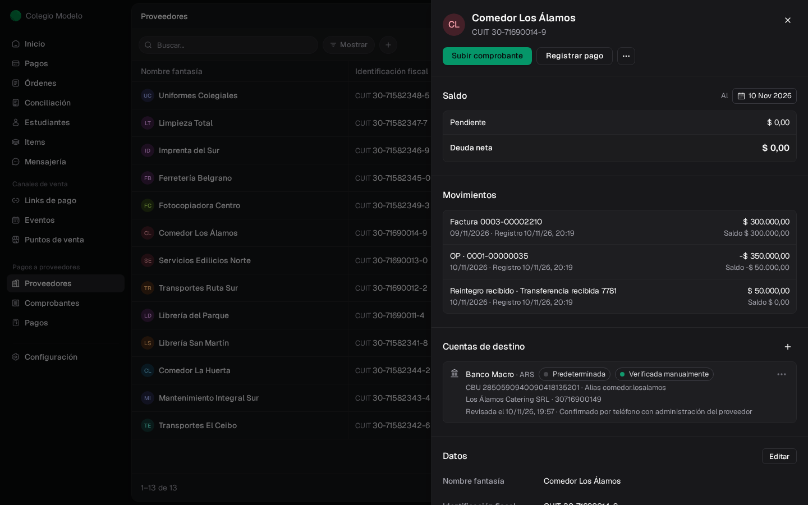

Un proveedor puede tener **crédito a favor** de tu institución. Viene de tres lugares:

- Una **nota de crédito** aprobada (por ejemplo, por una devolución de mercadería).
- Un **anticipo**: un pago que hiciste antes de tener la factura.
- Un **saldo anterior** a favor del colegio: un saldo inicial negativo, o una nota de crédito o un anticipo importados con las facturas impagas anteriores. Ver [Saldos anteriores](/docs/guides/proveedores-saldos-anteriores).

Ese crédito ya descuenta la deuda neta del proveedor. Para que una factura concreta baje su pendiente, **aplicás** el crédito a esa factura. Si el proveedor te devuelve plata, registrás un **reintegro**.

## Dónde ver el crédito

En la ficha del proveedor, el **Saldo** muestra el **Pendiente**, el **Crédito disponible** (en negativo) y la **Deuda neta**. Debajo, **Créditos y anticipos** lista cada nota de crédito u OP con crédito sin usar, cuánto se aplicó y cuánto se reintegró. **Usar crédito** ofrece **Aplicar crédito** y **Registrar reintegro**.

<Frame>
  
</Frame>

Si registrás un pago a un proveedor con crédito sin usar, Fint te avisa y pide un **Motivo para pagar sin aplicar el crédito**. Así nadie paga de más sin darse cuenta.

<Frame>
  
</Frame>

## Aplicar una nota de crédito a una factura

<Steps>
  <Step title="Abrí la nota de crédito">
    Desde **Comprobantes** o desde **Usar crédito** en la ficha. Tocá **Aplicar crédito**.
  </Step>
  <Step title="Elegí la factura">
    En **Comprobante a cancelar con el crédito** aparecen las obligaciones pendientes del proveedor; podés buscar por número o descripción. Una nota de crédito se aplica a comprobantes de su misma moneda: una en dólares, a facturas en dólares. El **Importe a aplicar** se completa con lo menor entre el crédito y el pendiente; podés aplicar solo una parte.
  </Step>
  <Step title="Confirmá">
    Elegí la **Fecha efectiva de aplicación** y tocá **Confirmar aplicación**.
  </Step>
</Steps>

<Frame>
  
</Frame>

En el ejemplo, la factura de \$1.210.000 tenía un pago de \$400.000. Con la nota de crédito de \$210.000 aplicada le quedan \$600.000 pendientes. La deuda neta del proveedor no cambia: ya descontaba el crédito. Aplicar no mueve dinero ni genera una orden de pago.

Si la factura está reservada en un lote, se pide **Saldo reservado: elige cómo usarlo**: usar la reserva del lote o liberarla (con motivo) y aplicar el crédito por fuera.

## Registrar un anticipo

Cuando le pagás a un proveedor antes de tener la factura (una seña, por ejemplo):

<Steps>
  <Step title="Abrí la ficha del proveedor">
    En **⋯**, elegí **Registrar anticipo**.
  </Step>
  <Step title="Completá el pago">
    Igual que un pago común: **Importe**, **Fecha de pago**, **Medio de pago**, origen y destino. Además, el **Motivo del anticipo** es obligatorio.
  </Step>
  <Step title="Registrá">
    Tocá **Registrar anticipo**.
  </Step>
</Steps>

<Frame>
  
</Frame>

Se genera una OP con **Deuda cancelada** en \$0 y el importe como **Anticipo**. Hasta que llegue la factura, el proveedor queda con saldo a favor de tu institución (deuda neta negativa).

## Usar el anticipo cuando llega la factura

Cuando cargues y apruebes la factura, abrí la OP del anticipo desde **Pagos** o desde **Créditos y anticipos** de la ficha. En **Crédito disponible**, tocá **Aplicar crédito**, elegí la factura y confirmá. Un anticipo se puede aplicar a cualquier factura del proveedor, también a una cargada en dólares, por su equivalente en pesos.

<Frame>
  
</Frame>

En el ejemplo, la seña de \$350.000 cancela la factura de comedor de \$300.000 y quedan \$50.000 a favor. La OP muestra la factura como **Aplicación posterior**. El PDF de la OP conserva lo que tenía al emitirse.

## Deshacer una aplicación

Si aplicaste un crédito a la factura equivocada:

- **Desde la factura**: en la sección **Pagos**, abrí **⋯** en el crédito aplicado y elegí **Desaplicar crédito**.
- **Desde la OP**: en **Comprobantes**, abrí **⋯** en la línea y elegí **Desaplicar**.

Indicá la **Fecha efectiva** y el **Motivo**.

<Frame>
  
</Frame>

La factura vuelve a tener ese importe pendiente y el crédito vuelve a estar disponible para aplicarlo a otra. No cambia la deuda neta ni mueve dinero. Desaplicar una línea de un pago común también funciona: ese importe queda como crédito de la OP.

## Registrar un reintegro

Usá el reintegro cuando el proveedor **te devolvió dinero** de un crédito a favor (por ejemplo, el excedente de una seña).

<Steps>
  <Step title="Abrí el crédito">
    Desde la OP (**Registrar reintegro** en **Crédito disponible**), desde la nota de crédito o desde **Usar crédito** en la ficha.
  </Step>
  <Step title="Completá el ingreso">
    **Importe reintegrado** (hasta el crédito disponible), **Fecha efectiva del ingreso**, **Cuenta o caja que recibió el dinero**, **Referencia del ingreso** y **Motivo del reintegro**. Tocá **Revisar reintegro**.
  </Step>
  <Step title="Confirmá">
    Revisá el resumen, marcá que la devolución ocurrió y tocá **Confirmar reintegro recibido**.
  </Step>
</Steps>

<Frame>
  
</Frame>

Se abre el reintegro con sus datos y el enlace al crédito de origen. El crédito disponible baja y la cuenta corriente muestra el **Reintegro recibido**.

<Frame>
  
</Frame>

Con la factura de \$300.000 cancelada por la seña y los \$50.000 devueltos, la cuenta del comedor cierra en cero:

<Frame>
  
</Frame>

Si registraste un reintegro que no ocurrió, abrilo y tocá **Corregir un reintegro erróneo**, con fecha y motivo. El crédito vuelve a estar disponible. Una OP con un reintegro vigente no se puede anular: corregí primero el reintegro.

<Note>
  Un reintegro es dinero que entró. Para corregir un pago que cargaste mal, no uses un reintegro: [anulá el registro de pago](/docs/guides/proveedores-pagos#corregir-un-pago-registrado-por-error).
</Note>

## Preguntas frecuentes

<AccordionGroup>
  <Accordion title="¿Aplicar un crédito cuenta como un pago?">
    No. Baja el pendiente de la factura sin mover dinero y sin generar otra orden de pago. En la factura se ve como **Créditos aplicados**, separado de **Pagado**.
  </Accordion>
  <Accordion title="¿Puedo usar parte de una nota de crédito?">
    Sí. Aplicá el importe que quieras; el resto queda disponible para otra factura de la misma moneda o para un reintegro.
  </Accordion>
  <Accordion title="Pagué de más a un proveedor, ¿cómo lo registro?">
    Registrá la diferencia como **anticipo**: queda como crédito a favor para la próxima factura o para un reintegro.
  </Accordion>
  <Accordion title="¿Por qué la deuda neta es negativa?">
    El proveedor tiene más crédito a favor de tu institución (anticipos, notas de crédito o un saldo anterior negativo) que facturas pendientes.
  </Accordion>
</AccordionGroup>
