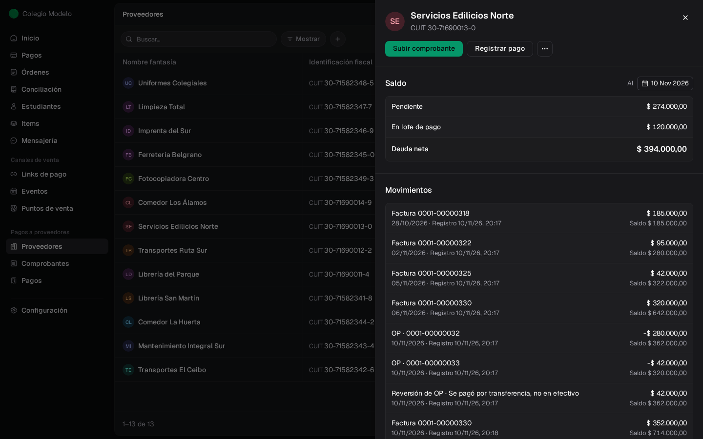
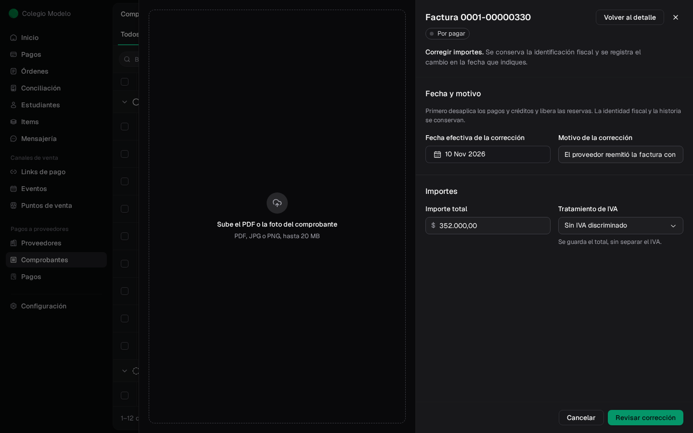
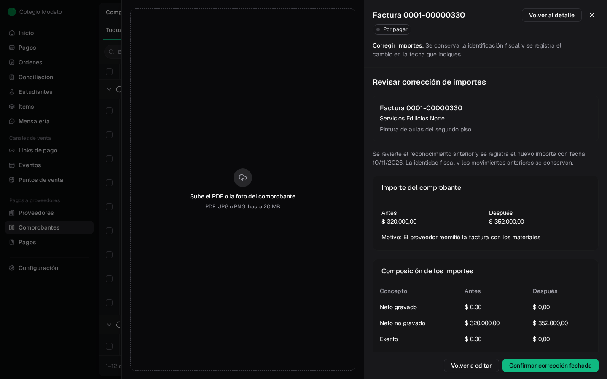
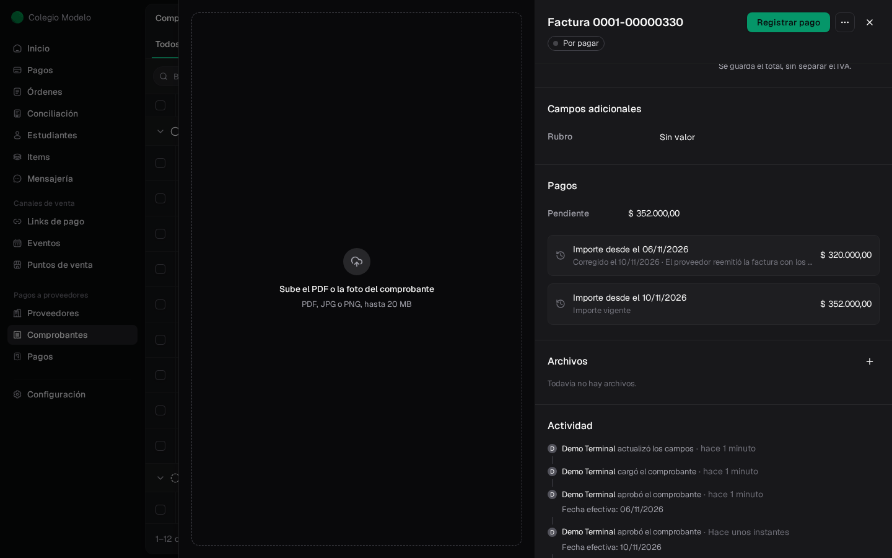

Cada proveedor tiene su **cuenta corriente**: arriba de su ficha, en **Proveedores**. Ahí ves cuánto le debe tu institución, cuánto está planificado en lotes y cuánto crédito tiene a favor.

## El saldo

<Frame>
  
</Frame>

- **Pendiente**: lo que falta pagar de los comprobantes aprobados. Si hay reservas en lotes, muestra lo que queda sin lote.
- **En lote de pago**: lo reservado en [lotes de pago](/docs/guides/proveedores-lotes). Sigue siendo deuda.
- **Crédito disponible**: notas de crédito y anticipos sin usar, en negativo. Ver [Créditos, anticipos y reintegros](/docs/guides/proveedores-creditos).
- **Deuda neta**: lo que le debés al proveedor después de descontar el crédito. Si es negativa, el proveedor tiene saldo a favor de tu institución.

Un comprobante **Por revisar** todavía no suma: la deuda se reconoce al aprobarlo.

## El saldo a otra fecha

El selector **Al** (arriba a la derecha del saldo) cambia la **fecha de corte**. Con una fecha anterior ves el saldo y los movimientos tal como estaban ese día: sirve para cerrar un mes o responderle a un proveedor que pide su estado de cuenta. No se pueden elegir fechas futuras.

## Los movimientos

Debajo del saldo, **Movimientos** lista todo lo que cambió la deuda, ordenado por fecha, con el saldo acumulado en cada línea:

- Comprobantes aprobados (facturas y notas de débito suman; notas de crédito restan).
- **OP ·** número: pagos y anticipos registrados.
- **Reversión de OP**: un pago anulado, con su motivo.
- **Anulación de comprobante**.
- **Reintegro recibido** y su reversión, si se corrigió.

Cada línea muestra la **fecha efectiva** y cuándo se registró. Tocá la línea para abrir el comprobante, la OP o el reintegro.

Aplicar o desaplicar un crédito, o reservar en un lote, **no** agrega movimientos: no cambian la deuda neta.

## Corregir el importe de un comprobante aprobado

Si el proveedor reemitió una factura con otro total, o el importe se cargó mal y ya la aprobaste, no hace falta anularla y cargarla de nuevo: hacé una **corrección fechada**. El comprobante conserva su número y su historia.

<Steps>
  <Step title="Liberá lo que lo use">
    Si el comprobante tiene pagos, créditos aplicados o reservas en lotes, primero desaplicalos ([desde la OP o la factura](/docs/guides/proveedores-creditos#deshacer-una-aplicación)) y liberá las reservas.
  </Step>
  <Step title="Abrí Corregir importes">
    En el comprobante, tocá **⋯ → Corregir importes**. Completá la **Fecha efectiva de la corrección** (desde la fecha en que se aprobó hasta hoy) y el **Motivo de la corrección**.
  </Step>
  <Step title="Cargá los importes correctos">
    **Importe total** y, si corresponde, el desglose de IVA. En un comprobante en dólares también podés corregir la cotización. Tocá **Revisar corrección**.
  </Step>
  <Step title="Confirmá">
    Compará el **Antes** y el **Después** y tocá **Confirmar corrección fechada**.
  </Step>
</Steps>

<Frame>
  
</Frame>

<Frame>
  
</Frame>

La sección **Pagos** del comprobante guarda cada versión del importe con su fecha y motivo. En la cuenta corriente, el importe anterior se revierte y el nuevo se reconoce en la fecha de la corrección. Con una fecha de corte anterior seguís viendo el importe original.

<Frame>
  
</Frame>

En el ejemplo, la factura de pintura pasa de \$320.000 a \$352.000. El día anterior a la corrección la cuenta corriente sigue mostrando \$320.000.

**Corregir importes** no está disponible para los saldos iniciales ni para las facturas impagas cargadas como [saldos anteriores](/docs/guides/proveedores-saldos-anteriores). Para cambiar el proveedor, el tipo o el número del comprobante, anulalo y cargalo de nuevo (ver [Comprobantes](/docs/guides/proveedores-comprobantes)).

## Preguntas frecuentes

<AccordionGroup>
  <Accordion title="Subí una factura y no aparece en la cuenta corriente">
    Está **Por revisar**. Aprobala desde **Comprobantes** para que se reconozca la deuda.
  </Accordion>
  <Accordion title="¿Por qué el pendiente es menor que la deuda neta?">
    Parte de la deuda está reservada en un lote de pago: se muestra aparte como **En lote de pago**.
  </Accordion>
  <Accordion title="¿Corregir el importe cambia lo que se veía en meses anteriores?">
    No. La corrección tiene efecto desde su fecha. Con una fecha de corte anterior se ve el importe original.
  </Accordion>
  <Accordion title="No me deja corregir el importe">
    El comprobante tiene pagos, créditos aplicados o reservas. Desaplicalos y liberá las reservas, y volvé a intentar.
  </Accordion>
</AccordionGroup>
