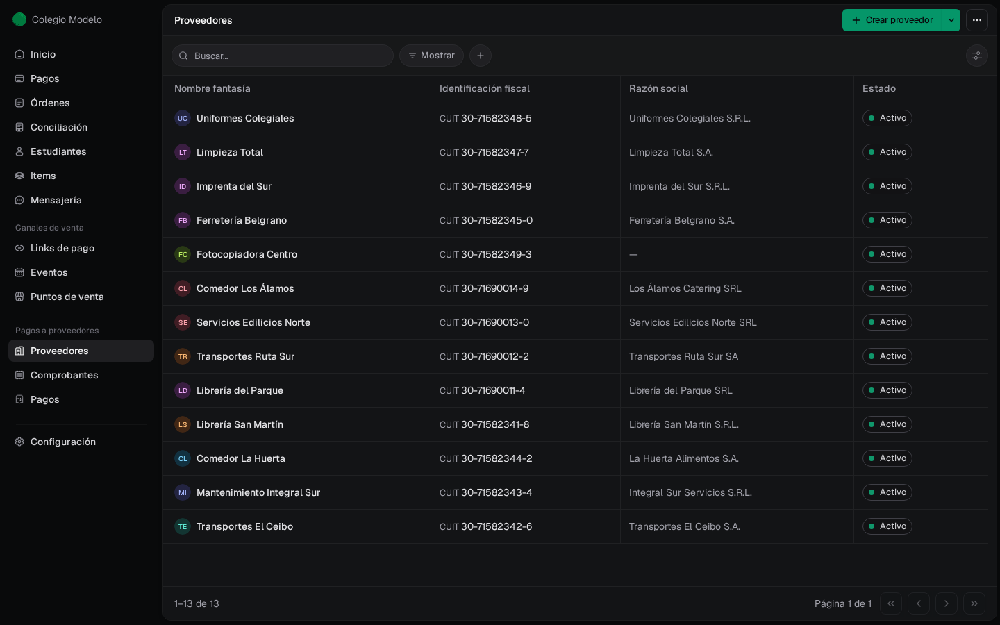
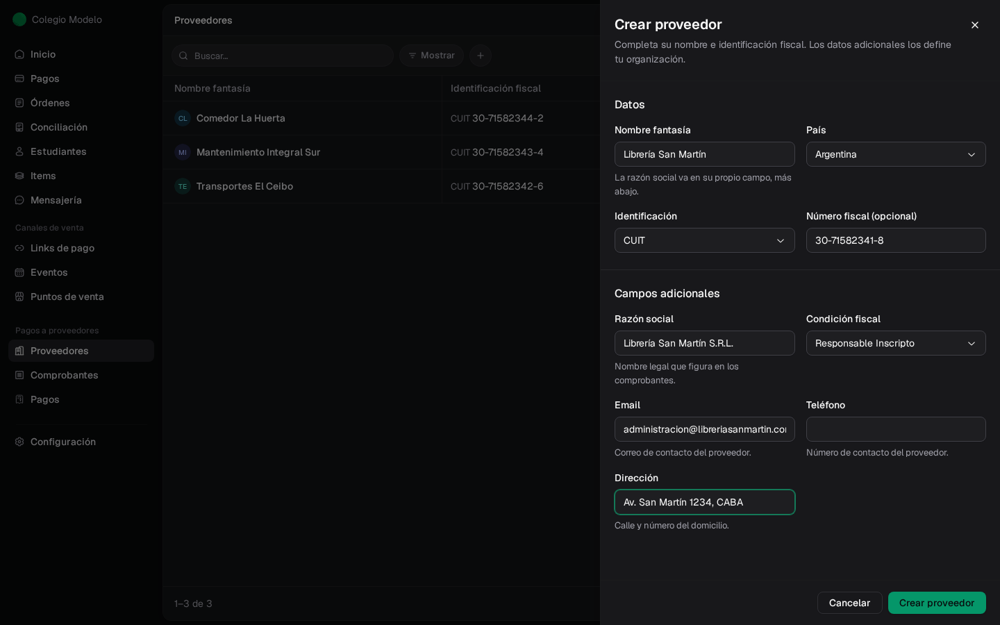
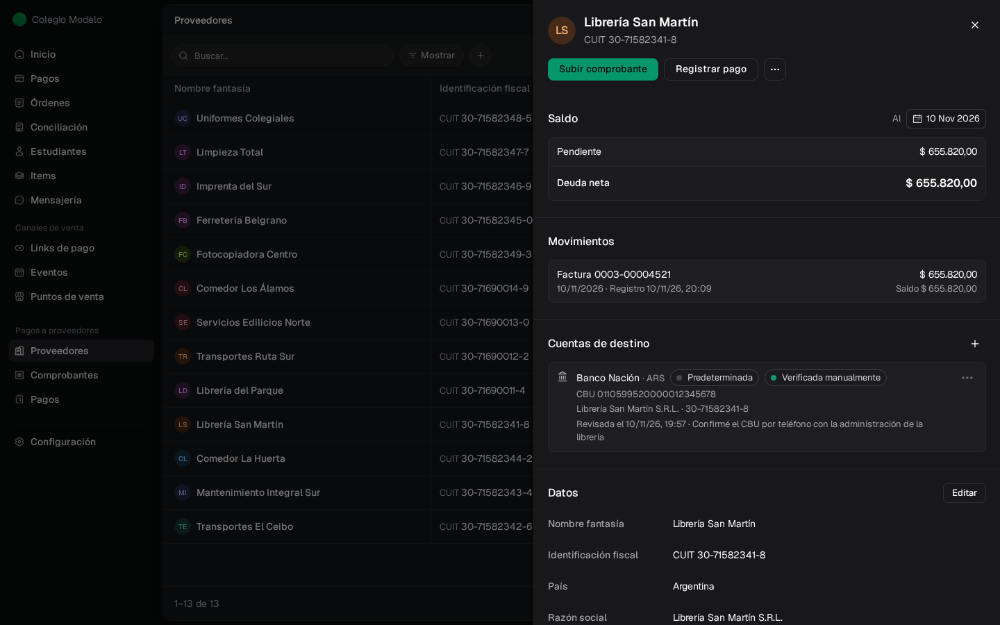
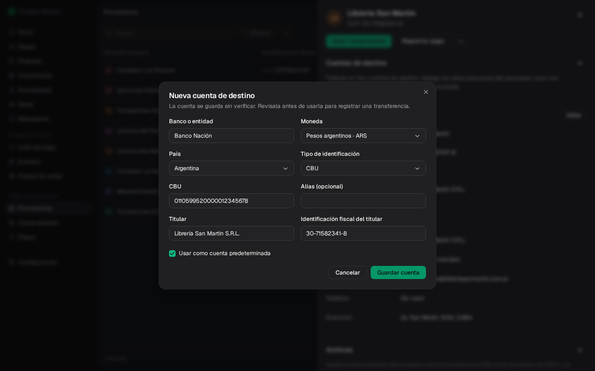
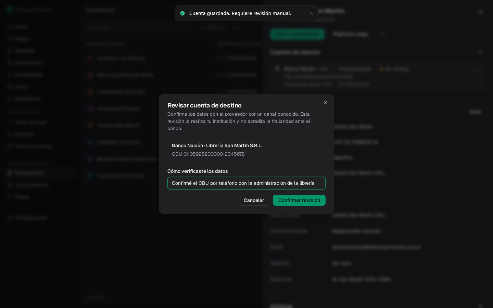
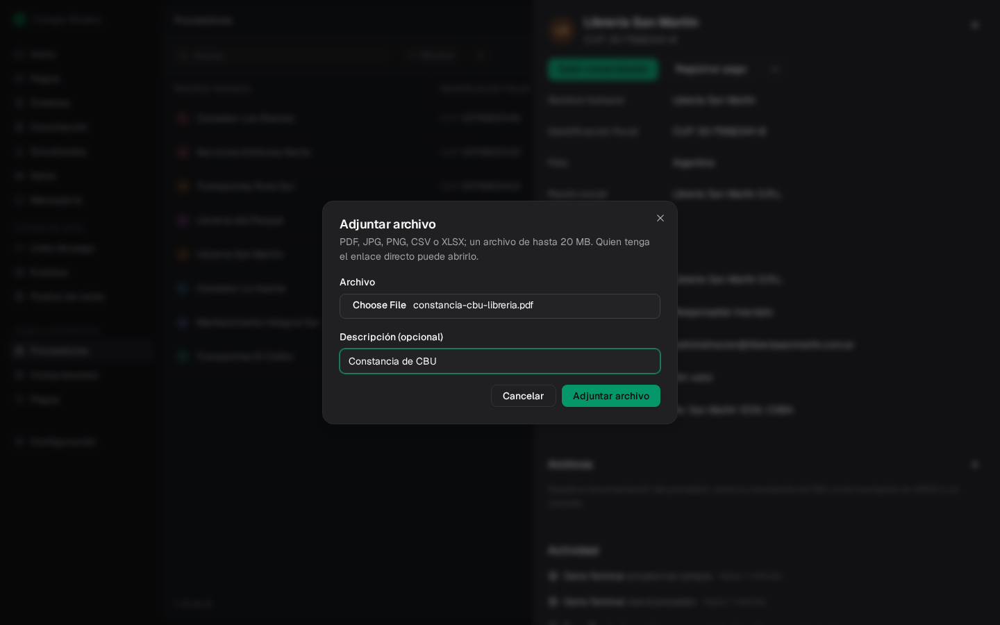
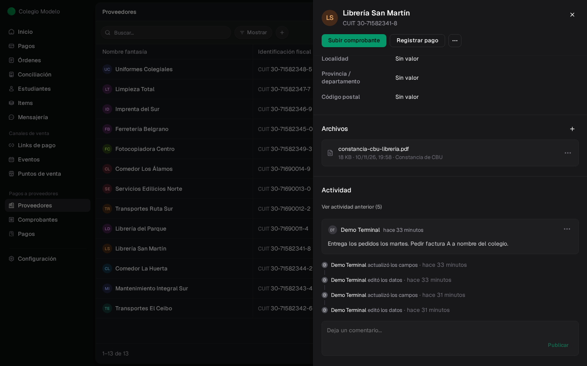
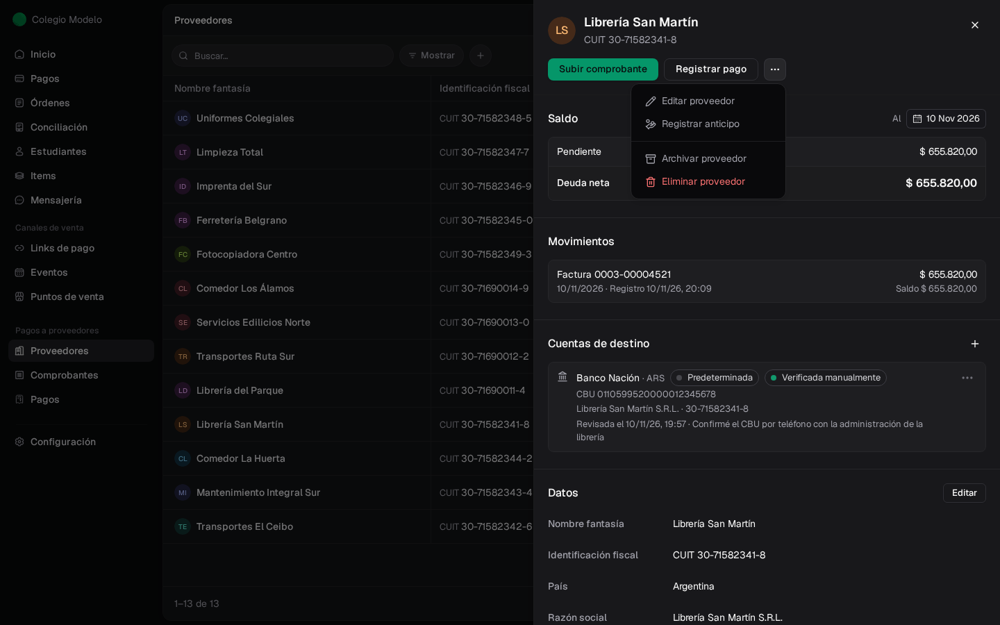
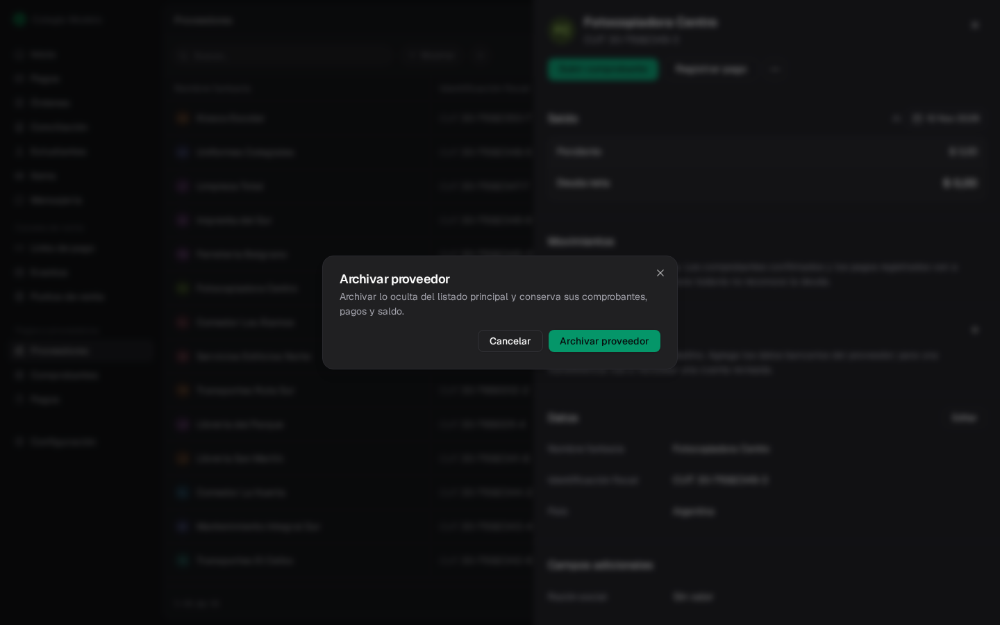

**Proveedores** es el directorio de quienes le venden o le prestan servicios a tu organización. Cada proveedor tiene una ficha con su saldo, sus cuentas bancarias de destino, sus datos, archivos y notas. Necesitás ser **Administrador**.

<Frame>
  
</Frame>

## Buscar y filtrar

- **Buscar…** encuentra por nombre, identificación fiscal o cualquier dato adicional (por ejemplo, el email).
- **Mostrar** elige entre **Activos**, **Archivados** o **Todos**.
- El botón **+** agrega un filtro por un dato del proveedor, como la condición fiscal o un campo propio.
- El ícono de la derecha elige qué columnas ver. Las columnas y filtros se recuerdan cuando volvés.

## Crear un proveedor

<Steps>
  <Step title="Abrí el formulario">
    Tocá **Crear proveedor**.
  </Step>
  <Step title="Completá los datos">
    **Nombre fantasía** es obligatorio. Elegí el **País**, el tipo de **Identificación** (CUIT, RUT u otra) y el **Número fiscal**. Abajo, en **Campos adicionales**, aparecen los datos que definió tu organización (razón social, condición fiscal, email, etc.).
  </Step>
  <Step title="Guardá">
    Tocá **Crear proveedor**. Se abre su ficha.
  </Step>
</Steps>

<Frame>
  
</Frame>

Fint controla el dígito verificador del CUIT. Si ya existe un proveedor con la misma identificación, te avisa: buscalo antes de crear otro. Si realmente necesitás dos registros con el mismo CUIT, escribí el motivo en **Motivo para conservar otro proveedor**.

¿Necesitás un dato que no está en el formulario? Agregalo desde **Configurar campos**: ver [Configuración](/docs/guides/proveedores-configuracion).

Para cargar muchos proveedores juntos, usá [Importar desde Excel](/docs/guides/proveedores-importaciones).

## La ficha del proveedor

Tocá un proveedor del listado para abrir su ficha. Arriba tenés las acciones principales: **Subir comprobante**, **Registrar pago** y el menú **⋯**.

<Frame>
  
</Frame>

La ficha tiene estas secciones:

- **Saldo** y **Movimientos**: la cuenta corriente, con lo pendiente, lo que está en un lote de pago y el crédito disponible. Ver [Cuenta corriente](/docs/guides/proveedores-cuenta-corriente).
- **Cuentas de destino**: las cuentas bancarias del proveedor.
- **Datos**: nombre, identificación, país y los campos adicionales. **Editar** abre el formulario.
- **Archivos**: constancias y contratos del proveedor.
- **Actividad**: el historial de cambios y las notas del equipo.

## Cuentas de destino

Son las cuentas bancarias del proveedor adonde le transferís. Para elegir una cuenta como destino de una transferencia, tiene que estar **verificada**. También podés registrar una transferencia sin cuenta de destino (ver [Medios de pago](/docs/guides/proveedores-pagos#medios-de-pago)).

<Steps>
  <Step title="Agregá la cuenta">
    En **Cuentas de destino**, tocá **+**. Completá **Banco o entidad**, **Moneda**, el tipo de identificación (CBU, CVU, alias, número de cuenta, IBAN o celular), el número, el **Titular** y su identificación fiscal. Marcá **Usar como cuenta predeterminada** si es la habitual, y tocá **Guardar cuenta**.
  </Step>
  <Step title="Verificala">
    La cuenta queda **Sin verificar**. Confirmá los datos con el proveedor por un canal conocido (teléfono, mail habitual) y, en el menú **⋯** de la cuenta, elegí **Verificar manualmente**. Anotá cómo la verificaste y tocá **Confirmar revisión**.
  </Step>
</Steps>

<Frame>
  
</Frame>

<Frame>
  
</Frame>

La cuenta pasa a **Verificada manualmente**, con la fecha y tu nota. Esa revisión la hace tu organización: no es una validación del banco.

Desde el menú **⋯** de cada cuenta también podés **Editar** (los cambios piden una nueva verificación), **Usar por defecto** o **Archivar**. Una cuenta archivada no se puede elegir para pagar; su menú ofrece **Reactivar**. Los pagos anteriores conservan la cuenta que se usó al registrarlos.

## Archivos y notas

En **Archivos**, el **+** adjunta la constancia de CBU, la de inscripción en ARCA o un contrato. Se aceptan PDF, JPG, PNG, CSV o XLSX de hasta 20 MB, con una descripción opcional.

<Frame>
  
</Frame>

<Info>
  Quien tenga el enlace directo de un archivo puede abrirlo. No adjuntes información que no corresponda compartir así.
</Info>

Al final de la ficha, en **Actividad**, escribí una nota en **Deja un comentario...** y tocá **Publicar**. La actividad muestra también quién creó el proveedor, editó sus datos, adjuntó archivos o verificó una cuenta.

Si adjuntaste un archivo por error, en su menú **⋯** elegí **Quitar archivo**: deja de aparecer en la ficha, pero se conserva junto con su historia y los demás registros a los que esté vinculado. Para borrar una nota tuya, pasá el mouse sobre ella, abrí **⋯** y elegí **Eliminar**. Lo mismo vale para los archivos y notas de un comprobante o de una orden de pago.

<Frame>
  
</Frame>

Los comprobantes también tienen sus propios archivos y notas: ver [Comprobantes](/docs/guides/proveedores-comprobantes#archivos-y-actividad).

## Editar, archivar o eliminar

El menú **⋯** de la ficha ofrece:

<Frame>
  
</Frame>

- **Editar proveedor**: cambia sus datos. Tocá **Guardar cambios** al terminar.
- **Registrar anticipo**: ver [Anticipos y créditos](/docs/guides/proveedores-creditos).
- **Archivar proveedor**: lo saca del listado principal y conserva sus comprobantes, pagos y saldo. Lo encontrás con **Mostrar → Archivados** y lo volvés a usar con **Reactivar proveedor**.
- **Eliminar proveedor**: solo si no tiene comprobantes ni pagos. Si ya operaste con él, archivalo.

<Frame>
  
</Frame>

## Preguntas frecuentes

<AccordionGroup>
  <Accordion title="Cargué dos veces el mismo proveedor">
    Si uno no tiene comprobantes ni pagos, eliminalo desde **⋯ → Eliminar proveedor**. Si los dos tienen movimientos, archivá el que no vas a usar.
  </Accordion>
  <Accordion title="¿Por qué no puedo transferirle a una cuenta?">
    Solo se puede transferir a cuentas activas y verificadas. Si la cuenta está archivada, abrí su menú **⋯** y elegí **Reactivar**. Si está **Sin verificar**, confirmá los datos con el proveedor y elegí **⋯ → Verificar manualmente**.
  </Accordion>
  <Accordion title="Cambié el CBU del proveedor y la cuenta volvió a Sin verificar">
    Es esperable: cualquier cambio en la cuenta pide una nueva verificación.
  </Accordion>
</AccordionGroup>
