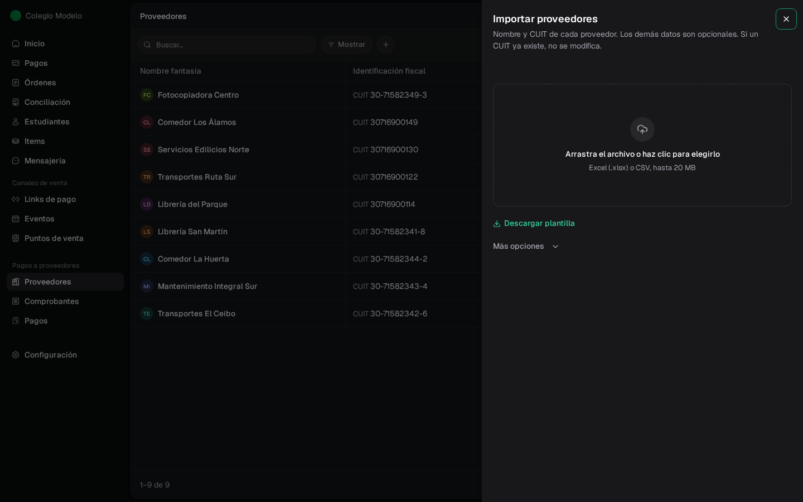
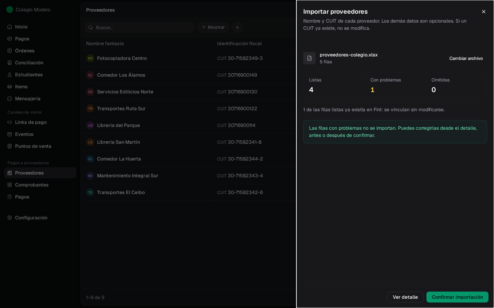
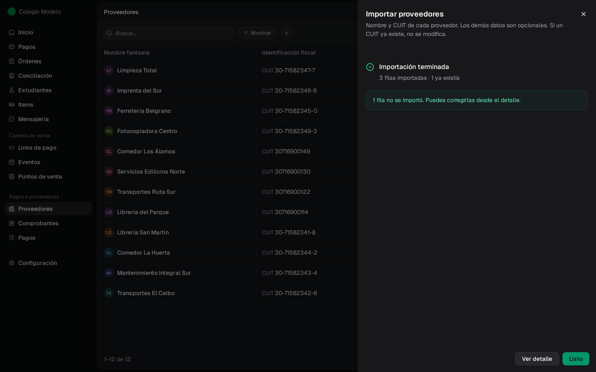
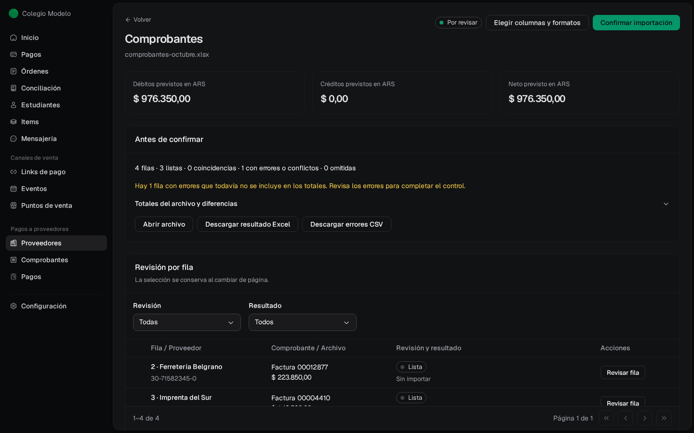
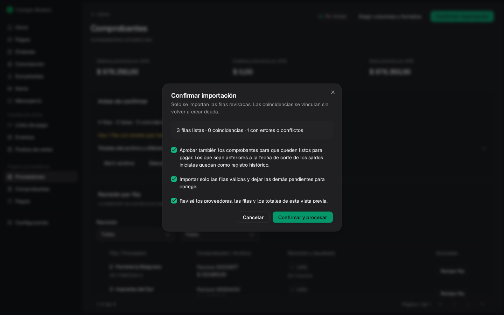
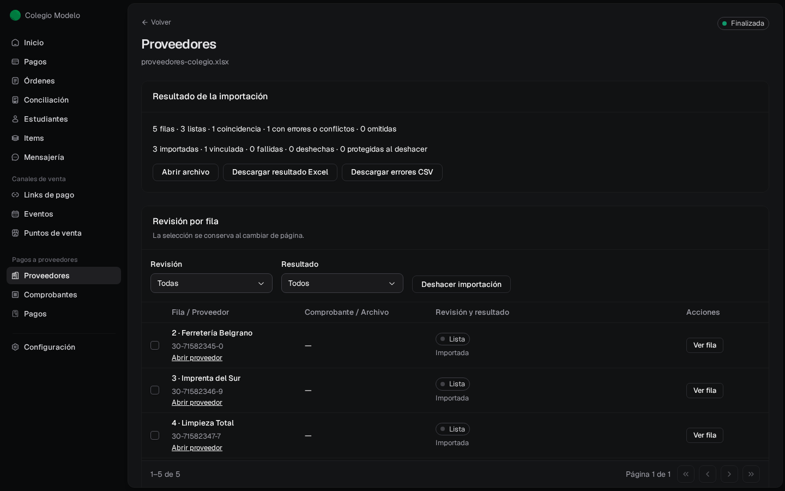
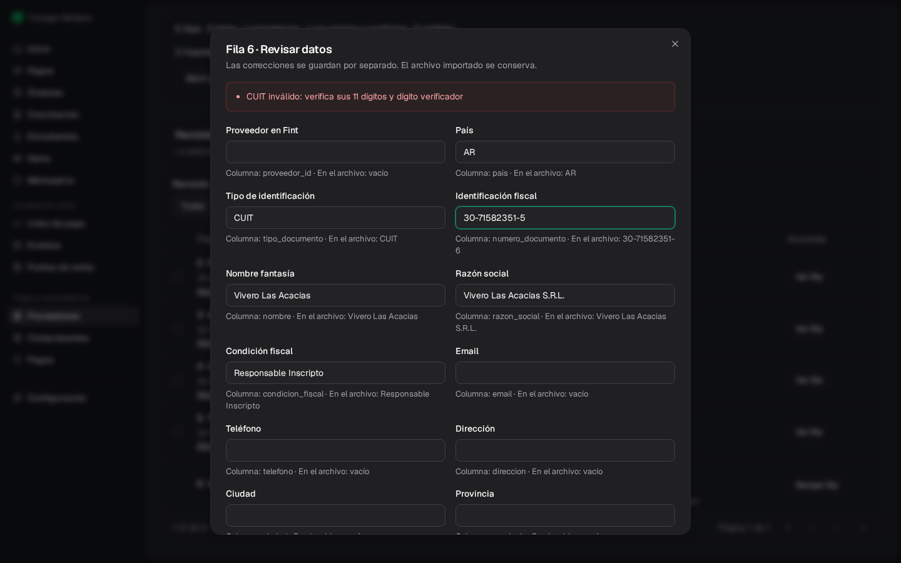
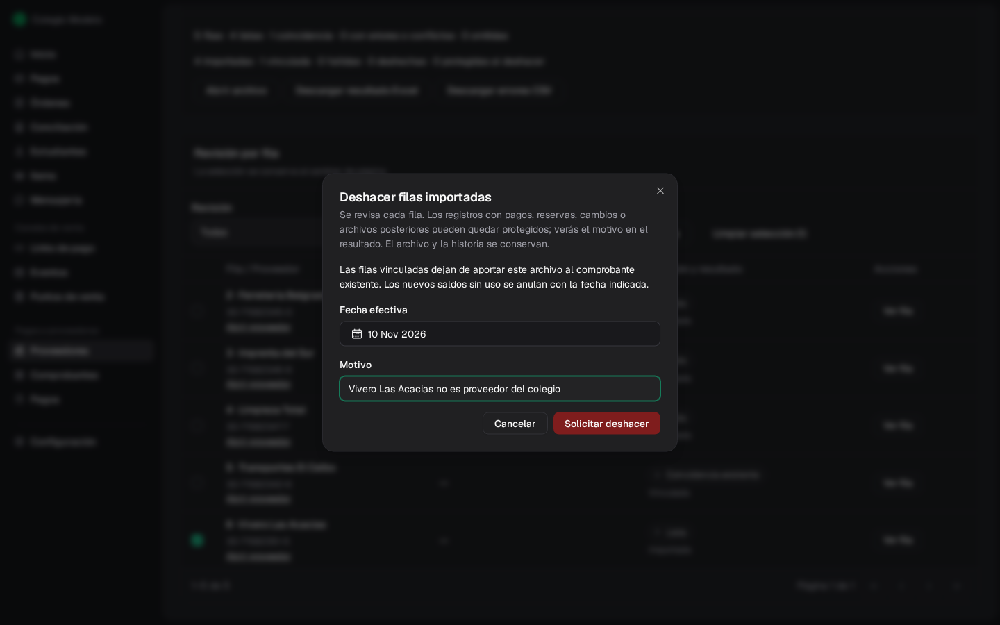
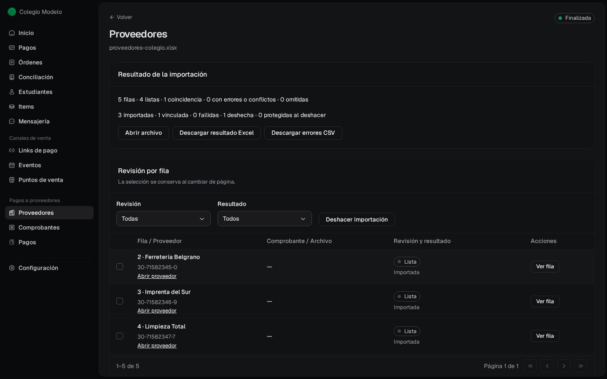
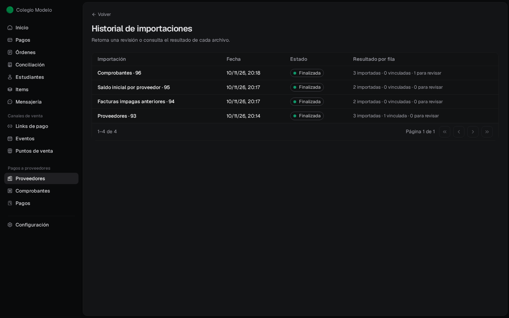

Si tenés el padrón de proveedores o las facturas del mes en una planilla, importala en lugar de cargar uno por uno. Fint te muestra una vista previa, importa solo las filas que están bien y te deja corregir el resto. Necesitás ser **Administrador**.

Se puede importar:

- **Proveedores**: nombre y CUIT de cada uno, más los datos que tu organización haya marcado como **Requerido** (ver [Configuración](/docs/guides/proveedores-configuracion)); los demás son opcionales.
- **Comprobantes**: una fila por comprobante, con proveedor, tipo, fechas e importes.
- **Facturas impagas anteriores** y **Saldo inicial por proveedor**: lo que ya debías antes de usar Fint. Ver [Saldos anteriores](/docs/guides/proveedores-saldos-anteriores).

## Preparar la planilla

<Steps>
  <Step title="Abrí la importación">
    En **Proveedores**, tocá la flecha junto a **Crear proveedor** y elegí **Importar desde Excel**. Para comprobantes, la flecha junto a **Subir comprobante** en **Comprobantes**.
  </Step>
  <Step title="Descargá la plantilla">
    **Descargar plantilla** baja un Excel con las columnas que Fint espera, incluidos los campos propios de tu organización (con el prefijo **Campo:**). Si un campo es una lista, la hoja **Campos y opciones** muestra los valores válidos.
  </Step>
  <Step title="Completala">
    Una fila por proveedor o por comprobante. La identificación fiscal es obligatoria: con ella Fint reconoce al proveedor. En comprobantes, el tipo se escribe FC, NC, ND, recibo, ticket o gasto.
  </Step>
</Steps>

<Frame>
  
</Frame>

Se aceptan Excel (.xlsx) o CSV de hasta 20 MB y 10.000 filas. En **Más opciones** elegís el formato de decimales (punto o coma) y de fechas, el separador y la codificación de un CSV, o la hoja del Excel. Si tu planilla no sigue la plantilla, en **Columnas** elegí **Otro archivo: elegir columnas** y después indicás qué columna corresponde a cada dato. Para comprobantes también está **Archivo de ARCA: elegir columnas**.

## Revisar y confirmar

Arrastrá el archivo. Fint arma la vista previa: cuántas filas están **Listas**, cuántas **Con problemas** y cuántas **Omitidas**.

<Frame>
  
</Frame>

- Un proveedor que **ya existía** (mismo CUIT) se vincula sin modificarse.
- Las filas **Con problemas** no se importan. Las podés corregir antes o después de confirmar.

Tocá **Confirmar importación**. Al terminar ves cuántas filas se importaron y cuántas ya existían.

<Frame>
  
</Frame>

Si volvés a subir el mismo archivo, Fint lo reconoce y te muestra la importación anterior en lugar de duplicarla.

### Comprobantes: aprobarlos en el mismo paso

Los comprobantes importados entran **Por revisar**. Si ya los controlaste en la planilla, abrí **Ver detalle** y, en **Confirmar importación**, marcá **Aprobar también los comprobantes para que queden listos para pagar**.

<Frame>
  
</Frame>

<Frame>
  
</Frame>

Si hay filas con errores, marcá también **Importar solo las filas válidas y dejar las demás pendientes para corregir**. Confirmá que revisaste la vista previa y tocá **Confirmar y procesar**.

Si el proveedor tiene un [saldo anterior](/docs/guides/proveedores-saldos-anteriores), los comprobantes con fecha igual o anterior a su fecha de corte se importan como registro histórico, con o sin esta opción: quedan con su archivo y sus datos, pero no suman deuda ni se aprueban, porque esa deuda ya está en el saldo anterior.

## Corregir una fila

En el detalle de la importación, la tabla **Revisión por fila** muestra el estado de cada fila. Filtrala por **Revisión** o **Resultado** para ver solo las que tienen problemas.

<Frame>
  
</Frame>

<Steps>
  <Step title="Abrí la fila">
    Tocá **Revisar fila**. Arriba ves el problema y, debajo de cada dato, qué traía el archivo.
  </Step>
  <Step title="Corregí el dato">
    Cambiá el valor y tocá **Guardar y volver a revisar fila**. El archivo original no se modifica: la corrección se guarda aparte.
  </Step>
  <Step title="Reintentá">
    Tocá **Reintentar pendientes**, confirmá y **Confirmar y procesar**. Solo se procesan las filas pendientes; las ya importadas conservan su resultado.
  </Step>
</Steps>

<Frame>
  
</Frame>

En el detalle también podés **Abrir archivo**, **Descargar resultado Excel** o **Descargar errores CSV**, y desde cada fila importada **Abrir proveedor** o **Abrir comprobante**.

## Deshacer filas importadas

Si importaste algo que no correspondía, seleccioná las filas en **Revisión por fila** y tocá **Deshacer** (sin seleccionar, deshace toda la importación). Indicá la **Fecha efectiva** y el **Motivo** y tocá **Solicitar deshacer**.

<Frame>
  
</Frame>

Fint revisa cada fila. Lo que no se usó se quita o se anula con la fecha indicada. Una fila queda **protegida** si su registro ya tiene pagos, reservas en un lote, cambios o archivos posteriores: el resultado te dice el motivo. El archivo y la historia se conservan.

<Frame>
  
</Frame>

## Historial de importaciones

En **Proveedores** o **Comprobantes**, menú **⋯** → **Historial de importaciones**, ves cada archivo con su estado (**Por revisar**, **Importando**, **Finalizada**, **Deshaciendo** o **Requiere atención**) y el resultado por fila. Desde ahí retomás una revisión que dejaste a medias.

<Frame>
  
</Frame>

## Preguntas frecuentes

<AccordionGroup>
  <Accordion title="Importé proveedores que ya existían">
    Si el CUIT coincide, la fila se vincula al proveedor existente y no lo modifica.
  </Accordion>
  <Accordion title="Los comprobantes importados no aparecen en la cuenta corriente">
    Quedaron **Por revisar**. Aprobalos desde **Comprobantes** o, la próxima vez, marcá **Aprobar también los comprobantes** al confirmar. Los que tienen fecha igual o anterior al corte de un saldo anterior son registros históricos y no se aprueban: esa deuda ya está en el saldo anterior.
  </Accordion>
  <Accordion title="El archivo tiene varias hojas">
    En **Más opciones**, escribí en **Hoja** el nombre de la hoja que querés importar.
  </Accordion>
</AccordionGroup>
