Un **lote de pago** agrupa lo que pensás pagar en una fecha, por ejemplo los pagos de la semana. Al armarlo **reservás** el saldo de cada comprobante; la deuda baja recién cuando registrás el pago.

<Info>
  Reservar no paga ni mueve dinero: la deuda del proveedor sigue igual. Sirve para planificar y para que nadie pague dos veces lo mismo, porque un comprobante reservado solo se paga desde su lote.
</Info>

Los lotes están en **Pagos → Lotes de pago**. Necesitás ser **Administrador**.

## Armar un lote desde Por pagar

<Steps>
  <Step title="Elegí los comprobantes">
    En **Comprobantes → Por pagar**, marcá las filas (hasta 100 por vez). La barra de abajo muestra cuántos elegiste y el total. Tocá **Agregar a un lote**.
  </Step>
  <Step title="Completá el lote">
    Con **Lote nuevo**, escribí el **Nombre del lote** y la **Fecha prevista de pago**. **Reservar saldo desde** es la fecha desde la que cuenta la reserva. En **Origen de los fondos** podés dejar sugerida la cuenta o caja de la que vas a pagar, o elegir **Elegir al registrar cada pago**.
  </Step>
  <Step title="Ajustá los importes y reservá">
    Cada comprobante viene con todo su **Pendiente sin lote**. Podés reservar menos o quitarlo con la **X**. Revisá **Total a reservar** y tocá **Crear lote y reservar**.
  </Step>
</Steps>

<Frame>
  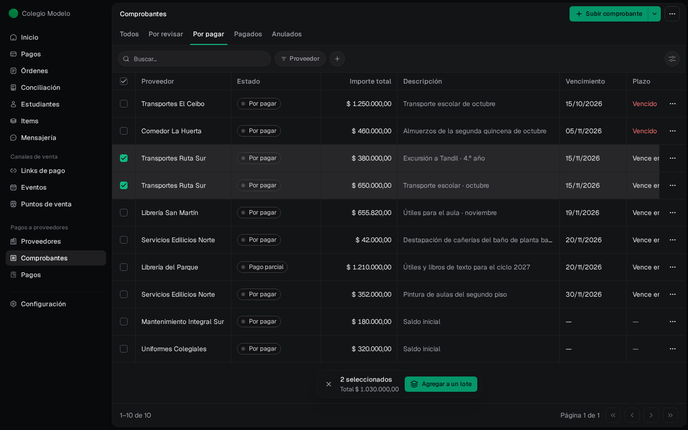
</Frame>

<Frame>
  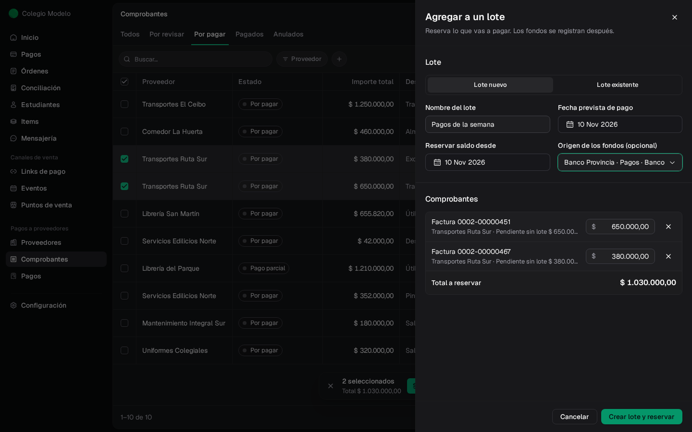
</Frame>

También podés empezar en **Lotes de pago → Crear lote**: elegís los comprobantes en una lista que muestra el **Saldo pendiente**, lo que ya está **En lotes de pago** y el **Pendiente sin lote** de cada uno.

## Sumar comprobantes a un lote que ya existe

Desde **Por pagar** (o desde **⋯ → Agregar a un lote** en un comprobante), elegí **Lote existente**, buscá el lote y tocá **Agregar y reservar**. Dentro del lote, **Agregar comprobantes** hace lo mismo.

<Frame>
  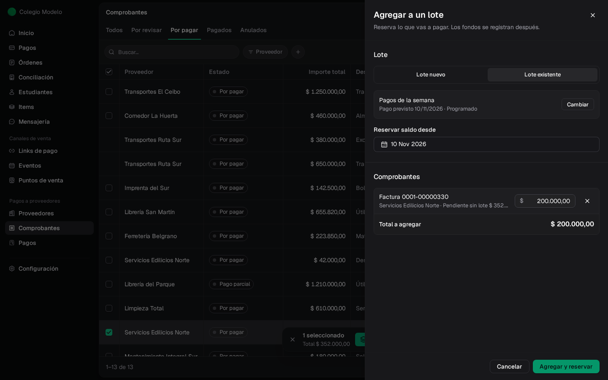
</Frame>

En el ejemplo se reservan \$200.000 de una factura de \$352.000: el resto queda pendiente sin lote para pagarlo más adelante.

## El lote por dentro

Arriba ves el **Pago previsto**, el **Origen sugerido** y tres totales: **Programado**, **Pagado** y **Pendiente**. La pestaña **Comprobantes** lista cada línea con su cuenta de destino; **Pagos registrados** lista las OP que salieron del lote.

<Frame>
  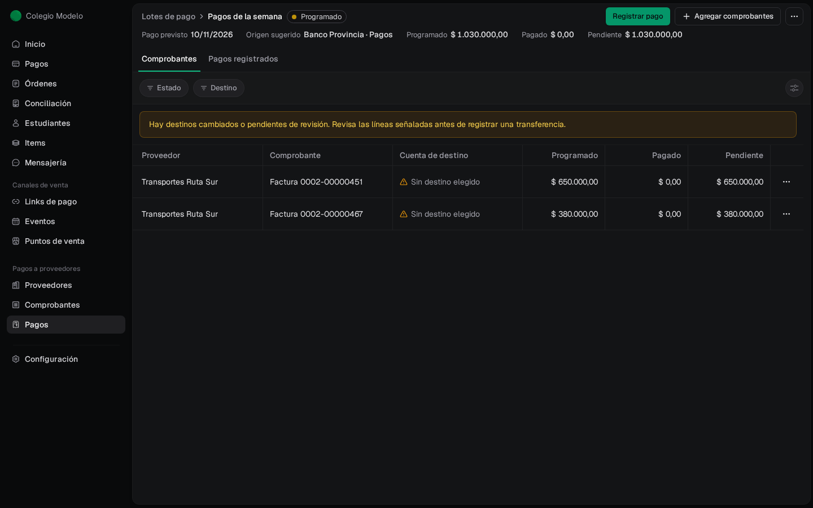
</Frame>

Podés filtrar las líneas por **Proveedor**, **Estado** (Pendiente, Pagado, Liberado) y **Destino**, y agruparlas por proveedor desde el botón de vista.

| Estado del lote | Qué significa |
| --- | --- |
| **Programado** | Tiene reservas y todavía no se registró ningún pago |
| **Registrado en parte** | Ya hay pagos registrados y queda algo reservado |
| **Sin reserva pendiente** | Todo lo reservado se pagó o se liberó |
| **Cancelado** | Se canceló lo pendiente; los pagos ya registrados se conservan |

## Revisar a qué cuenta va cada transferencia

Si el lote tiene un origen bancario, cada línea necesita una cuenta de destino revisada antes de registrar la transferencia. También se pide revisar cuando el proveedor cambia los datos de su cuenta después de armar el lote. Esas líneas aparecen con un aviso amarillo.

En el menú **⋯** de la línea, elegí **Revisar destino**. Compará el destino que tenía el lote con la cuenta actual, elegí la **Cuenta de destino del proveedor** (solo cuentas verificadas), escribí el **Motivo de la revisión** y tocá **Confirmar destino revisado**.

<Frame>
  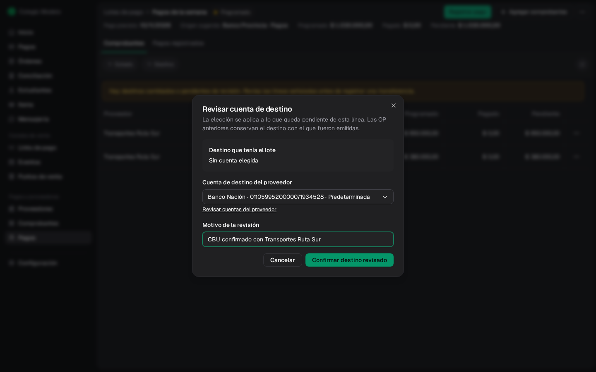
</Frame>

La revisión cambia solo lo que queda pendiente de esa línea. Las OP ya registradas conservan el destino con el que se emitieron.

## Registrar los pagos del lote

Cada orden de pago es de un solo proveedor, así que el lote se paga proveedor por proveedor.

<Steps>
  <Step title="Elegí el proveedor">
    Tocá **Registrar pago**. Si el lote tiene varios proveedores, elegí uno de la lista (muestra cuánto tiene reservado cada uno). También podés usar **⋯ → Registrar pago** en una línea.
  </Step>
  <Step title="Revisá y registrá">
    El pago incluye todas las líneas pendientes de ese proveedor, por lo reservado. El medio, el origen y el destino vienen del plan del lote; cambiá lo que haga falta y tocá **Registrar pago**.
  </Step>
</Steps>

<Frame>
  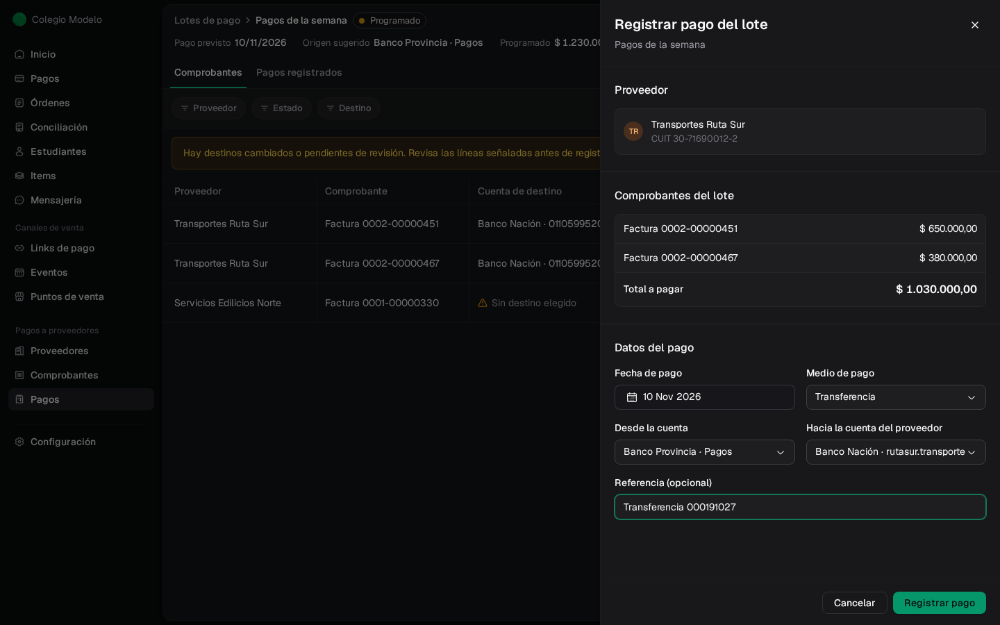
</Frame>

Cada registro genera su propia OP, que también aparece en **Pagos**. El lote pasa a **Registrado en parte** mientras quede algo reservado.

<Frame>
  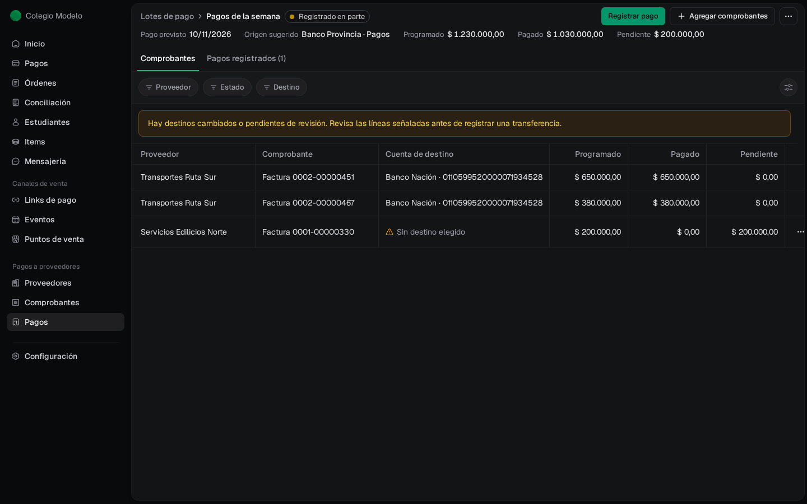
</Frame>

Si las líneas de un mismo proveedor van a cuentas distintas, registralas por separado. Si querés pagar menos de lo reservado, primero liberá la diferencia.

## Liberar una reserva

Cuando una parte ya no se va a pagar en este lote, abrí **⋯ → Liberar reserva** en la línea. Indicá el **Importe a liberar**, la **Fecha efectiva** y el **Motivo**, y tocá **Confirmar liberación**. Ese importe vuelve a quedar pendiente sin lote.

<Frame>
  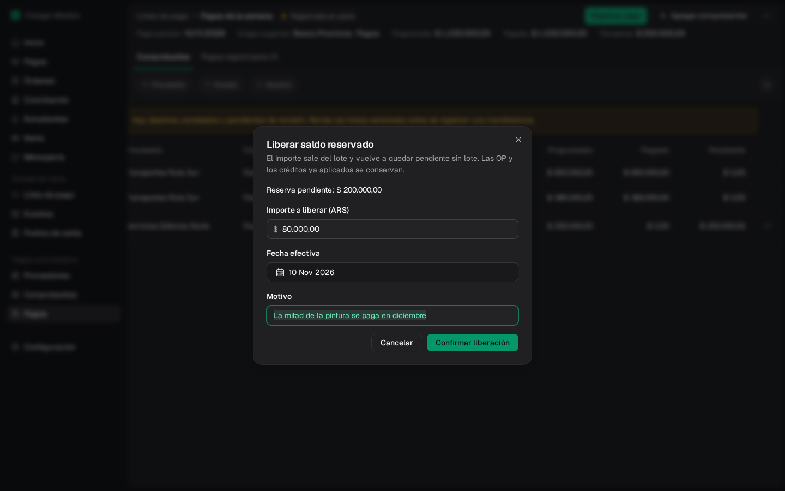
</Frame>

En el ejemplo quedan \$120.000 reservados de la factura de pintura. En la ficha del proveedor se ve así: lo reservado sigue siendo deuda.

<Frame>
  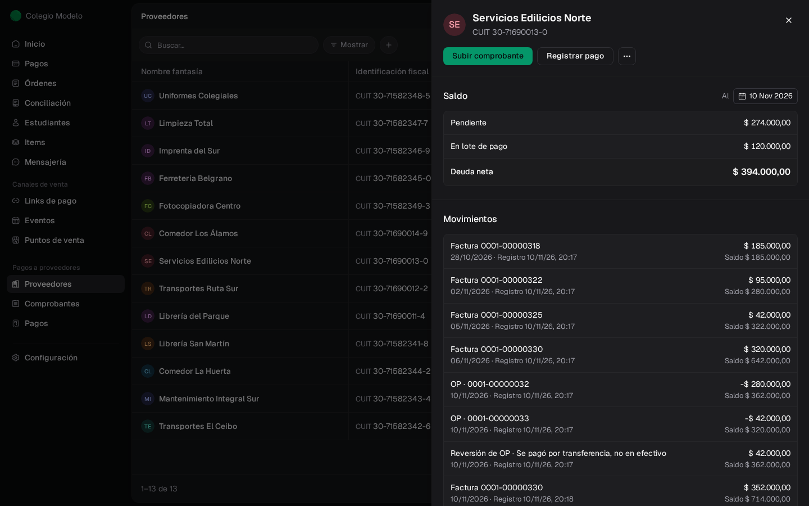
</Frame>

## Cambiar el plan o cerrar el lote

En **⋯** del lote:

- **Editar planificación** cambia el nombre, la fecha prevista o el origen sugerido. Los pagos ya registrados no cambian.
- **Cancelar lo pendiente** libera todas las reservas que quedan y cierra el lote. Pedí una **Fecha efectiva** y un **Motivo**. Las OP y los créditos ya aplicados se conservan: no se anula ningún pago.

<Frame>
  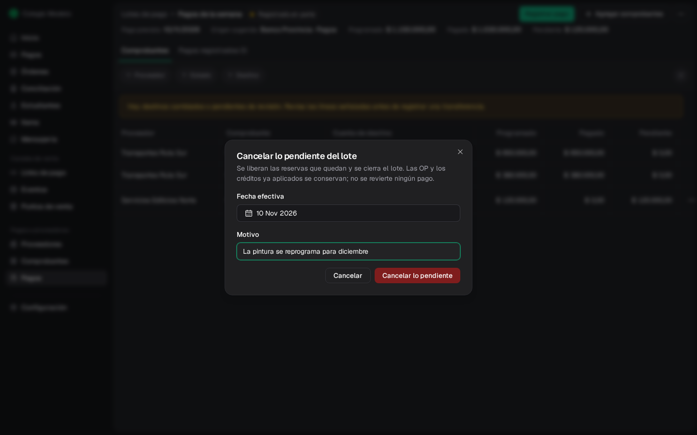
</Frame>

Para corregir un pago del lote registrado por error, anulá esa OP desde **Pagos** (ver [Corregir un pago registrado por error](/docs/guides/proveedores-pagos#corregir-un-pago-registrado-por-error)). Si el lote sigue abierto, el importe vuelve a quedar reservado.

<Frame>
  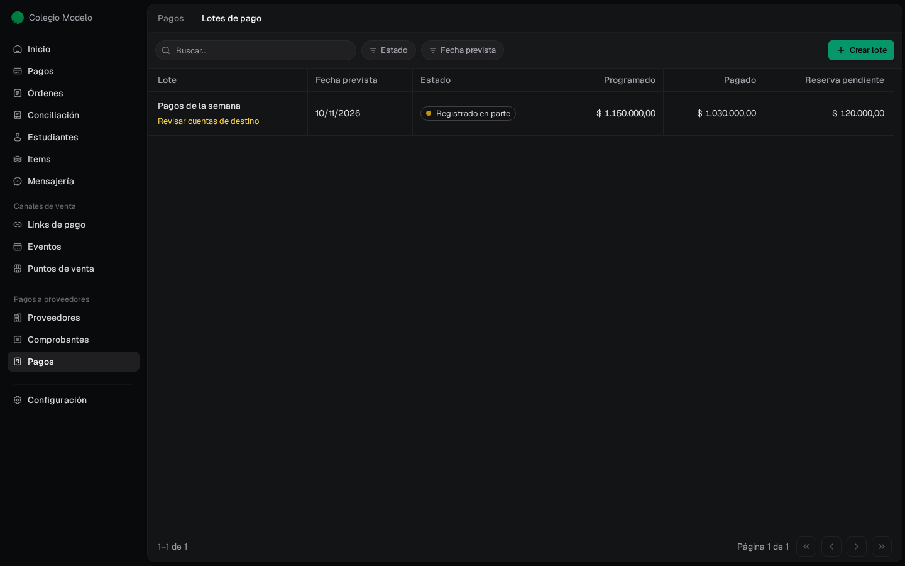
</Frame>

## Preguntas frecuentes

<AccordionGroup>
  <Accordion title="¿Reservar en un lote baja la deuda?">
    No. La deuda baja cuando registrás el pago. En la ficha del proveedor, lo reservado aparece como **En lote de pago** y sigue sumando a la deuda neta.
  </Accordion>
  <Accordion title="No puedo pagar un comprobante desde Por pagar">
    Está reservado en un lote. Registrá el pago desde ese lote, o liberá la reserva si lo vas a pagar por fuera.
  </Accordion>
  <Accordion title="¿Por qué el lote dice Revisar cuentas de destino?">
    Hay líneas sin cuenta de destino elegida o cuyo proveedor cambió la cuenta. Revisalas con **⋯ → Revisar destino** antes de registrar transferencias.
  </Accordion>
  <Accordion title="¿Puedo tener el mismo comprobante en dos lotes?">
    Sí, por partes: cada lote reserva una porción y entre todos no pueden superar el pendiente del comprobante.
  </Accordion>
</AccordionGroup>
