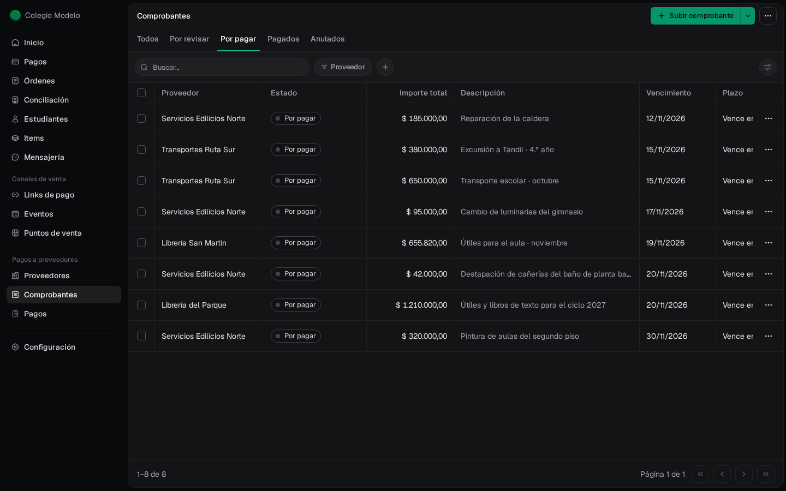
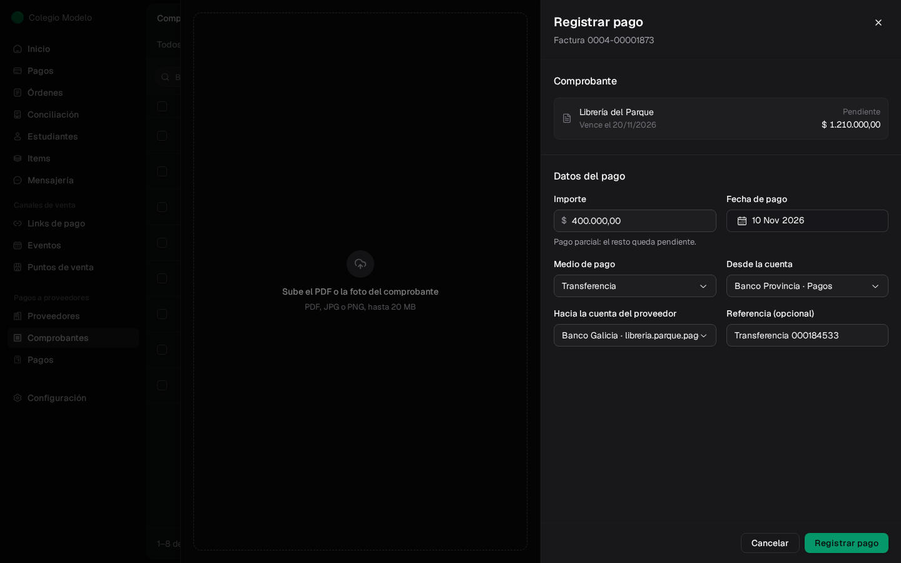
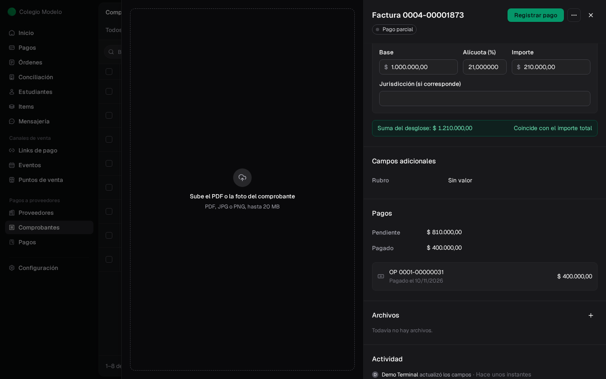
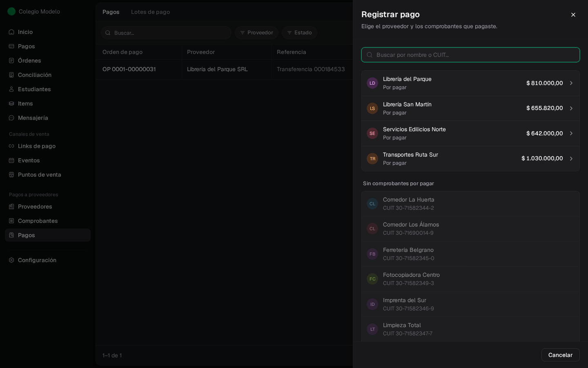
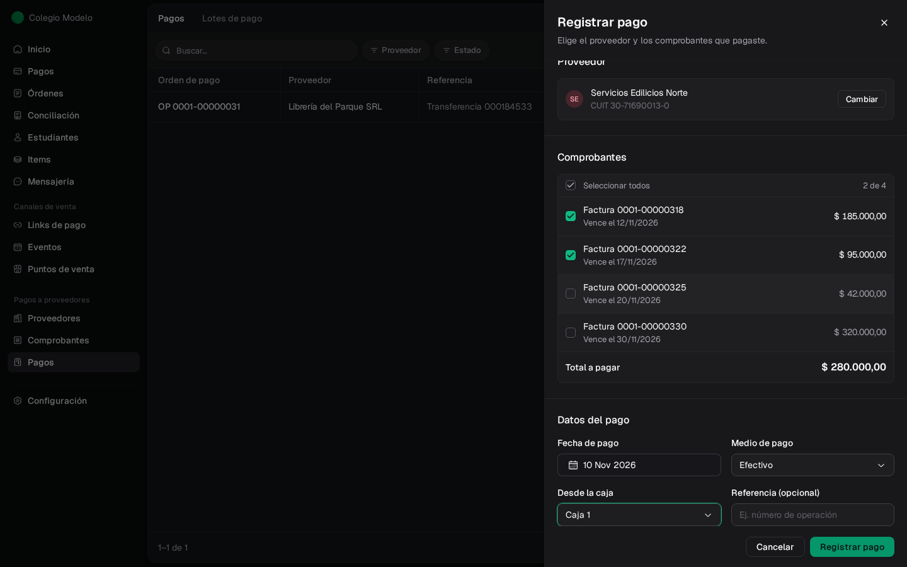
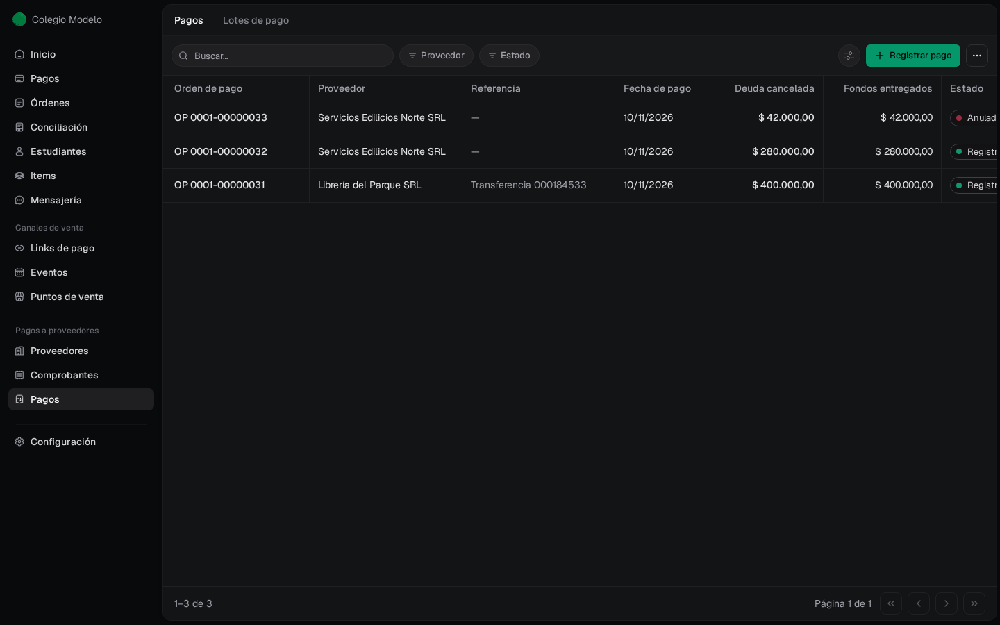
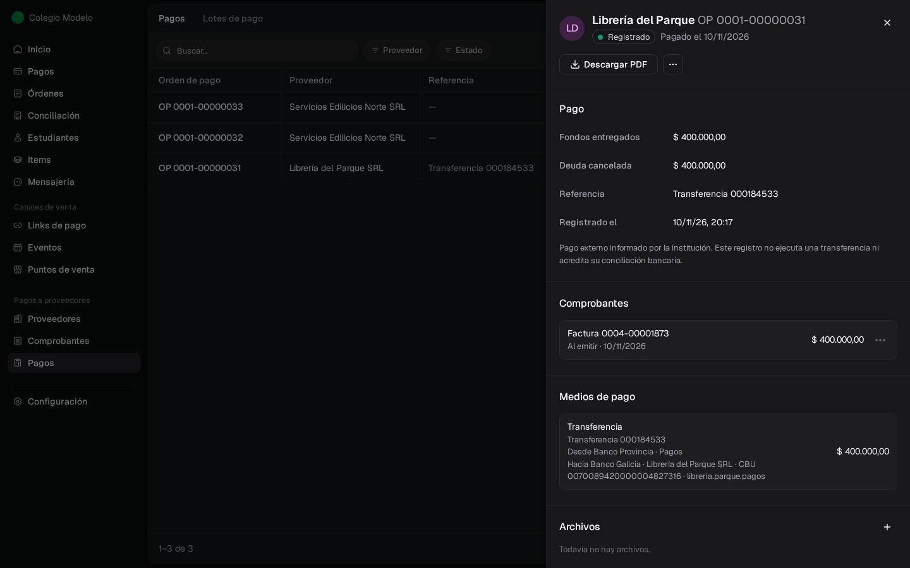
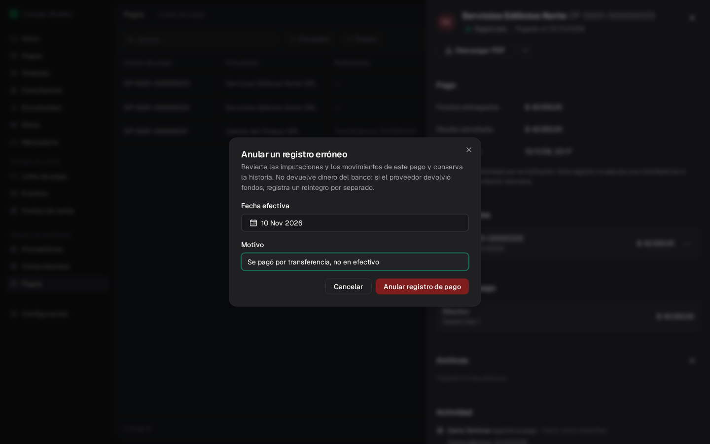

Cuando le pagás a un proveedor, registrás ese pago en Fint para que el comprobante baje su saldo y quede una **orden de pago** (OP) numerada. Necesitás ser **Administrador** y tener activo **Pagos a proveedores**.

<Info>
  Registrar un pago no hace la transferencia ni mueve dinero: deja constancia de un pago que ya hiciste por fuera (homebanking, efectivo, cheque). Tampoco lo concilia con el extracto del banco.
</Info>

## Qué hay para pagar

En **Comprobantes**, la pestaña **Por pagar** muestra los comprobantes aprobados que todavía tienen saldo. Desde cada fila, el menú **⋯** ofrece **Registrar pago** y **Agregar a un lote**.

<Frame>
  
</Frame>

Un comprobante aparece acá recién cuando está aprobado. Mientras está **Por revisar**, todavía no es deuda: ver [Comprobantes](/docs/guides/proveedores-comprobantes).

## Pagar un comprobante, entero o una parte

<Steps>
  <Step title="Abrí el comprobante">
    Hacé clic en la fila y tocá **Registrar pago** (o usá **⋯ → Registrar pago** en la fila).
  </Step>
  <Step title="Completá el pago">
    El **Importe** viene con todo lo pendiente. Si pagás menos, aparece *Pago parcial: el resto queda pendiente*. No puede superar lo pendiente.

    Elegí la **Fecha de pago** (hoy o antes), el **Medio de pago** y de dónde salió la plata.
  </Step>
  <Step title="Registrá">
    Tocá **Registrar pago**. El comprobante queda en **Pago parcial** o **Pagado**.
  </Step>
</Steps>

<Frame>
  
</Frame>

En el ejemplo, la factura de \$1.210.000 recibe un pago de \$400.000 y quedan \$810.000 pendientes. La sección **Pagos** del comprobante muestra el pendiente, lo pagado y cada OP.

<Frame>
  
</Frame>

### Medios de pago

Cada pago tiene **un solo medio**. Si pagaste una factura con dos medios (por ejemplo, parte en efectivo y parte por transferencia), registrá dos pagos.

| Medio | Desde | Qué más pide |
| --- | --- | --- |
| **Transferencia** | Una cuenta bancaria de la institución | **Hacia la cuenta del proveedor**. Referencia opcional |
| **Efectivo** | Una caja | Referencia opcional |
| **Cheque**, **Echeq**, **Tarjeta**, **Mercado Pago**, **Otro medio** | Una cuenta bancaria | **Referencia** obligatoria (en cheques, el número de cheque) |

- Las cuentas y cajas que aparecen en **Desde la cuenta** / **Desde la caja** se configuran en [Cajas y cuentas de pago](/docs/guides/proveedores-configuracion). Si falta una, elegí **+ Crear cuenta** o **+ Crear caja** sin salir del pago. También podés elegir **Sin cuenta** o **Sin caja**.
- En **Hacia la cuenta del proveedor** solo se pueden elegir cuentas en pesos **verificadas**. Una cuenta sin verificar aparece deshabilitada con la marca *sin revisar*: verificala primero desde la [ficha del proveedor](/docs/guides/proveedores-directorio). También podés elegir **Sin cuenta de destino** o **+ Agregar cuenta del proveedor**.
- Los pagos son siempre en pesos. Un comprobante cargado en dólares se paga por su equivalente en pesos.

## Pagar varios comprobantes juntos

Si pagaste varias facturas del mismo proveedor en un solo movimiento, registralas en una sola OP.

<Steps>
  <Step title="Elegí el proveedor">
    En **Pagos**, tocá **Registrar pago**. Arriba aparecen los proveedores con deuda y cuánto se les debe; los que no tienen comprobantes por pagar aparecen abajo, deshabilitados. También podés empezar desde la ficha del proveedor con **Registrar pago**.
  </Step>
  <Step title="Marcá los comprobantes">
    Cada comprobante elegido se paga por todo su pendiente. **Total a pagar** suma la selección.
  </Step>
  <Step title="Completá el medio y registrá">
    Igual que con un comprobante solo.
  </Step>
</Steps>

<Frame>
  
</Frame>

<Frame>
  
</Frame>

Para pagar solo una parte de un comprobante, registrá el pago desde ese comprobante.

## Antes de pagar: crédito a favor y lotes

- **Si el proveedor tiene crédito a favor** (una nota de crédito o un anticipo sin usar), el pago avisa cuánto crédito hay y pide un **Motivo para pagar sin aplicar el crédito**. Si preferís usarlo, aplicalo primero: ver [Créditos, anticipos y reintegros](/docs/guides/proveedores-creditos).
- **Si el comprobante está reservado en un lote de pago**, no se paga suelto: el pago se registra desde el lote, para no pagarlo dos veces. Ver [Lotes de pago](/docs/guides/proveedores-lotes).

## Consultar los pagos

**Pagos** lista todas las órdenes de pago: número de OP, proveedor, referencia, fecha de pago, **Deuda cancelada**, **Fondos entregados** y estado (**Registrado** o **Anulado**). Podés buscar, filtrar por **Proveedor** y **Estado**, y elegir columnas.

<Frame>
  
</Frame>

Hacé clic en una OP para ver su detalle: los comprobantes que canceló, el medio con su origen y destino, archivos y actividad. **Descargar PDF** baja la orden de pago (`OP-0001-….pdf`) para archivarla o mandarla al proveedor.

<Frame>
  
</Frame>

Las OP se numeran solas (`0001-00000001`, `0001-00000002`…).

## Corregir un pago registrado por error

Si registraste un pago que no corresponde (otro medio, otro importe, otro comprobante), anulá ese registro y cargá el correcto.

<Steps>
  <Step title="Abrí la OP">
    Desde **Pagos**, abrí la orden de pago.
  </Step>
  <Step title="Anulá">
    En **⋯**, elegí **Anular registro de pago**. Indicá la **Fecha efectiva** y el **Motivo**, y confirmá.
  </Step>
</Steps>

<Frame>
  
</Frame>

La OP queda **Anulado** y conserva su historia; el comprobante vuelve a tener el importe pendiente. Si el pago salía de una caja o una cuenta, ese movimiento también se revierte. Si el pago era de un lote que sigue abierto, el importe vuelve a quedar reservado en el lote.

<Note>
  Anular no es una devolución de dinero. Si el proveedor te devolvió plata de verdad, registrá un [reintegro](/docs/guides/proveedores-creditos#registrar-un-reintegro). Una OP con un reintegro registrado no se puede anular hasta corregir ese reintegro.
</Note>

## Preguntas frecuentes

<AccordionGroup>
  <Accordion title="¿Registrar el pago hace la transferencia al proveedor?">
    No. Fint deja constancia de un pago que ya hiciste. La transferencia la hacés desde tu banco.
  </Accordion>
  <Accordion title="Pagué una factura con efectivo y transferencia, ¿cómo lo cargo?">
    Registrá dos pagos sobre el mismo comprobante, uno por cada medio. El primero queda como pago parcial.
  </Accordion>
  <Accordion title="¿Por qué no puedo elegir la cuenta del proveedor?">
    Solo se puede transferir a cuentas en pesos verificadas. Verificala desde la ficha del proveedor o elegí **Sin cuenta de destino**.
  </Accordion>
  <Accordion title="¿Por qué me pide un motivo para pagar?">
    El proveedor tiene crédito a favor sin usar. Podés aplicarlo antes o explicar por qué pagás igual.
  </Accordion>
  <Accordion title="El botón Registrar pago está deshabilitado">
    Pasá el mouse por encima: dice qué falta. Lo más común es un comprobante reservado en un lote (se paga desde el lote) o un campo obligatorio vacío.
  </Accordion>
</AccordionGroup>
