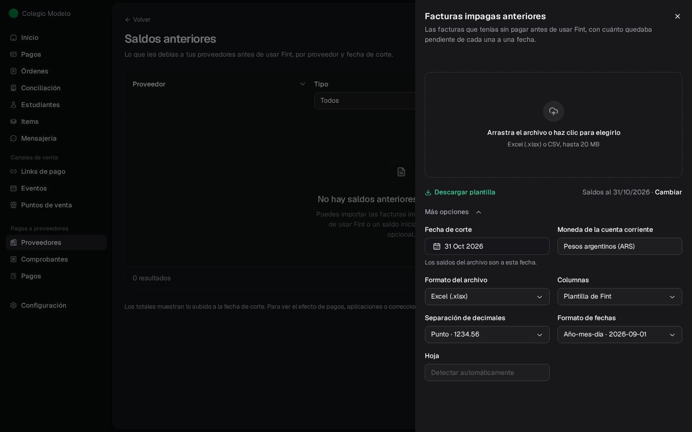
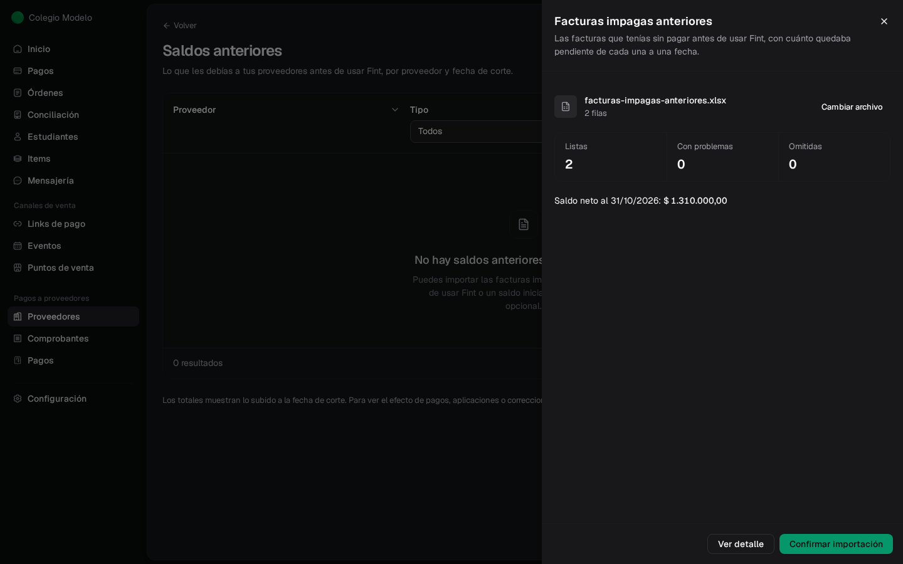
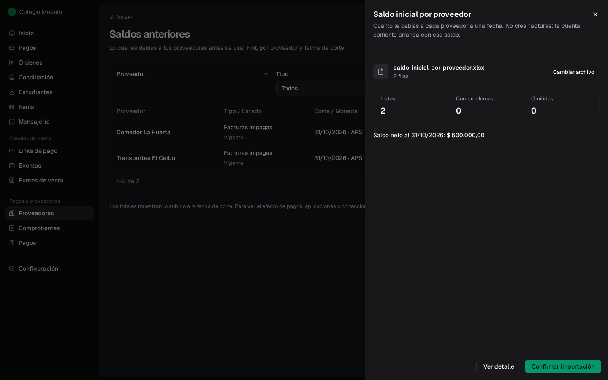
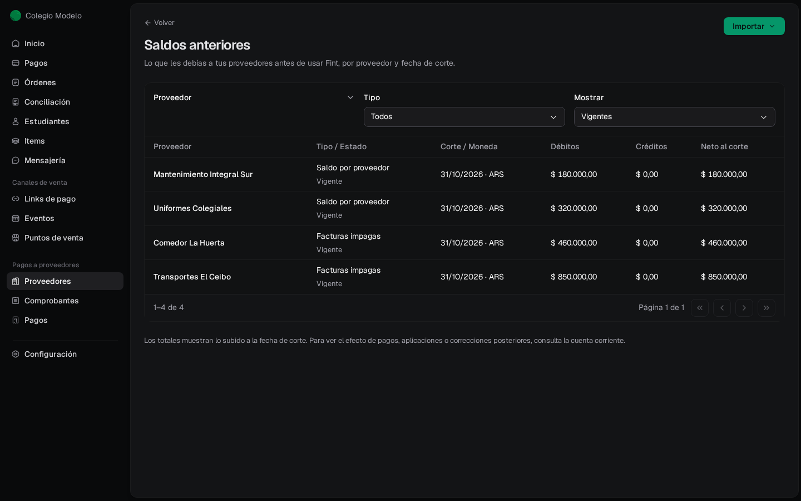
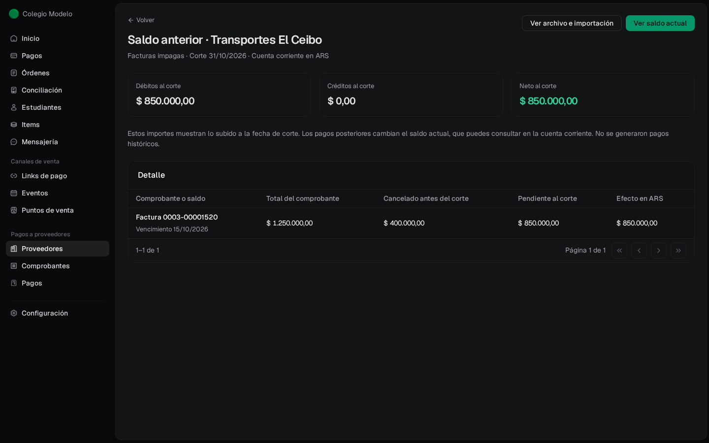

Cuando empezás a usar **Pagos a proveedores**, seguramente ya tenías facturas sin pagar. En lugar de cargarlas como comprobantes nuevos, incorporalas como **saldo anterior** a una **fecha de corte**: la cuenta corriente de cada proveedor arranca con lo que le debías ese día, sin inventar pagos pasados. Necesitás ser **Administrador**.

Hay dos formas. Usá **una sola por proveedor**:

<CardGroup cols={2}>
  <Card title="Facturas impagas anteriores" icon="file-invoice">
    Cada factura que tenías sin pagar, con su total y cuánto quedaba pendiente al corte. Después las pagás una por una, igual que una factura nueva.
  </Card>
  <Card title="Saldo inicial por proveedor" icon="calculator">
    Si no tenés el detalle: cuánto le debías a cada proveedor. No crea facturas; la cuenta corriente arranca con ese saldo.
  </Card>
</CardGroup>

## Dónde se importan

- Al empezar, desde las opciones de **Proveedores** o **Comprobantes** vacíos: **Saldo inicial por proveedor** y **Facturas impagas anteriores**. Ver [primeros pasos](/docs/guides/proveedores#primeros-pasos).
- En la pantalla **Saldos anteriores**, con el botón **Importar**. Llegás a ella desde el detalle de una importación de saldos, con **Ver saldos anteriores**.

## Antes de importar

El saldo anterior es el punto de partida de la cuenta corriente, así que va **antes** de operar con ese proveedor en Fint:

- El proveedor no tiene que tener comprobantes aprobados ni pagos registrados. Importá los saldos anteriores primero y después aprobá las facturas nuevas.
- Si ya subiste comprobantes de ese proveedor con fecha igual o anterior al corte y siguen **Por revisar**, anulalos antes: esa deuda ya la incluye el saldo anterior.

## Importar las facturas impagas

<Steps>
  <Step title="Elegí la fecha de corte">
    Abrí **Facturas impagas anteriores**, desplegá **Más opciones** y elegí la **Fecha de corte**: el día al que corresponden los saldos del archivo. La cuenta corriente es en pesos.
  </Step>
  <Step title="Prepará la planilla">
    **Descargar plantilla** baja las columnas de un comprobante más **saldo_pendiente**: cuánto quedaba sin pagar de esa factura al corte. Si la factura estaba pagada en parte, poné el total en **total** y lo que faltaba en **saldo_pendiente**. Una nota de crédito sin usar va con el tipo **NC**, y un anticipo que le habías dado al proveedor, con el tipo **ANTICIPO**: los dos quedan como crédito a favor del colegio.
  </Step>
  <Step title="Subí y confirmá">
    Arrastrá el archivo, revisá el **Saldo neto** al corte y tocá **Confirmar importación**.
  </Step>
</Steps>

<Frame>
  
</Frame>

<Frame>
  
</Frame>

En el ejemplo, la factura de octubre de Transportes El Ceibo era de $1.250.000 y al 31/10 quedaban $850.000. Fint incorpora los $850.000 como deuda y muestra los $400.000 como **Cancelado antes del corte**, sin registrar un pago nuevo. Las facturas quedan **Por pagar** en **Comprobantes**, con su número y vencimiento.

## Importar el saldo por proveedor

Es igual, con **Saldo inicial por proveedor**: elegí la fecha de corte y subí una planilla con el proveedor, la moneda (ARS) y **saldo_neto**. Un saldo positivo es lo que le debías; uno negativo, un crédito a favor del colegio. Los proveedores que no existan se crean con los datos del archivo. En **Comprobantes**, cada saldo aparece como **Saldo inicial**: el positivo queda listo para pagar y el negativo se usa como cualquier crédito, aplicándolo a una factura o registrando un reintegro (ver [Créditos, anticipos y reintegros](/docs/guides/proveedores-creditos)).

<Frame>
  
</Frame>

## Consultar los saldos anteriores

La pantalla **Saldos anteriores** lista cada proveedor con su tipo (**Facturas impagas** o **Saldo por proveedor**), la fecha de corte, los débitos, los créditos y el **Neto al corte**. Podés filtrar por proveedor, tipo y si mostrar los deshechos.

<Frame>
  
</Frame>

Tocá un proveedor para ver el detalle: cada factura con su total, lo cancelado antes del corte y lo pendiente. **Ver saldo actual** abre su cuenta corriente y **Ver archivo e importación** vuelve a la importación de origen.

<Frame>
  
</Frame>

Los importes de esta pantalla son los del corte. Los pagos que registres después cambian el saldo actual, que ves en la [cuenta corriente](/docs/guides/proveedores-cuenta-corriente).

## Preguntas frecuentes

<AccordionGroup>
  <Accordion title="¿Puedo usar las dos formas para el mismo proveedor?">
    No. Cada proveedor tiene una sola forma y una sola fecha de corte. Con facturas impagas podés importar más partidas después, a la misma fecha de corte; con un saldo inicial, no se puede sumar otro. Elegí facturas impagas si tenés el detalle, o un saldo único si no.
  </Accordion>
  <Accordion title="Me equivoqué en un saldo anterior">
    Deshacé la fila desde el detalle de la importación (**Deshacer**) y volvé a importarla corregida. Ver [Deshacer filas importadas](/docs/guides/proveedores-importaciones#deshacer-filas-importadas).
  </Accordion>
  <Accordion title="Tengo una factura anterior al corte que ya está en el saldo inicial">
    Si la importás después desde Excel como comprobante, con fecha igual o anterior al corte, queda como registro histórico: conserva el archivo y los datos, no vuelve a sumar deuda y no se aprueba. Pasa lo mismo aunque marques **Aprobar también los comprobantes**.
  </Accordion>
</AccordionGroup>
