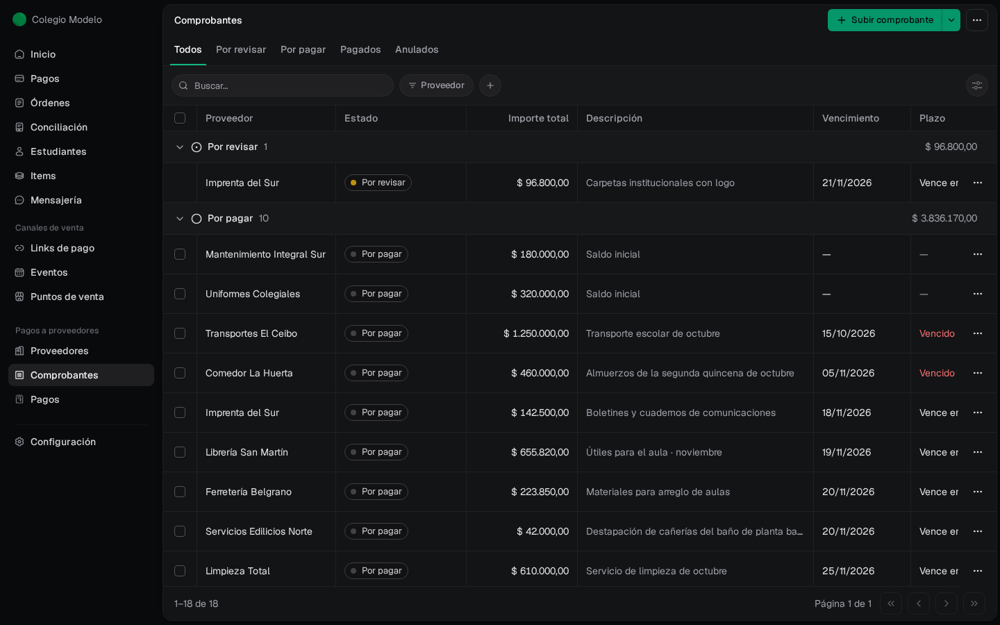
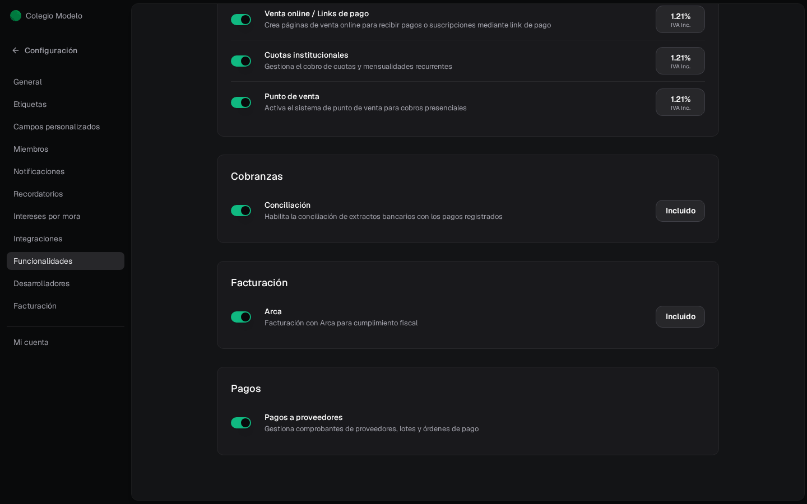
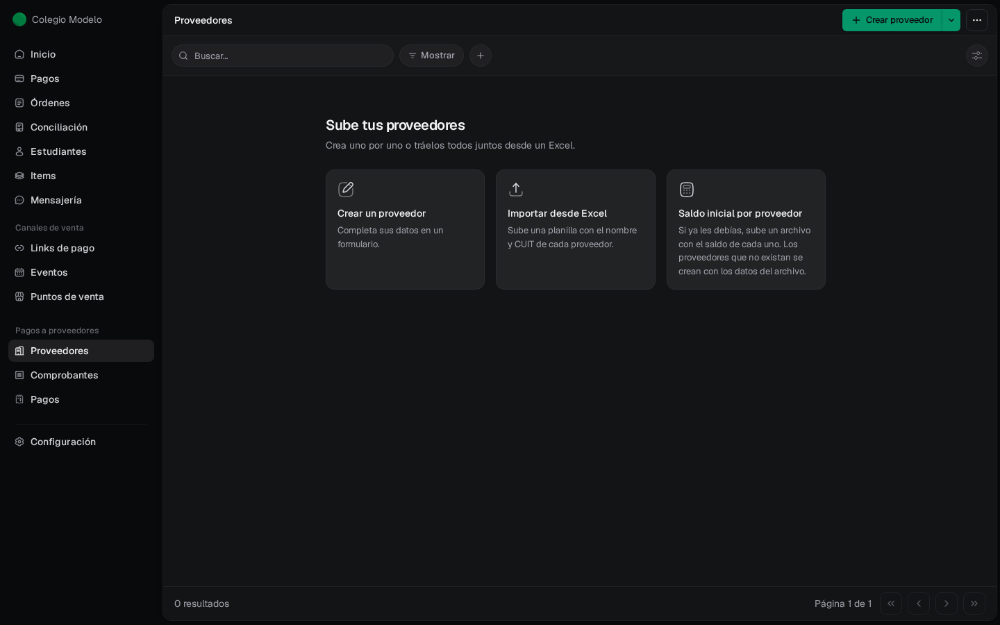
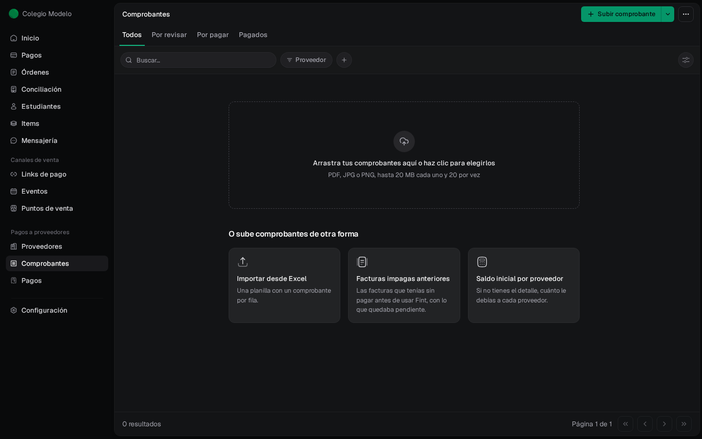

**Pagos a proveedores** ordena lo que el colegio le debe a quienes le venden o le prestan servicios: la librería, el transporte escolar, el mantenimiento, el comedor. Subís cada factura, la revisás, la aprobás y, cuando la pagás, queda registrada la orden de pago. Cada proveedor tiene su cuenta corriente con lo pendiente y lo pagado.

Fint no mueve dinero: registra los pagos que hacés por homebanking, en efectivo o con cheque, para que la deuda esté al día.

<Frame>
  
</Frame>

## Quién lo usa

- Solo los **administradores** de la organización. Los roles **Cajero** y **Acomodador** no ven el módulo.
- La organización tiene que tener activa la función **Pagos a proveedores**. Un administrador la prende en **Configuración → Funcionalidades**, sección **Pagos**.

<Frame>
  
</Frame>

Con la función activa, el menú lateral muestra el grupo **Pagos a proveedores** con tres secciones:

| Sección | Para qué |
| --- | --- |
| **Proveedores** | El directorio: datos fiscales, cuentas bancarias de destino, archivos, notas y la cuenta corriente de cada proveedor. |
| **Comprobantes** | Facturas, notas de crédito, tickets y gastos. Se suben, se revisan y se aprueban; las pestañas separan lo que falta revisar, lo que hay que pagar y lo pagado. |
| **Pagos** | Las órdenes de pago registradas y los lotes de pago. |

## Primeros pasos

La primera vez que entrás, **Proveedores** está vacío y te ofrece tres formas de empezar. Fint ya deja preparados los datos más comunes de cada proveedor (razón social, condición fiscal, email y teléfono) y el campo **Rubro** de los comprobantes; podés cambiarlos después.

<Frame>
  
</Frame>

- **Crear un proveedor**: completás un formulario. Ver [Proveedores](/docs/guides/proveedores-directorio).
- **Importar desde Excel**: subís una planilla con el nombre y CUIT de cada uno. Ver [Importar desde Excel](/docs/guides/proveedores-importaciones).
- **Saldo inicial por proveedor**: si ya les debías algo antes de usar Fint. Cargalo antes de aprobar comprobantes o registrar pagos de ese proveedor. Ver [Saldos anteriores](/docs/guides/proveedores-saldos-anteriores).

**Comprobantes** vacío te deja arrastrar los primeros PDF o fotos de facturas, o importarlos desde una planilla.

<Frame>
  
</Frame>

## El recorrido de una factura

<Steps>
  <Step title="Subís el comprobante">
    En **Comprobantes → Subir comprobante** cargás el PDF o la foto. Fint lee los datos y lo deja **Por revisar**. Ver [Comprobantes](/docs/guides/proveedores-comprobantes).
  </Step>
  <Step title="Lo revisás y lo aprobás">
    Controlás proveedor, número, fechas e importes y tocás **Aprobar comprobante**. Recién ahí la deuda entra en la cuenta corriente y el comprobante pasa a **Por pagar**.
  </Step>
  <Step title="Registrás el pago">
    Desde el comprobante o el proveedor, **Registrar pago** deja una orden de pago con el medio usado. Ver [Registrar pagos](/docs/guides/proveedores-pagos) y [Lotes de pago](/docs/guides/proveedores-lotes).
  </Step>
</Steps>

## Guías del módulo

<CardGroup cols={2}>
  <Card title="Configurar el módulo" icon="sliders" href="/docs/guides/proveedores-configuracion">
    Qué datos pedir de cada proveedor y comprobante, y desde qué cajas y cuentas pagás.
  </Card>
  <Card title="Proveedores" icon="building" href="/docs/guides/proveedores-directorio">
    Alta, ficha, cuentas de destino, archivos y notas.
  </Card>
  <Card title="Comprobantes" icon="file-invoice" href="/docs/guides/proveedores-comprobantes">
    Subir, completar, aprobar y anular facturas y gastos.
  </Card>
  <Card title="Importar desde Excel" icon="file-excel" href="/docs/guides/proveedores-importaciones">
    Proveedores y comprobantes en cantidad, con revisión fila por fila.
  </Card>
  <Card title="Saldos anteriores" icon="clock-rotate-left" href="/docs/guides/proveedores-saldos-anteriores">
    Lo que ya les debías antes de usar Fint.
  </Card>
  <Card title="Registrar pagos" icon="money-bill-transfer" href="/docs/guides/proveedores-pagos">
    Órdenes de pago, pagos parciales y correcciones.
  </Card>
  <Card title="Lotes de pago" icon="layer-group" href="/docs/guides/proveedores-lotes">
    Reservar lo que vas a pagar en una fecha y registrarlo proveedor por proveedor.
  </Card>
  <Card title="Créditos y anticipos" icon="hand-holding-dollar" href="/docs/guides/proveedores-creditos">
    Notas de crédito, anticipos y reintegros.
  </Card>
  <Card title="Cuenta corriente" icon="scale-balanced" href="/docs/guides/proveedores-cuenta-corriente">
    Saldo a una fecha, movimientos y corrección de importes.
  </Card>
</CardGroup>

## Preguntas frecuentes

<AccordionGroup>
  <Accordion title="¿Subir una factura ya cuenta como deuda?">
    No. Mientras está **Por revisar** no suma en la cuenta corriente. La deuda se reconoce al **aprobar** el comprobante.
  </Accordion>
  <Accordion title="¿Fint paga a los proveedores?">
    No. Registra el pago que hiciste por tu banco, en efectivo o con cheque, y deja la orden de pago para tu control.
  </Accordion>
  <Accordion title="¿Un cajero puede cargar facturas de proveedores?">
    No. El módulo es solo para administradores.
  </Accordion>
</AccordionGroup>
