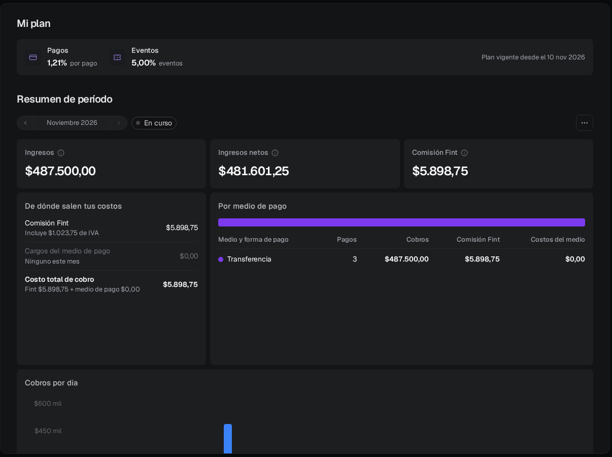
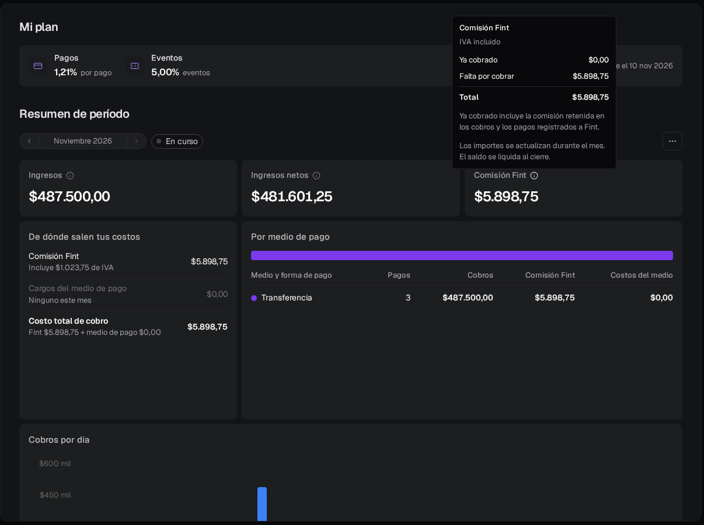
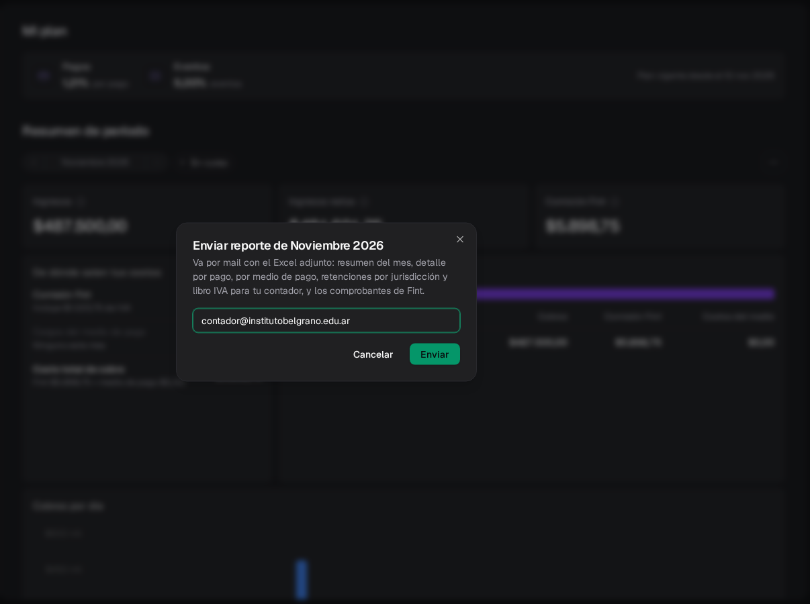
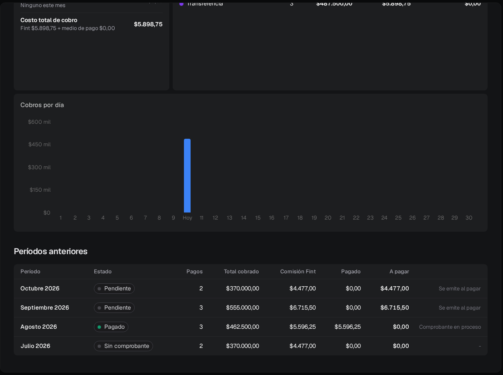
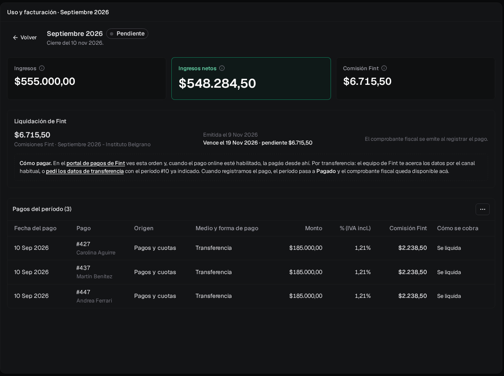
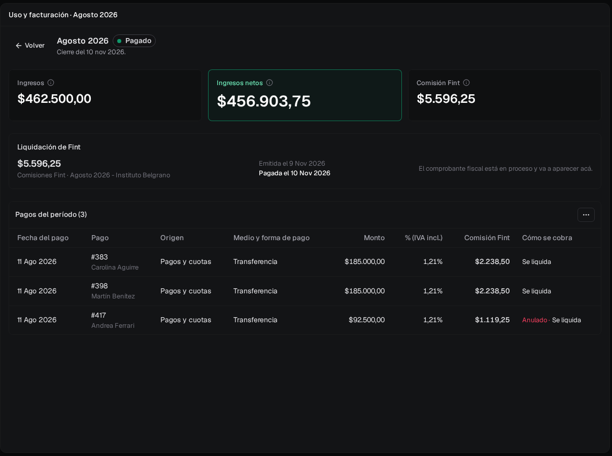

**Uso y facturación** muestra lo que Fint le cobra a tu organización: tu plan, cuánto cobraste en el mes, la comisión de Fint y, mes por mes, qué ya está pago y qué queda pendiente. Está en el menú lateral, debajo de **Configuración**, y la ve el **administrador**.

## Cómo cobra Fint

Fint cobra una comisión por cada pago que registrás o que entra por un procesador. En el plan habitual es un porcentaje del monto, uno para pagos y cuotas y otro para eventos, **con IVA incluido**. Esa comisión se cobra de una de dos formas, y en un mismo mes pueden convivir las dos:

<CardGroup cols={2}>
  <Card title="Retenida en el cobro" icon="bolt">
    Con **Mercado Pago** (cobros online, salvo suscripciones) o **Pagos360**, la comisión se descuenta en el mismo pago. No hay nada que pagar después.
  </Card>
  <Card title="Se liquida a fin de mes" icon="file-invoice">
    Los pagos **manuales** (efectivo, transferencia), Mercado Pago Point, las suscripciones, Stripe y Nuvei acumulan la comisión. Al cerrar el mes Fint emite una **liquidación** con el total.
  </Card>
</CardGroup>

Si el pago incluye un costo de servicio que paga quien compra (por ejemplo, en una entrada), la comisión se calcula sin ese costo. En Stripe y Nuvei, que cobran en dólares, la comisión no lleva IVA.

## Mi plan

Arriba de todo está tu plan y desde cuándo rige (**Plan vigente desde el…**).

<Frame>
  
</Frame>

| Plan | Cómo se calcula la comisión |
| --- | --- |
| Por porcentaje (el habitual) | Un porcentaje de cada pago: uno para **Pagos** y otro para **Eventos**. |
| **Monto fijo por pago** | Un importe fijo por cada pago, sin importar el monto. Puede tener otro importe para las entradas de eventos. |
| **Plan mensual** | Un abono por mes que incluye una cantidad de pagos. Los incluidos no pagan comisión; los que pasan esa cantidad pagan el excedente acordado. La pantalla muestra cuántos usaste (**1 de 2 pagos incluidos usados este mes**) y el abono se suma a la liquidación. |

Con un plan fijo o mensual la comisión siempre se liquida a fin de mes. Cada pago se calcula con el plan que regía cuando se registró: un cambio de plan no modifica lo ya cobrado. Si un mes tuvo dos planes, el detalle del período lo aclara.

Los planes fijos y mensuales los configura Fint. Si tu acuerdo no coincide con lo que ves, escribinos a [soporte@fint.app](mailto:soporte@fint.app).

## Resumen del mes

En **Resumen de período** elegís el mes con las flechas. El mes actual dice **En curso** y se actualiza con cada pago.

- **Ingresos**: el total cobrado en el mes. El ícono de información dice cuántos pagos son y cuántos se anularon.
- **Ingresos netos**: lo que te queda después de los costos del medio de pago y de la comisión de Fint.
- **Comisión Fint**: la comisión del mes, con IVA. El ícono de información la separa en **Ya cobrado** (lo retenido en los cobros y lo que ya le pagaste a Fint) y **Falta por cobrar**.

<Frame>
  
</Frame>

Debajo:

- **De dónde salen tus costos**: la comisión de Fint (con su IVA), el abono si tenés plan mensual, los cargos del medio de pago y los impuestos y retenciones que descontó el medio. Termina en **Costo total de cobro**. Lo que pagó quien compró (financiación, impuestos propios) no está acá porque no sale de tus cobros.
- **Por origen** y **Por medio de pago**: los mismos números repartidos entre pagos y cuotas, eventos y suscripciones, y entre cada medio y forma de pago (por ejemplo, Mercado Pago con tarjeta de crédito o Transferencia). **Por origen** solo aparece si cobraste de más de un origen.
- **Cobros por día**: lo que entró cada día del mes.

Si el medio de pago todavía retiene parte del dinero, debajo de los números dice cuánto está liberado y cuándo se libera el resto.

<Tip>
  Si ves el aviso de que algunos pagos todavía no tienen la comisión calculada, esperá unos minutos: el cálculo corre solo después de cada pago y los totales se actualizan.
</Tip>

## Ver los pagos, descargar y enviar

El botón **…** a la derecha del mes tiene:

- **Ver pagos del mes** (o **Ver detalle del período** si el mes ya cerró): cada pago con su fecha, quién pagó, origen, medio, monto, el porcentaje aplicado, la comisión y **Cómo se cobra** (**Se liquida** o **Retenida**).
- **Descargar Excel**: el archivo `fint-uso-<año>-<mes>.xlsx` con las hojas **Resumen**, **Pagos**, **Por medio de pago**, **Impuestos y retenciones**, **Por jurisdicción**, **Resumen impuestos**, **Comprobantes** y **Libro IVA**.
- **Descargar CSV (zip)**: lo mismo, un CSV por hoja con los importes sin formato, para importar en un sistema contable.
- **Enviar reporte por mail**: el mismo Excel, adjunto, a la dirección que escribas (tu contador, por ejemplo).

<Frame>
  
</Frame>

Al enviarlo aparece **Reporte de Noviembre 2026 enviado a …**. Los certificados de retención y las facturas por las comisiones del medio de pago los emite cada medio a tu nombre: se descargan desde tu cuenta en ese medio.

## Períodos anteriores

Cuando termina el mes, Fint lo cierra. En **Períodos anteriores** hay una fila por mes con los pagos, el total cobrado, la comisión, lo pagado, lo que queda **A pagar** y, a la derecha, el comprobante.

<Frame>
  
</Frame>

| Estado | Qué significa |
| --- | --- |
| **En curso** | El mes no cerró. Los importes cambian con cada pago. |
| **Calculando cierre** | Fint está cerrando el período. Tarda unos minutos. |
| **Pendiente** | Fint emitió la liquidación y falta pagarla. Pasando el mouse se ve el vencimiento. |
| **Pago parcial** | Una parte de la comisión está paga y queda saldo. |
| **Pagado** | La comisión del período está toda paga. |
| **Saldado** | No queda nada por pagar: la comisión se retuvo en cada cobro o no hubo comisión. |
| **Sin comprobante** | Un mes anterior al sistema actual que no tiene una factura asociada. |
| **En revisión** | Fint está revisando el cierre. No tenés que hacer nada. |
| **Recalculando** | Fint está recalculando la comisión con el plan correcto. Se actualiza solo al terminar. |

La última columna dice qué pasa con el comprobante fiscal:

- Un ícono de descarga para cada comprobante: el de la **Liquidación** y, si el medio de pago retuvo comisión, el de la **Comisión retenida**.
- **Se emite al pagar**: la liquidación todavía no está paga. El comprobante fiscal se emite cuando se registra el pago.
- **Comprobante en proceso**: el período está pago y el comprobante va a aparecer en un rato.

En los meses anteriores al sistema actual, el comprobante es la factura que Fint emitió en ese momento (también las invoices en dólares), y se descarga igual.

## Detalle de un período

Tocá el nombre del mes. Arriba están los mismos tres números del mes y, debajo, la **Liquidación de Fint**: importe, fecha de emisión, vencimiento y lo que queda pendiente.

<Frame>
  
</Frame>

Mientras está pendiente, el recuadro **Cómo pagar** tiene el link al **portal de pagos de Fint**, donde ves la orden, y el link **pedí los datos de transferencia**, que arma un mail a soporte con el período ya indicado. Cuando Fint registra el pago, el período pasa a **Pagado** y el comprobante fiscal queda para descargar en el mismo lugar (**Descargar comprobante**).

<Frame>
  
</Frame>

Más abajo, **Pagos del período** lista cada pago con su comisión. Un pago anulado o con contracargo aparece marcado y conserva su comisión. Con plan mensual, la liquidación separa el abono de la comisión por pagos y los pagos incluidos dicen **Incluido en el plan**. Si además hubo comisión retenida por el medio de pago, aparece **Comprobante de la comisión retenida**: ya está cobrada y ese comprobante la respalda.

## Preguntas frecuentes

<AccordionGroup>
  <Accordion title="¿Por qué la comisión es más alta que el porcentaje de mi plan?">
    No lo es: el porcentaje ya incluye IVA. En **De dónde salen tus costos** la comisión dice cuánto de ese importe es IVA, igual que el comprobante.
  </Accordion>
  <Accordion title="Cobro con Mercado Pago y también registro pagos en efectivo. ¿Qué pago a fin de mes?">
    Solo la comisión de los pagos en efectivo o transferencia. La de Mercado Pago ya se retuvo en cada cobro: figura en **Ya cobrado** y en el detalle de cada pago como **Retenida**.
  </Accordion>
  <Accordion title="Anulé un pago o hubo un contracargo. ¿Se devuelve la comisión?">
    No. La comisión de Fint se mantiene, igual que la del medio de pago. Un pago que se **elimina** antes de que cierre el mes sale del período y no paga comisión. Si se elimina después del cierre, sigue en el detalle de ese período marcado **Eliminado**.
  </Accordion>
  <Accordion title="¿Cómo pago la liquidación?">
    Desde el detalle del período: el link al portal de pagos de Fint o **pedí los datos de transferencia**. Cuando Fint registra el pago, el período pasa a **Pagado** y aparece el comprobante.
  </Accordion>
  <Accordion title="¿Por qué un mes viejo dice Sin comprobante?">
    Es un mes anterior al sistema actual que no tiene una factura asociada en Fint. Si necesitás ese comprobante, escribinos a [soporte@fint.app](mailto:soporte@fint.app).
  </Accordion>
  <Accordion title="¿Un pago de fin de mes en qué período cae?">
    En el mes en que se registró en Fint, aunque tenga una fecha de pago anterior. El detalle del período lo aclara cuando pasa.
  </Accordion>
</AccordionGroup>

## Próximos pasos

<CardGroup cols={3}>
  <Card title="Funcionalidades" icon="toggle-on" href="/docs/guides/configuracion-funcionalidades">
    La comisión de cada canal, al lado de su interruptor.
  </Card>
  <Card title="Integraciones" icon="plug" href="/docs/guides/configuracion-integraciones">
    Con qué procesador cobrás.
  </Card>
  <Card title="Pagos" icon="credit-card" href="/docs/guides/pagos">
    El detalle de cada cobro y su comisión.
  </Card>
</CardGroup>
