<Update label="Noviembre 2026" tags={["Pagos a proveedores", "Liquidaciones", "Comunicación"]}>
  <Frame>
    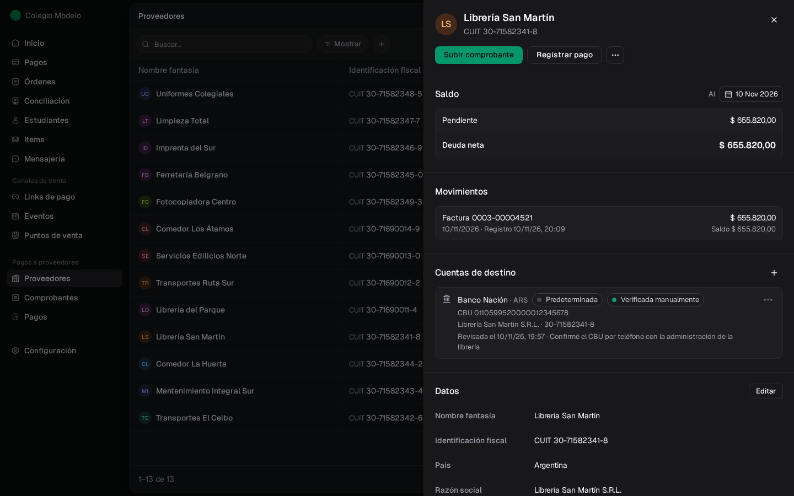
  </Frame>

  **Pagos a proveedores**

  - **Ahora podés llevar en Fint lo que le pagás a tus proveedores.** Se activa en Configuración → Funcionalidades. [Ver más](/docs/guides/proveedores)
  - **Cargá las facturas de tus proveedores** con una foto o un PDF: Fint lee los datos y vos los revisás. [Ver más](/docs/guides/proveedores-comprobantes)
  - **Traé lo que ya tenías desde un Excel:** proveedores, facturas y lo que les debías de antes. [Ver más](/docs/guides/proveedores-importaciones)
  - **Registrá cada pago,** completo o en partes, y bajá la orden de pago en PDF para mandársela al proveedor. [Ver más](/docs/guides/proveedores-pagos)
  - **Armá los pagos de la semana:** juntá todo lo que vas a pagar y revisá a qué cuenta va cada transferencia antes de hacerla. [Ver más](/docs/guides/proveedores-lotes)
  - **El saldo de cada proveedor en un solo lugar:** cuánto le debés, cuánto le adelantaste y sus notas de crédito. [Ver más](/docs/guides/proveedores-creditos)

  <Frame>
    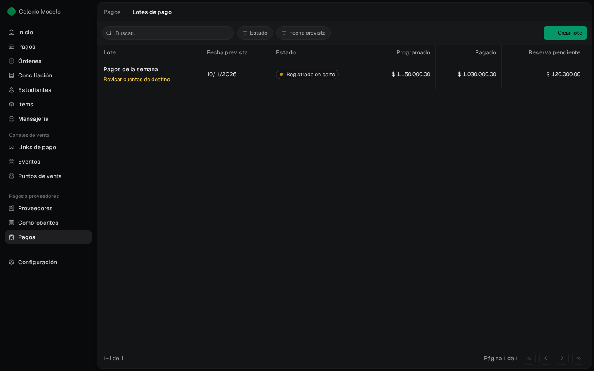
  </Frame>

  **Liquidaciones y comunicación**

  <Frame>
    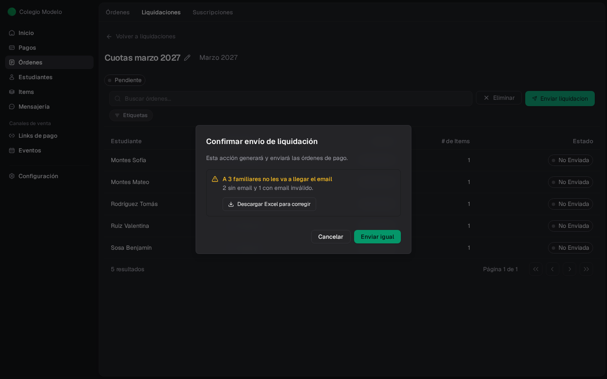
  </Frame>

  - **Antes de enviar una liquidación** te avisamos a qué familias no les va a llegar el email, y podés bajar la lista para corregirlas. [Ver más](/docs/guides/liquidaciones-corregir-enviar-cancelar#iniciar-el-envío)
  - **Mirá cómo avanza el envío de un comunicado:** ves cuántos emails ya salieron mientras se envían. [Ver más](/docs/guides/mensajeria#después-del-envío)
  - **Exportaciones grandes por email:** si bajás un Excel con muchos datos (más de 5.000 órdenes o pagos), te lo mandamos por email. [Ver más](/docs/guides/pagos#exportar)
</Update>

<Update label="Octubre 2026" tags={["Eventos", "Punto de venta", "Cobranzas", "Comunicación"]}>
  <Frame>
    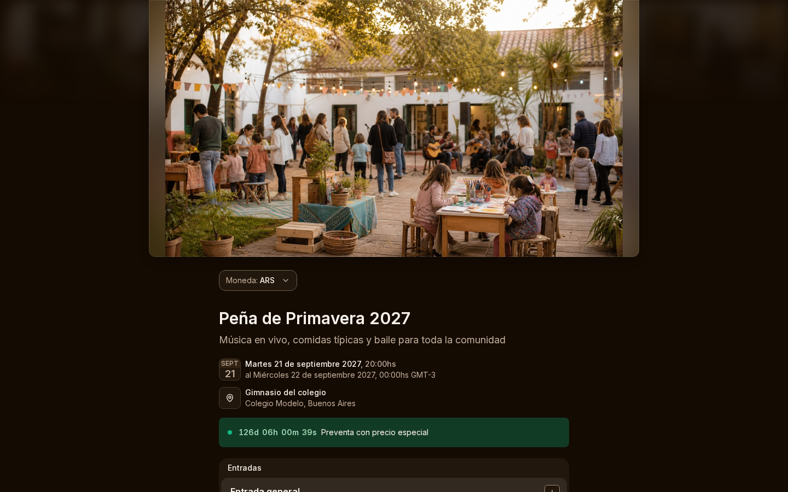
  </Frame>

  **Eventos**

  - **Personalizá la página de tu evento:** elegí colores, modo claro u oscuro y dónde va la foto de portada. Se ve igual en todo el recorrido de compra. [Ver más](/docs/guides/eventos-crear-publicar#personalizar-la-apariencia)
  - **Link corto y QR para compartir tu evento,** que siguen andando aunque cambies la dirección de la página. [Ver más](/docs/guides/eventos-crear-publicar#link-corto-y-qr)
  - **Te avisamos cuando se están por agotar las entradas** o cuando el evento se acerca al cupo máximo. Si querés, las ventas se cortan solas al llegar. [Ver más](/docs/guides/eventos-entradas-ventas-asistentes#avisos-de-stock-y-aforo)
  - **Elegí qué datos pedirle a cada asistente,** como el documento o el email, y en qué orden aparecen. [Ver más](/docs/guides/eventos-crear-publicar)
  - **Dos opciones de inscripción para el mismo evento,** por ejemplo en pesos y en dólares, y **una cuenta regresiva** en el mensaje destacado que desaparece sola cuando termina. [Ver más](/docs/guides/eventos-crear-publicar)
  - **Límite de entradas por compra,** y en la puerta te avisamos si una entrada ya se usó, quién la escaneó y a qué hora. [Ver más](/docs/guides/eventos-entradas-ventas-asistentes#tope-de-entradas-por-compra)
  - **Reportes más claros:** muestran todas las ventas del evento y cada número dice a qué período corresponde. [Ver más](/docs/guides/eventos-entradas-ventas-asistentes)
  - **Historial de cada entrada:** ves por qué subió o bajó la cantidad disponible. [Ver más](/docs/guides/eventos-entradas-ventas-asistentes)

  <Frame>
    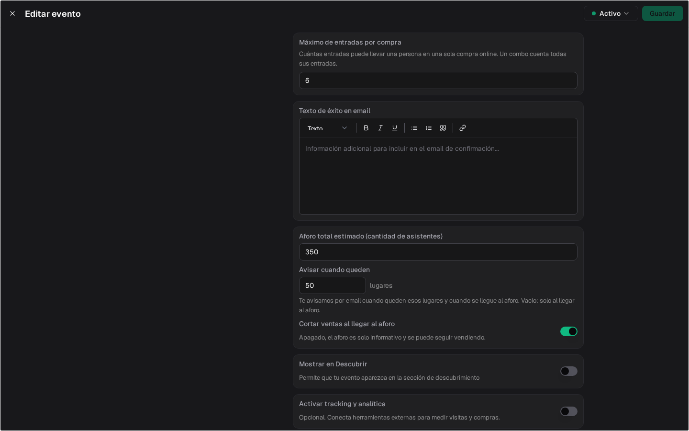
  </Frame>

  **Punto de venta y cobros**

  <Frame>
    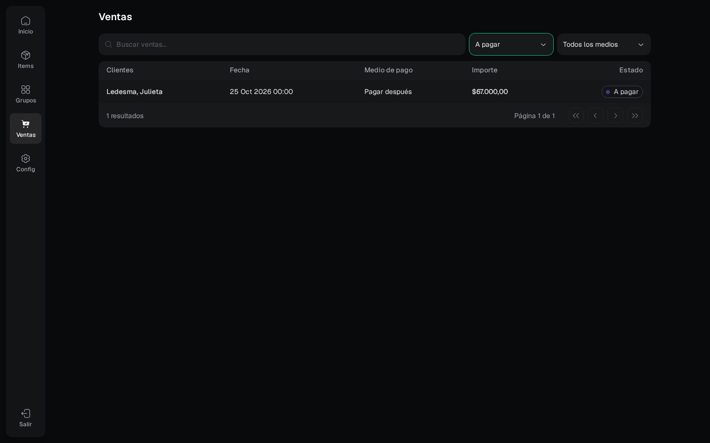
  </Frame>

  - **Vendé ahora y cobrá después en el punto de venta:** la venta queda como deuda a nombre del cliente, con fecha de vencimiento. [Ver más](/docs/guides/pos-pagar-despues)
  - **Cobrá cualquier monto en efectivo o transferencia.** El mínimo de $30 queda solo para el Point y el QR de Mercado Pago, y una venta con descuento del 100 % se registra sin cobro. [Ver más](/docs/guides/pos-cobros)
  - **Pagos360:** una nueva forma de cobrar con QR o en efectivo en locales como Pago Fácil. Se conecta en Configuración → Integraciones. [Ver más](/docs/guides/configuracion-integraciones)
  - **Pagos que ya cargaste a mano:** cuando subís el resumen del banco, Fint reconoce las transferencias que ya registraste y no las duplica. También podés dejar de lado los movimientos que no son cobros. [Ver más](/docs/guides/conciliacion-bancaria-casos-frecuentes)
  - **Por qué no se pudo pagar:** en cada orden ves el motivo de un pago rechazado y qué puede hacer la familia. [Ver más](/docs/guides/ordenes-gestionar)
  - **De dónde salió cada orden:** si la cargaste a mano o vino de una liquidación, un evento, el punto de venta u otro lado. [Ver más](/docs/guides/ordenes-gestionar)
  - **Borrar un pago que ya tenía factura:** primero anulás la factura con una nota de crédito y después podés borrar el pago. Si algo lo impide, te decimos qué. [Ver más](/docs/guides/pagos)

  **Gestión y comunicación**

  - **Cambios a muchos a la vez:** filtrá estudiantes, órdenes, ítems, descuentos o suscripciones y aplicá un cambio a todos los resultados de una sola vez. [Ver más](/docs/guides/clientes#hacer-algo-con-muchos-a-la-vez)
  - **Completá el mismo dato en muchos estudiantes u órdenes a la vez,** por ejemplo un campo propio como "Turno". [Ver más](/docs/guides/configuracion-campos#completar-un-campo-en-muchos-a-la-vez)
  - **Mensajes a todos los asistentes de un evento,** aunque sean miles, o solo a quienes compraron. [Ver más](/docs/guides/mensajeria)
  - **Elegí quién recibe cada aviso de Fint por email:** entradas por agotarse, problemas con las facturas o con Mercado Pago. Se configura en Configuración → Notificaciones. [Ver más](/docs/guides/configuracion-notificaciones)
  - **Emails que no llegan:** te avisamos cuando una dirección no está recibiendo los mensajes, para que la corrijas. [Ver más](/docs/guides/clientes-familias-responsables#cuando-un-email-no-llega)
</Update>

<Update label="Septiembre 2026" tags={["Eventos", "Cobranzas", "Punto de venta"]}>
  <Frame>
    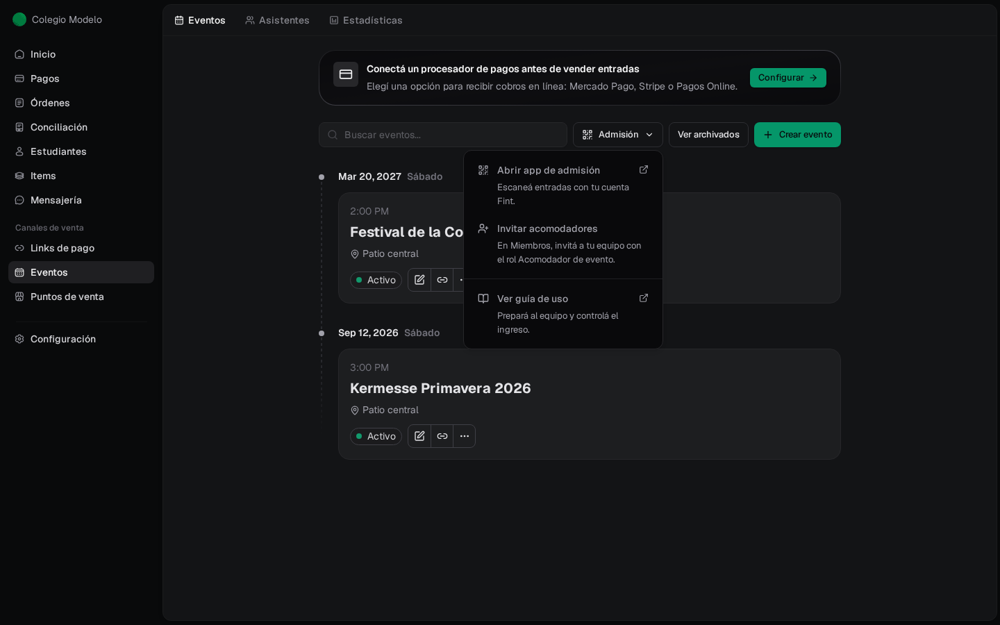
  </Frame>

  - **Entradas manuales con combos:** al cargar una entrada a mano podés elegir un combo del evento. [Ver más](/docs/guides/eventos-entradas-ventas-asistentes)
  - **Menú Admisión** en Eventos para abrir la app, invitar acomodadores y llegar a la guía. [Ver más](/docs/guides/app-admision)
  - **Links de pago con email configurable:** sumá un texto propio al mail de confirmación del link y de cada artículo. [Ver más](/docs/guides/links-pago)
  - **Exportación de ventas del punto de venta por medio de pago**, con los pagos combinados repartidos por producto. [Ver más](/docs/guides/pos-ventas-reportes)
</Update>

<Update label="Agosto 2026" tags={["Punto de venta", "Facturación", "Cobranzas", "Configuración"]}>
  <Frame>
    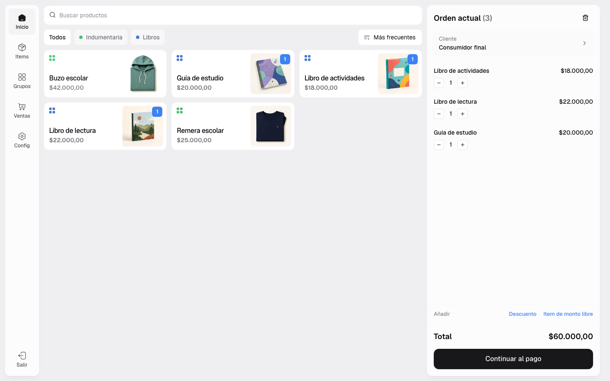
  </Frame>

  - **El punto de venta suma terminales y QR:** cajas, cobro con terminal o QR de Mercado Pago, rol de Cajero, varios descuentos por venta y un tablero de reportes. [Ver más](/docs/guides/punto-de-venta)
  - **Facturación ARCA guiada en 4 pasos:** Datos del emisor, conexión con ARCA, punto de venta y regla de Facturación automática, con envío del comprobante por email. [Ver más](/docs/guides/facturacion-arca)
  - **Nuevos procesadores de pago:** Pagos360 y Nuvei. [Ver más](/docs/guides/configuracion-integraciones)
  - **Invitaciones a miembros** con un link directo para aceptarlas, aunque primero tengas que iniciar sesión. [Ver más](/docs/guides/miembros-y-roles)
  - **Campos personalizados de tipo URL** y links clickeables en las notas. [Ver más](/docs/guides/configuracion-campos)
</Update>

<Update label="Julio 2026" tags={["Eventos"]}>
  <Frame>
    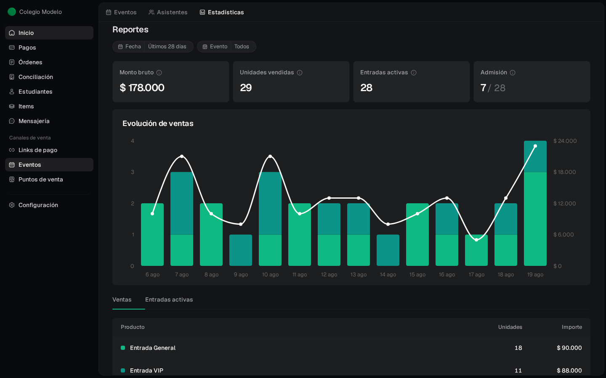
  </Frame>

  - **Nuevas estadísticas de eventos:** monto bruto, unidades, entradas activas, admisión, evolución de ventas y resumen de descuentos y pagos. [Ver más](/docs/guides/eventos-entradas-ventas-asistentes)
  - **Reenvío de entradas por email** y un enlace directo a cada evento y a cada entrada en el panel. [Ver más](/docs/guides/eventos-entradas-ventas-asistentes)
  - **Meta Pixel y API de Conversiones** configurables de forma segura y con consentimiento. [Ver más](/docs/guides/meta-pixel)
</Update>

<Update label="Mayo y junio 2026" tags={["Conciliación", "Comunicación", "Cobranzas"]}>
  <Frame>
    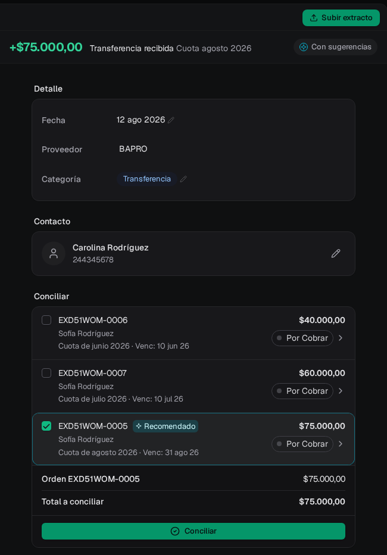
  </Frame>

  - **Conciliación más precisa:** mejor lectura de extractos y sugerencias ordenadas por nivel de confianza. [Ver más](/docs/guides/conciliacion-bancaria)
  - **Editor de texto enriquecido** en Mensajería y en las descripciones de eventos, links de pago e items. [Ver más](/docs/guides/mensajeria)
  - **Intereses por mora** con más opciones de cálculo. [Ver más](/docs/guides/configuracion-mora)
</Update>

<Update label="Marzo y abril 2026" tags={["Configuración", "Cobranzas"]}>
  <Frame>
    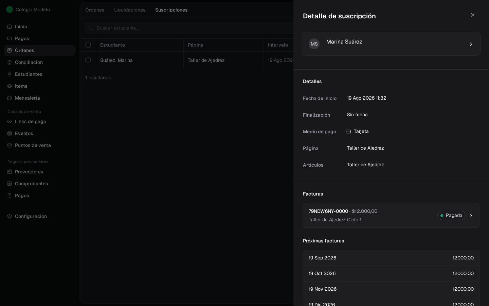
  </Frame>

  - **Campos personalizados** para estudiantes, contactos y órdenes, con filtros en los listados. [Ver más](/docs/guides/configuracion-campos)
  - **Suscripciones con Mercado Pago**, con día fijo de emisión y vencimiento. [Ver más](/docs/guides/suscripciones)
</Update>

<Update label="Enero y febrero 2026" tags={["Conciliación", "Configuración", "Cobranzas"]}>
  <Frame>
    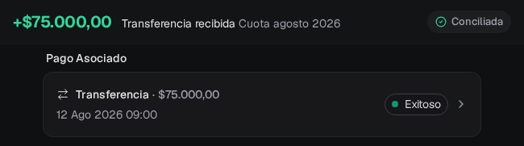
  </Frame>

  - **Conciliación bancaria:** subí los extractos de tus cuentas y Fint sugiere qué cobro corresponde a cada movimiento. [Ver más](/docs/guides/conciliacion-bancaria)
  - **Marca propia** (white label) y zona horaria por organización y por evento. [Ver más](/docs/guides/configuracion-general)
  - **Comprobantes de pago en PDF**, reporte de ventas del punto de venta en Excel y pagos con tarjeta con 3D Secure.
</Update>

<Update label="Octubre a diciembre 2025" tags={["Punto de venta", "Eventos", "Cobranzas"]}>
  <Frame>
    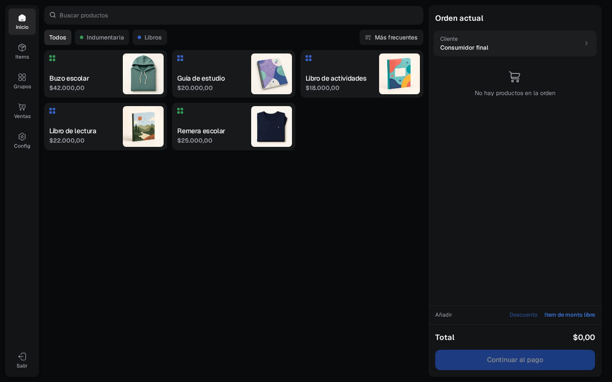
  </Frame>

  - **Punto de venta.** Vendé en el mostrador con un catálogo con categorías e imágenes, items de monto libre y venta a consumidor final. [Ver más](/docs/guides/punto-de-venta)
  - **Tus eventos en Descubrir**, el directorio público de eventos de Fint, con el perfil del organizador. [Ver más](/docs/guides/eventos-crear-publicar)
  - **Pagos por tipo de fecha:** filtrá y exportá según la fecha que elijas. [Ver más](/docs/guides/pagos)
</Update>

<Update label="Julio a septiembre 2025" tags={["Comunicación", "Eventos", "Configuración"]}>
  <Frame>
    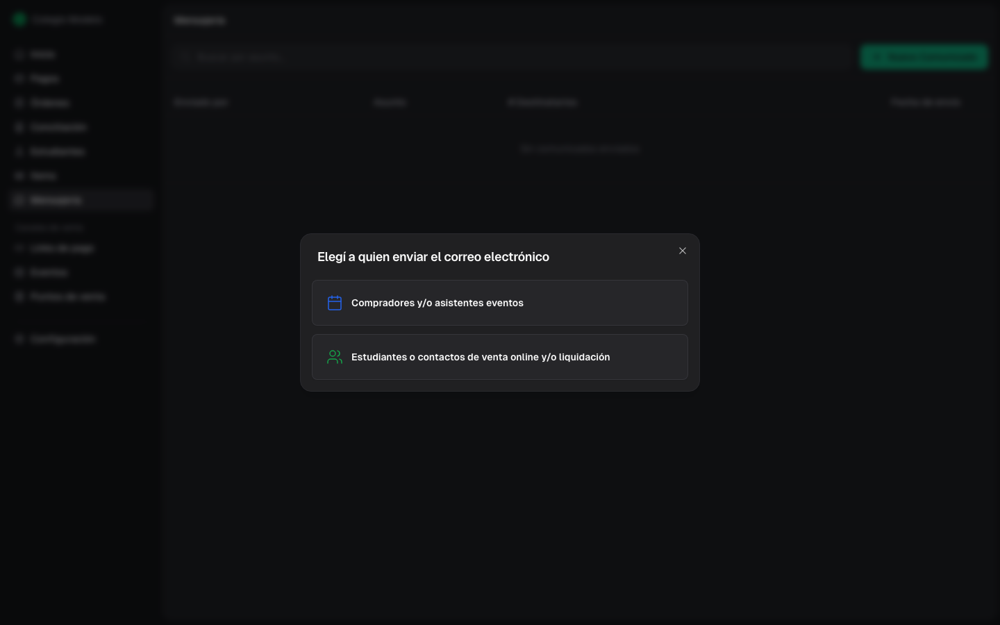
  </Frame>

  - **Mensajes a compradores y asistentes de un evento**, con la entrada QR en el email. [Ver más](/docs/guides/mensajeria)
  - **Registro por tu cuenta:** creá tu usuario y tu organización, recuperá tu contraseña y aceptá invitaciones pendientes. [Ver más](/docs/guides/miembros-y-roles)
  - **Entradas gratuitas.** [Ver más](/docs/guides/eventos-crear-publicar)
  - **Mercado Pago más claro:** ves la cuenta conectada y podés desconectarla. [Ver más](/docs/guides/conectar-mercado-pago)
</Update>

<Update label="Abril a junio 2025" tags={["Eventos", "Cobranzas"]}>
  <Frame>
    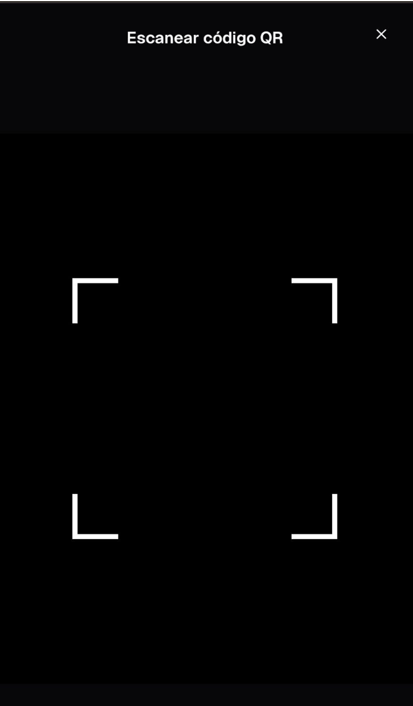
  </Frame>

  - **Entradas con QR y control de ingreso:** cada entrada lleva su QR y su PDF, y se escanea en la puerta. [Ver más](/docs/guides/app-admision)
  - **Mercado Pago en eventos** y cobro en Uruguay (UYU). [Ver más](/docs/guides/conectar-mercado-pago)
  - **Cupones de descuento para eventos**, con condiciones y stock. [Ver más](/docs/guides/descuentos)
  - **Entradas manuales y exportación de asistentes.** [Ver más](/docs/guides/eventos-entradas-ventas-asistentes)
</Update>

<Update label="Enero a marzo 2025" tags={["Eventos", "Facturación"]}>
  <Frame>
    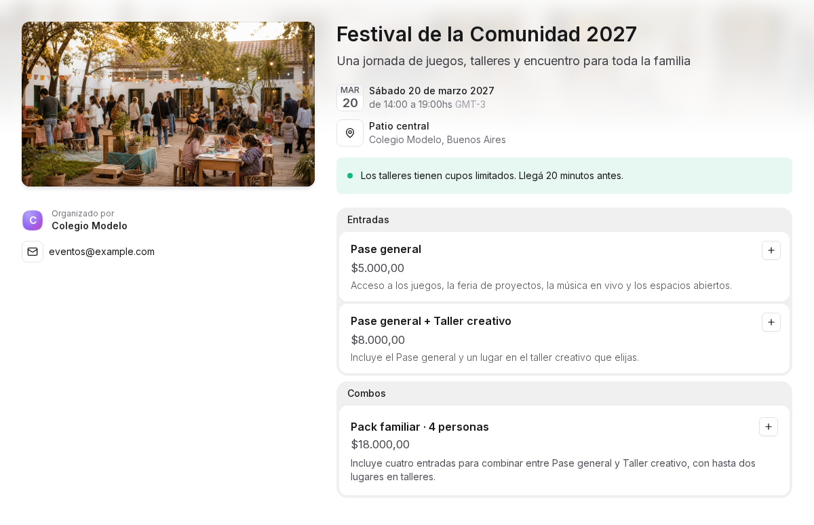
  </Frame>

  - **Eventos con venta de entradas online:** creá el evento, publicalo con su página y cobrá con tarjeta. [Ver más](/docs/guides/eventos-crear-publicar)
  - **Combos de entradas, stock con historial y campos propios** en el checkout. [Ver más](/docs/guides/eventos-crear-publicar)
  - **Alícuota de IVA** en las reglas de facturación y en los pagos manuales. [Ver más](/docs/guides/facturacion-arca)
</Update>
